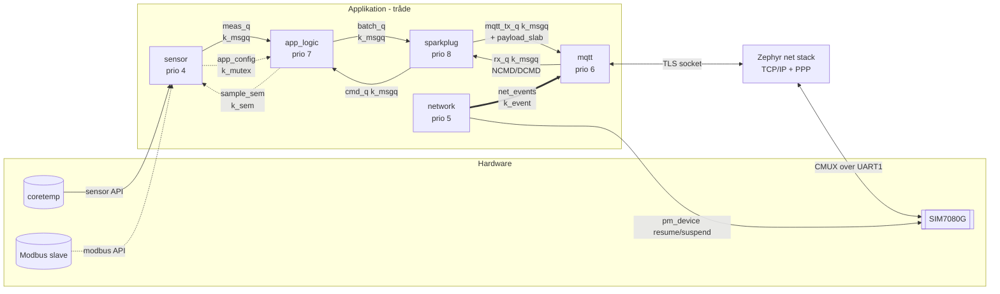
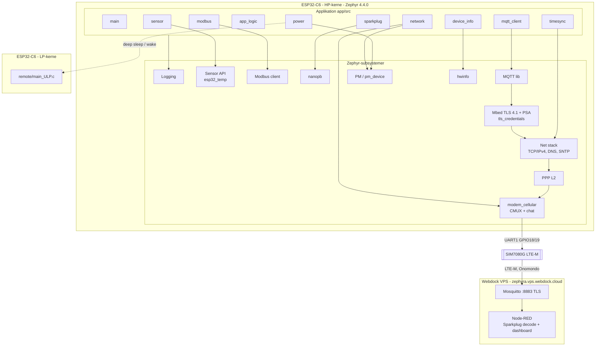
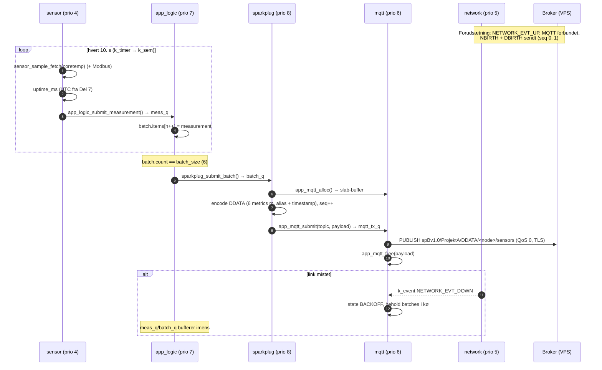
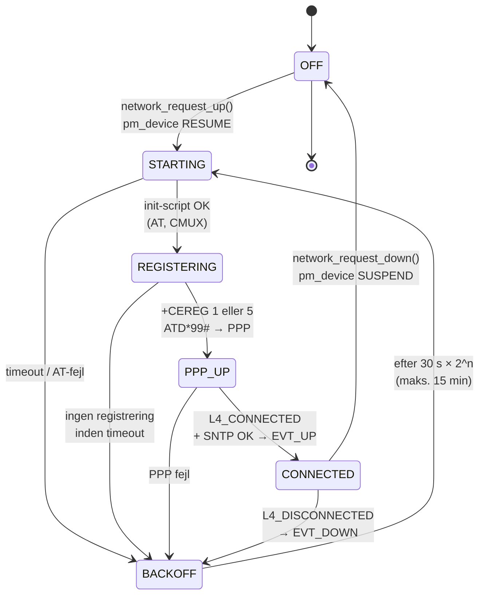
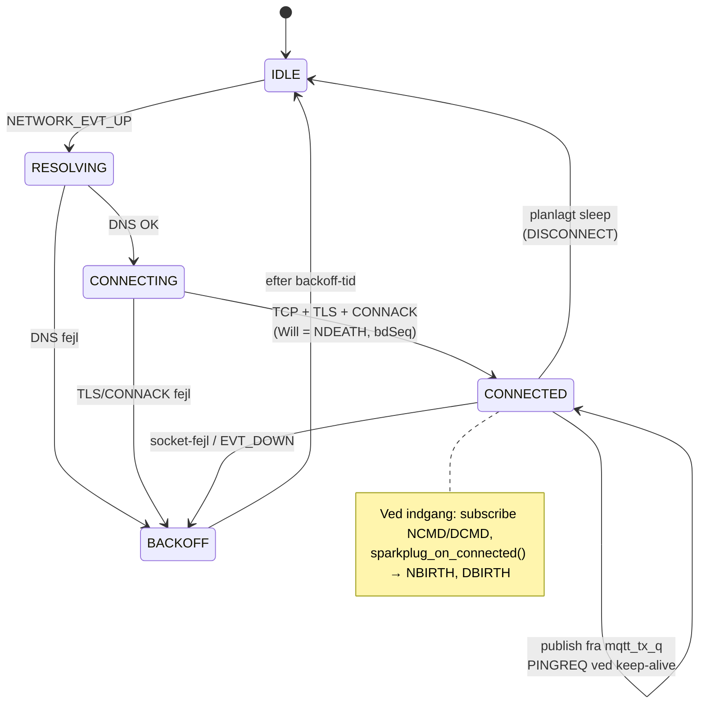

# Del 2 – Arkitektur og design

Dette dokument beskriver firmwarens opbygning, før modulerne kodes: moduler og deres API,
tråde, kommunikation mellem tråde, tilstandsmaskiner, pin- og UART-plan samt strategien for
lavt strøm- og dataforbrug. Skelettet i `app/src/` følger præcis denne opdeling. Det bygger
og kører med de samme log-linjer som Del 1.

> **Opdateret i Del 3:** én måling er nu `struct measurement` (alle kanaler fra samme cyklus med fælles
> tidsstempel) i stedet for `struct sample` (én værdi). Sensor-tråden drives af en `k_timer` og en semafor.
> Delene er omnummereret: 3 Dataopsamling, 4 Cellulært netværk, 5 Cloud, 6 MQTT + TLS, 7 Sparkplug + tid.
> Detaljer: [03-dataopsamling.md](03-dataopsamling.md).

Alle Zephyr-API'er og Kconfig-symboler nævnt her er slået op i **Zephyr v4.4.0**-kildekoden.
Hvor et valg er verificeret med en prototype-build, står det under
[Verificerede fund og risici](#9-verificerede-fund-og-risici).

---

## 1. Overblik

Enheden er en Sparkplug B **Edge Node**. Hvert 10. sekund (konfigurerbart 5–15 s) måles
temperaturen. Målingerne samles i batches à 6 (= 1 besked pr. minut). Hver batch sendes som én
Sparkplug B `DDATA`-besked over MQTT/TLS via LTE-M til egen broker på Webdock-serveren.

```
 [coretemp]──┐                                        ┌─────────── Webdock VPS ───────────┐
 [Modbus]────┤ sensor ─► app_logic ─► sparkplug ─► mqtt ─► TLS ─► PPP ─► SIM7080G ─► LTE-M ─► Mosquitto ─► Node-RED │
             └ (5–15 s)   (batch)     (protobuf)   (pub)                                └───────────────────────────────────┘
```

---

## 2. Modul-oversigt

| Modul (fil) | Ansvar | Ejer-tråd | Zephyr-API'er |
|---|---|---|---|
| `main.c` | Initialiserer moduler i rækkefølge og starter deres tråde | `main` (kun under opstart) | kernel, logging |
| `device_info.c/.h` | Device-id (fabriks-MAC fra eFuse), firmware-version, reset-årsag | ingen (bibliotek, read-only efter init) | `hwinfo` |
| `timesync.c/.h` | UTC-tid (SNTP efter PPP up) til tidsstempler | `network` kalder sync, alle læser | `sntp`, `clock_settime` |
| `sensor.c/.h` | Dataopsamling med fast interval: intern temperatursensor (+ Modbus, simulering) | `sensor` | `sensor` (coretemp), `k_timer`, `k_sem` |
| `modbus.c/.h` | Modbus RTU-klient med registertabel, retry og backoff | kaldes af `sensor` | `modbus` (client) |
| `app_logic.c/.h` | Batching, runtime-konfiguration, kommandoer fra cloud (NCMD), sleep-politik | `app_logic` | `k_msgq`, `k_poll`, `k_mutex` |
| `sparkplug.c/.h` | Sparkplug B-topics, protobuf encode/decode (nanopb), bdSeq/seq, aliases | `sparkplug` | nanopb, `k_msgq`, `k_poll` |
| `mqtt_client.c/.h` | MQTT 3.1.1 over TLS, Last Will (NDEATH), subscribe NCMD/DCMD, publish | `mqtt` | `mqtt`, `tls_credentials`, sockets, `k_mem_slab` |
| `network.c/.h` | Cellulær forbindelse: modem power, registrering, PPP, tilstandsmaskine | `network` | `modem_cellular`, `pm_device`, `net_mgmt`, `conn_mgr`, `k_event` |
| `power.c/.h` | Sleep-politik: lås/tillad light sleep, deep sleep + LP-core-wake | ingen (bibliotek) | `pm`, `pm_policy_state_lock` |
| `app_types.h` | Fælles datatyper (`struct measurement`, `channel_value`, `measurement_batch`, `app_cmd`, `app_config`) | – | – |

Funktionerne i modulerne `sensor`, `modbus`, `mqtt_client` og `power` har præfiks (`app_sensor_`,
`app_modbus_`, `app_mqtt_`, `app_power_`). Det undgår navnekonflikter med Zephyrs egne API'er.
Zephyrs MQTT-bibliotek har fx selv `mqtt_client_init()`.

### 2.1 API pr. modul

De fulde prototyper med dokumentation står i header-filerne. Her er overblikket:

```c
/* device_info.h */
int         device_info_init(void);
const char *device_info_id(void);              /* "esp32c6-14c19fe0ab24" */
const char *device_info_fw_version(void);
uint32_t    device_info_reset_cause(void);

/* timesync.h */
int     timesync_init(void);
int     timesync_sync(uint32_t timeout_ms);    /* SNTP, blocking */
bool    timesync_is_valid(void);
int64_t timesync_now_ms(void);                 /* UTC ms, 0 if unknown */
int64_t timesync_uptime_to_utc_ms(int64_t uptime_ms);

/* sensor.h */
int  app_sensor_init(void);
int  app_sensor_start(void);
int  app_sensor_read_all(struct measurement *m);
void app_sensor_trigger(void);                 /* sample now (NCMD) */
const char *app_sensor_channel_name(uint8_t channel);
const char *app_sensor_channel_unit(uint8_t channel);
void app_sensor_get_stats(struct app_sensor_stats *out);

/* modbus.h */
int    app_modbus_init(void);                  /* -ENOTSUP if not configured */
size_t app_modbus_channel_count(void);
const char *app_modbus_channel_name(size_t idx);
int    app_modbus_read(struct channel_value *out, size_t max);

/* app_logic.h */
int  app_logic_init(void);
int  app_logic_start(void);
int  app_logic_submit_measurement(const struct measurement *m, k_timeout_t timeout);
int  app_logic_submit_command(const struct app_cmd *cmd, k_timeout_t timeout);
void app_logic_get_config(struct app_config *out);   /* k_mutex protected */

/* sparkplug.h */
int  sparkplug_init(void);
int  sparkplug_start(void);
int  sparkplug_topic(enum sparkplug_msg_type type, char *buf, size_t size);
int  sparkplug_encode_ndeath(uint8_t *buf, size_t size);
void sparkplug_on_connected(void);             /* -> NBIRTH + DBIRTH */
int  sparkplug_submit_batch(const struct measurement_batch *batch, k_timeout_t timeout);
int  sparkplug_submit_rx(const char *topic, const uint8_t *payload, size_t len);

/* mqtt_client.h */
int      app_mqtt_init(void);
int      app_mqtt_start(void);
bool     app_mqtt_is_connected(void);
enum app_mqtt_state app_mqtt_get_state(void);
uint8_t *app_mqtt_alloc(k_timeout_t timeout);  /* payload buffer from k_mem_slab */
void     app_mqtt_free(uint8_t *buf);
int      app_mqtt_submit(const struct app_mqtt_msg *msg, k_timeout_t timeout);
int      app_mqtt_set_will(const char *topic, const uint8_t *payload, size_t len);

/* network.h */
int  network_init(void);
int  network_start(void);
int  network_request_up(void);
int  network_request_down(void);
enum network_state network_get_state(void);
bool network_wait_up(k_timeout_t timeout);
struct k_event *network_events(void);          /* NETWORK_EVT_UP/DOWN/TIME_SYNCED */
int  network_get_rssi(int16_t *rssi_dbm);

/* power.h */
int  app_power_init(void);
void app_power_sleep_lock(void);
void app_power_sleep_unlock(void);
int  app_power_deep_sleep(uint32_t duration_ms);
```

**Designprincip: modulet, der forbruger en kø, ejer den.** En producent kalder forbrugerens
`*_submit_*()`-funktion. Den lægger data i en `k_msgq`, der er `static` i forbrugerens `.c`-fil.
Så kan ingen andre moduler røre køen direkte, og hvert modul kan testes alene.

### 2.2 Konfiguration (`app/Kconfig`)

Projektets egne indstillinger er Kconfig-symboler (`CONFIG_APP_*`), sat i `prj.conf`:

| Symbol | Standard | Bemærkning |
|---|---|---|
| `APP_SAMPLE_INTERVAL_MS` | 10000 | `range 5000 15000` – **et build uden for kravet afvises af Kconfig** (testet) |
| `APP_BATCH_SIZE` | 6 | Målinger pr. DDATA (1 besked/min) |
| `APP_SPARKPLUG_GROUP_ID` | `ProjektA` | Sparkplug group id |
| `APP_SPARKPLUG_DEVICE_ID` | `sensors` | Sparkplug device id for boardets egne sensorer |
| `APP_MQTT_BROKER_HOST/PORT` | `zephyra.vps.webdock.cloud` / 8883 | |
| `APP_MQTT_USERNAME/PASSWORD` | tom | Sættes kun i `secrets.conf` (git-ignoreret) |
| `APP_*_THREAD_PRIO/STACK` | se trådtabellen | |

---

## 3. Thread-tabel

Zephyr: **lavere tal = højere prioritet**. Prioriteter ≥ 0 er *preemptive*, negative er
*cooperative*. Med `CONFIG_NUM_PREEMPT_PRIORITIES=15` er 0–14 preemptive.

### 3.1 Applikationens tråde

| Tråd | Modul | Prio | Type | Stack | Periodisk / event | Begrundelse |
|---|---|---|---|---|---|---|
| `sensor` | sensor | 4 | preemptive | 1536 B | **Periodisk** (`k_timer` → `k_sem`) | Højeste app-prioritet: målingen skal ske til tiden (fast interval). Arbejdet er kort (få ms), så den blokerer ikke andre |
| `network` | network | 5 | preemptive | 2048 B | Event (net_mgmt-callbacks → `k_event`) | Skal hurtigt reagere på link op/ned, men laver kun lidt arbejde selv – driveren gør det tunge |
| `mqtt` | mqtt_client | 6 | preemptive | 8192 B (Del 6) | Event (`zsock_poll` på TLS-socket + eventfd, der signaleres af TX-køen og link-tab, timeout = keep-alive) | TLS-handshake i Mbed TLS bruger meget stack. Under network, så link-hændelser behandles først. Se `06-mqtt-tls.md` |
| `app_logic` | app_logic | 7 | preemptive | 1536 B | Event (`k_poll` på sample- og kommando-kø) | Tidskritisk er kun at kø'en tømmes, før den er fuld (16 pladser = 160 s) |
| `sparkplug` | sparkplug | 8 | preemptive | 3072 B | Event (`k_poll` på batch- og RX-kø) | Protobuf-encoding er CPU-arbejde uden deadline. Lavest, så den aldrig forsinker målinger eller netværk |
| `main` | main | 0 | preemptive | 2048 B | Kun opstart | Initialiserer og starter trådene, kører derefter heartbeat (fjernes, når alle moduler er implementeret) |

**Ingen cooperative app-tråde.** En cooperative tråd kan ikke afbrydes af andre tråde. Alle
app-tråde laver blokerende I/O (UART, socket, TLS) eller venter i køer, så preemptive er det
sikre valg. Cooperative prioritet er forbeholdt Zephyrs egne interne tråde, hvor korte,
uafbrudte sektioner er vigtige.

Stack-størrelserne er startværdier. De måles med `CONFIG_THREAD_ANALYZER` i Del 6/7 og
justeres (krav: mindst 25 % fri stack).

### 3.2 Zephyrs egne tråde (fra prototype-build)

| Tråd | Prio | Stack | Rolle |
|---|---|---|---|
| system workqueue | −1 (coop) | 1024 B | Driver-arbejde, bl.a. modem_cellular-events |
| modem workqueue | −1 (coop) | 1024 B | `CONFIG_MODEM_DEDICATED_WORKQUEUE=y` (planlagt): CMUX/PPP/chat ikke blokeret af anden systemkø-trafik |
| net RX (TC) | coop | 1792 B | Netværksstakkens modtagelse (PPP → IP → TCP) |
| net_mgmt events | – | 800 B | Leverer `NET_EVENT_L4_CONNECTED` osv. til callbacks |
| logging | 13 (laveste app-prio) | 768 B | Deferred log-udskrift |
| idle | 15 | 512 B | Kører når alt andet blokerer → **PM light sleep** |

Det sidste punkt er nøglen til lavt strømforbrug. Når alle tråde venter (på tid, køer eller
socket), kører idle-tråden. Med `CONFIG_PM=y` sætter den CPU'en i light sleep. Event-drevne
tråde, der *venter* i stedet for at polle, er derfor ikke kun pænere kode, de sparer strøm.

---

## 4. Inter-task communication

| Objekt | Type | Producent → forbruger | Indhold | Hvorfor denne type |
|---|---|---|---|---|
| `meas_q` | `k_msgq` (16 × 56 B) | sensor → app_logic | `struct measurement` (kopi) | Kopi-semantik: producent og forbruger deler ingen hukommelse. Bufferer 160 s, hvis app_logic er optaget |
| `cmd_q` | `k_msgq` (4) | sparkplug → app_logic | `struct app_cmd` | Kommandoer fra cloud er sjældne og små |
| `batch_q` | `k_msgq` (2 × ~680 B) | app_logic → sparkplug | `struct measurement_batch` | Én batch i arbejde + én i kø er nok (1 batch/min) |
| `rx_q` | `k_msgq` (2) | mqtt → sparkplug | modtaget NCMD/DCMD/STATE (topic + payload) | Decoding sker i sparkplug-tråden, ikke i mqtt-tråden |
| `mqtt_tx_q` | `k_msgq` (4) | sparkplug → mqtt | `struct app_mqtt_msg` (topic + **pointer** til payload) | Payload kopieres ikke to gange |
| `mqtt_payload_slab` | `k_mem_slab` (4 × 512 B) | sparkplug alloc → mqtt free | encodede protobuf-payloads | Fast hukommelse, ingen heap-fragmentering, deterministisk. Ejerskab følger beskeden |
| `config_lock` | `k_mutex` | app_logic skriver, sensor læser | `struct app_config` | Delt struktur med flere felter → mutex (prioritetsarv mod priority inversion) |
| `net_events` | `k_event` | network sætter, mqtt/app_logic venter | `NETWORK_EVT_UP/DOWN/TIME_SYNCED` | Flere tråde kan vente på samme tilstand, og bits kan kombineres. En semafor kan ikke det |
| `sample_sem` | `k_sem` (maks. 1) | `k_timer`-expiry (ISR) og app_logic (NCMD) → sensor | "mål nu" | Timer-ISR'en må kun signalere. Tråden laver arbejdet. Maks. 1, så ticks ikke hober sig op |
| `k_poll` | – | app_logic, sparkplug | venter på 2 køer samtidig | Én tråd kan betjene to køer uden busy-wait |
| ring buffer | `ring_buf` (i Zephyr) | UART ISR → modem chat/CMUX/PPP | rå bytes fra modemet | Bruges internt af modem-modulerne (`MODEM_CHAT` vælger `RING_BUFFER`). Ikke i app-koden |

### 4.1 Dataflow



---

## 5. Diagrammer

### 5.1 Komponentdiagram



### 5.2 Sekvens: måling → batching → MQTT publish



### 5.3 Tilstandsmaskine: netværk (network-tråden)

> Implementeret i Del 4. Den endelige maskine (med forbindelsestjek og grace-periode) står i
> [04-netvaerk.md](04-netvaerk.md) §2.



### 5.4 Tilstandsmaskine: MQTT/Sparkplug-session (mqtt-tråden)



Den samlede kæde fra kravspecifikationen er *disconnected → registering → PPP up →
TLS connect → MQTT connected → sleep*. Den svarer til de to maskiner tilsammen:
`network` håndterer de nederste lag (op til `CONNECTED`), og `mqtt` håndterer TLS og MQTT ovenpå.
De er adskilt, fordi netværket kan være oppe uden MQTT (fx under SNTP), og fordi hver tråd så kun
har én tilstandsmaskine.

---

## 6. Pin- og UART-plan (grundlag for `app.overlay`)

### 6.1 Seriel-ressourcer på ESP32-C6

Fra `esp32c6_common.dtsi` i Zephyr 4.4.0:

| Node | Compatible | Bemærkning |
|---|---|---|
| `uart0` | `espressif,esp32-uart` | Board-console (GPIO16 TX / GPIO17 RX → USB-UART-bro) |
| `uart1` | `espressif,esp32-uart` | Ledig → **modem** |
| `lp_uart` | `espressif,esp32-lpuart` | LP-domæne, faste pins GPIO4 (RX) / GPIO5 (TX). Driveren er beregnet til LP-kernen |
| `usb_serial` | `espressif,esp32-usb-serial` | Indbygget USB Serial/JTAG (GPIO12/13), "USB"-porten |

HP-kernen har altså kun **to fulde UART'er**. Det er den reelle begrænsning, hvis Modbus RTU
kommer til.

### 6.2 Plan

| Funktion | Interface | Pins | Del | Status |
|---|---|---|---|---|
| Console / log | `uart0` | GPIO16 TX, GPIO17 RX (UART-porten) | 1 | Uændret board-standard |
| Cellulært modem (SIM7080G) | `uart1`, 115200 8N1, ingen RTS/CTS | GPIO18 TX → modul RX, GPIO19 RX ← modul TX | 3 | Pinctrl verificeret: `UART1_TX_GPIO18`, `UART1_RX_GPIO19` findes i `esp32c6-pinctrl.h` |
| Modem `mdm-power-gpios` | GPIO (pladsholder) | GPIO22, **ikke forbundet** | 3 | Se 6.4 |
| Intern temperatur | `coretemp` (`espressif,esp32-temp`) | – | 6 | Skal sættes `status = "okay"` (disabled som standard) |
| Modbus RTU (RS485) – hvis valgt | `uart0` flyttes (se 6.3) eller `lp_uart` | fx GPIO20 TX, GPIO21 RX, GPIO23 DE/RE | senere | Afventer valg af Modbus-kilde |
| LP-kerne | `lp_uart` / LP-GPIO | GPIO0–7 er LP-pins | 9 | |
| Reserveret | – | GPIO8 (RGB-LED, strap), GPIO9 (BOOT, strap), GPIO15 (strap), GPIO4/5 (MTMS/MTDI strap) | – | Undgås til eksterne signaler |

### 6.3 Vurdering: skal console flyttes til USB Serial/JTAG?

| | Console på `uart0` (valgt nu) | Console på `usb_serial` |
|---|---|---|
| Frie HP-UART'er | 1 (`uart1` = modem) | 2 (`uart0` + `uart1`) |
| Flash og log | Samme kabel/port (UART), virker allerede | Log via "USB"-porten, flash via en af dem |
| Under light/deep sleep | UART-broen er på boardet og uafhængig af chippens USB. Log fortsætter efter wake | USB-forbindelsen til pc'en kan falde ud, når chippen sover. Windows ser porten forsvinde, og log går tabt |
| Strømmåling | USB-PHY i chippen er ikke i brug | USB-PHY'en trækker strøm og kan holde chippen vågen |

**Beslutning:** Console bliver på `uart0` for nu. Det er det mest robuste under udvikling og
især under strømmålinger (Del 9).

- Bliver Modbus-kilden **Modbus TCP**, kræves ingen UART.
- Bliver den **Modbus RTU**, flyttes console til `usb_serial` (`zephyr,console = &usb_serial`),
  og `uart0` remappes til RS485-pins (GPIO20/21 + DE/RE på GPIO23) via GPIO-matrixen.
  Beslutningen tages, når Modbus-kilden er kendt, og dokumenteres i `docs/hardware.md`.

### 6.4 Modemets power-pin

Zephyr 4.4.0 har en driver til modemet (`modem_cellular`, compatible `simcom,sim7080`). Dens
binding kræver `mdm-power-gpios` (`required: true`), men M5Stamp CAT-M har **ingen PWRKEY-stift**,
og modemet tænder selv, når det får strøm.

**Plan:** `mdm-power-gpios` peger på en ledig, **uforbundet** GPIO (GPIO22), og vi tilføjer
egenskaben `autostarts`, så driveren venter på, at modemet er klar, i stedet for at forvente en
power-puls. Driveren styrer dermed en pin, der ikke er forbundet. Det er harmløst, men skal
dokumenteres som en afvigelse. Prototype-buildet med denne devicetree compilerer (se afsnit 9).
Opførslen på hardwaren testes i Del 4.

Konsekvens: firmwaren kan ikke slukke modemet helt. "Radio off" sker med `AT+CFUN=4` (driverens
suspend) og PSM. Fuld sluk kræver en load-switch i 5 V-forsyningen. Det er en mulig forbedring.

### 6.5 Planlagt overlay (coretemp indført i Del 3, modem i Del 4)

```dts
&pinctrl {
	uart1_default: uart1_default {
		group1 { pinmux = <UART1_TX_GPIO18>; output-high; };
		group2 { pinmux = <UART1_RX_GPIO19>; bias-pull-up; };
	};
};

&uart1 {
	status = "okay";
	current-speed = <115200>;
	pinctrl-0 = <&uart1_default>;
	pinctrl-names = "default";

	modem: modem {
		compatible = "simcom,sim7080";
		mdm-power-gpios = <&gpio0 22 GPIO_ACTIVE_HIGH>; /* placeholder, not connected */
		autostarts;
		status = "okay";
	};
};

&coretemp {
	status = "okay";
};
```

---

## 7. Strategi for lavt strøm- og dataforbrug (overordnet)

Detaljer, målinger og tuning kommer i Del 9. Her er principperne, som arkitekturen er bygget til.

### 7.1 Strøm

Modemet er den største forbruger. M5Stack angiver ca. 46 mA i standby og 71 mA med netværk ved
5 V for modulet. ESP32-C6's eget forbrug er langt mindre. Strategien er derfor først og fremmest
at **holde radioen slukket så meget som muligt**, dernæst at lade CPU'en sove.

| Niveau | Tiltag | Hvor i arkitekturen |
|---|---|---|
| CPU mellem målinger | `CONFIG_PM=y`: idle-tråden går i **light sleep** (`standby`), når alle tråde venter | Alle tråde er event-drevne/blokerende, ingen polling |
| Modem mellem sendinger | **Batching** (6 målinger → 1 sending/min) giver radioen længere pauser. LTE-M **eDRX/PSM** (`AT+CEDRXS`/`AT+CPSMS`) og CMUX power save | `app_logic` bestemmer, hvornår der sendes. `network` styrer modemets tilstand |
| Lange pauser | **Deep sleep** af HP-kernen. **LP-kernen** (`remote/`) vågner periodisk og vækker HP-kernen | `power` + `remote/` |
| Interrupts frem for polling | Modem-UART er interrupt-drevet (`UART_INTERRUPT_DRIVEN`). Sensor bruger timer-timeout | Driver-niveau |

Afvejningen, der skal måles i Del 9: deep sleep mister TCP/TLS-sessionen. Hver opvågning koster
så et nyt TLS-handshake (data + radio-tid). Light sleep med modemet i eDRX/PSM bevarer
sessionen. Vi måler begge varianter med multimeteret og vælger ud fra tallene.

### 7.2 Data

| Tiltag | Effekt |
|---|---|
| **Sparkplug B = protobuf** (binært) | Langt mindre end JSON med feltnavne |
| **Metric aliases** | Navne ("Temperature/Die") sendes kun i NBIRTH/DBIRTH. DDATA bruger et tal (1–2 bytes) |
| **Batching**: 6 målinger pr. DDATA, hver med eget tidsstempel | Header-overhead (MQTT, TLS-record, TCP/IP, PPP) betales én gang pr. minut i stedet for hver 10. s |
| **Heltal** (`value_milli`, m°C) | Kompakt varint-encoding, ingen float |
| **QoS 0** for NDATA/DDATA (Sparkplug-reglen) | Ingen PUBACK-trafik |
| **Lang keep-alive** (`APP_MQTT_KEEPALIVE_S=1200`) | Der sendes alligevel data hvert minut, så PINGREQ er sjælden |
| **Undgå reconnects** + TLS session resumption | Et fuldt TLS-handshake med certifikatkæde koster flere kB. Det er mere end en times data |
| **SNTP sjældent** (ved opstart + ca. hver 24. time) | |

**Grov estimering** (verificeres med Onomondos dataforbrug i Del 9). Én DDATA med 6 målinger er
ca. 115 B protobuf + ca. 55 B MQTT-header/topic + 29 B TLS-record + ca. 48 B TCP/IP/PPP, altså
**cirka 250 B pr. minut, cirka 0,4 MB pr. døgn**. Uden batching (6 beskeder à 1 måling) bliver
overhead betalt 6 gange, og forbruget er cirka 4 gange større.

---

## 8. Sparkplug B-design (overblik, detaljer i Del 7)

| Element | Værdi |
|---|---|
| Namespace | `spBv1.0` |
| Group id | `ProjektA` |
| Edge node id | `device_info_id()`, fx `esp32c6-14c19fe0ab24` |
| Device id | `sensors` (boardets egne sensorer). Modbus-slaver bliver senere egne devices |
| NBIRTH | `bdSeq`, `Node Control/Rebirth`, `Properties/FW Version`, `Properties/Reset Cause`, `Config/Sample Interval`, `Config/Batch Size` |
| DBIRTH | `Temperature/Die` (alias 1, Int32, m°C) + evt. Modbus-metrics |
| DDATA | batch af metrics: alias + timestamp + værdi |
| NDEATH | MQTT Last Will med samme `bdSeq` som NBIRTH |
| NCMD | `Node Control/Rebirth`, `Node Control/Reboot`, `Config/Sample Interval`, `Config/Batch Size` |
| seq | 0–255, ny værdi pr. besked, nulstilles ved NBIRTH |

Kravet "hver MQTT-besked skal indeholde device-id, timestamp og aflæste værdier" er dækket
således: device-id står i topic'en (edge node id). Timestamp er Sparkplug-payloadens
`timestamp` plus ét tidsstempel pr. metric. Værdierne er metrics.

---

## 9. Verificerede fund og risici

Fundet ved at slå op i Zephyr v4.4.0-koden og bygge en prototype med modem, PPP, MQTT, SNTP,
nanopb, PM og temperatursensor for `esp32c6_devkitc/esp32c6/hpcore` med 4 MB-snippet.
Prototypen brugte 274 kB flash (6,5 %) og 104 kB RAM (20 %) uden TLS.

| # | Fund | Konsekvens / handling |
|---|---|---|
| F1 | Zephyr 4.4.0 bruger **Mbed TLS 4.1**, som kræver west-modulet `tf-psa-crypto` | Manglede i Del 1's `west.yml`. **Tilføjet i denne del.** Kør `west update` |
| F2 | Mbed TLS 4.1 er PSA-baseret. Ældre Kconfig-opskrifter (`MBEDTLS_TLS_VERSION_1_2`, `KEY_EXCHANGE_*`) er deprecated eller har nye afhængigheder (`PSA_WANT_*`) | TLS-konfigurationen udarbejdes og testes særskilt i Del 6. Risiko for ekstra tid |
| F3 | `CONFIG_PM=y` + logging giver linkerfejlen `undefined reference to log_const_soc` (i `soc/espressif/common/power.c`) | Workaround verificeret: `LOG_MODULE_REGISTER(soc, CONFIG_SOC_LOG_LEVEL);` i én app-fil. Indføres i Del 9 |
| F4 | `simcom,sim7080`-bindingen kræver `mdm-power-gpios`, men modulet har ingen PWRKEY | Pladsholder-GPIO + `autostarts` (afsnit 6.4). Testes i Del 4 |
| F5 | Ingen RTS/CTS mellem ESP32-C6 og modem | Risiko for tabte bytes ved 115200 baud under PPP-burst. Driverens UART-buffere (`MODEM_CELLULAR_UART_BUFFER_SIZES`) øges ved behov. Testes i Del 3 |
| F6 | `coretemp` er `disabled` i SoC-dtsi | Aktiveret i overlay (Del 3). Driveren `esp32_temp` understøtter ESP32-C6 |
| F7 | `modem_cellular` bruger CMUX (`AT+CMUX`) | Giver en AT-kanal ved siden af PPP. Den bruges til signalstyrke og PSM-kommandoer |
| F8 | Zephyrs eksempel `samples/net/cellular_modem` | Bruges som reference til Del 4 (Kconfig for PPP, DNS, conn_mgr) |

---

## 10. Designbeslutninger (resumé til rapporten)

1. **Én tråd pr. modul med ansvar for tid eller I/O** (sensor, network, mqtt, app_logic,
   sparkplug). Biblioteksmoduler uden egen tidsadfærd (device_info, timesync, power, modbus)
   har ingen tråd. Det overholder "ca. 1 thread pr. modul" uden unødige stacks.
2. **Forbrugeren ejer køen**, og producenter bruger `*_submit_*()`. Det giver løs kobling og
   klare ansvarsgrænser.
3. **Kopi gennem `k_msgq`** for små data, **pointer + `k_mem_slab`** for store payloads. Ingen
   dynamisk heap i app-koden.
4. **`k_mutex` for delt konfiguration** (prioritetsarv), **`k_event` for tilstande**, som flere
   tråde venter på, og **`k_sem` for simple signaler**.
5. **Event-drevne tråde** (`k_poll`, `zsock_poll`, absolutte timeouts). Det er korrekt
   realtidsadfærd og samtidig forudsætningen for light sleep.
6. **Projektkrav som Kconfig-grænser** (interval 5–15 s), så et build uden for kravet ikke kan
   laves.
7. **Console på `uart0` og modem på `uart1`.** Console flyttes kun til USB Serial/JTAG, hvis
   Modbus RTU kræver det.
