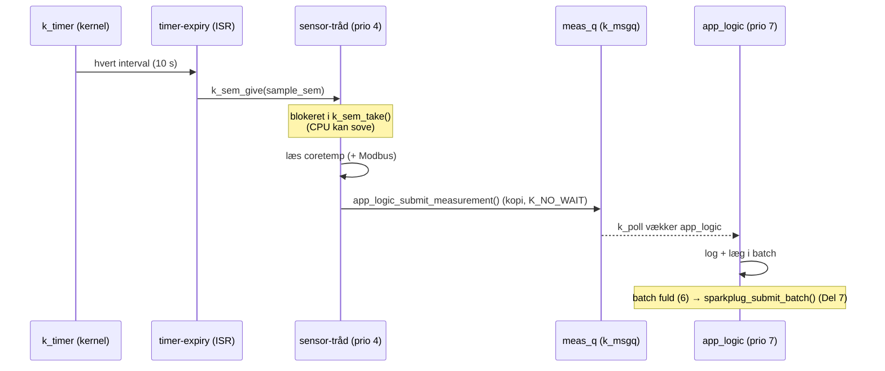

# Del 3 – Dataopsamling

Dataopsamlingen måler med et fast interval (Kconfig, standard 10 s, gyldigt 5–15 s). Hver måling
bliver én `struct measurement` med tidsstempel, værdier og kvalitetsflag. Målingen lægges i en
`k_msgq` til `app_logic`-tråden, som samler målingerne i batches til Sparkplug (Del 7).

Der er tre datakilder, og de kan kombineres:

| Kilde | Kconfig | Build | Status |
|---|---|---|---|
| ESP32-C6's interne temperatursensor | `CONFIG_APP_SOURCE_DIE_TEMP=y` (standard) | `.\scripts\build.ps1` | Primær kilde nu |
| Modbus RTU-slave over RS485 | `CONFIG_APP_MODBUS_RTU=y` | `.\scripts\build.ps1 -ModbusRtu` | Klar til test mod PC-simulator |
| Simulerede værdier (ingen hardware) | `CONFIG_APP_SENSOR_SIMULATION=y` | `.\scripts\build.ps1 -Simulation` | Til test af hele kæden |

---

## 1. Design

### 1.1 Timing: `k_timer` → semafor → tråd



- **Ingen busy-wait.** Tråden er blokeret i `k_sem_take()` mellem målingerne. Idle-tråden kører
  så, og med `CONFIG_PM` (Del 9) betyder det light sleep.
- **Ingen drift.** `k_timer` er periodisk på kernel-ticks. Det betyder ikke noget, hvor længe en
  måling tager. Testen på `native_sim` viser målinger ved præcis 5,010 / 10,010 / 15,010 s,
  også efter en fejlcyklus med retries, der tog 670 ms.
- **Ingen ophobning.** Semaforen har maks. 1. Tager en måling længere end intervallet (fx
  Modbus-timeouts), tages næste måling straks, og overløbet tælles og logges som `WRN`. Ticks
  hober sig ikke op.
- Intervallet kan ændres mens programmet kører (NCMD i Del 7). Sensor-tråden læser
  konfigurationen (`k_mutex`) hver cyklus og genstarter timeren, hvis intervallet er ændret.

### 1.2 Datastruktur

```c
struct channel_value {          /* 8 B */
	int32_t value_milli;    /* værdi x 1000 (m°C, m%RH) - heltal, ingen float */
	uint8_t channel;        /* 0 = Temperature/Die, 1.. = Modbus-registre */
	uint8_t quality;        /* QUALITY_GOOD / QUALITY_BAD / QUALITY_STALE */
};

struct measurement {            /* 56 B, kopieres gennem k_msgq */
	int64_t uptime_ms;      /* k_uptime_get() - foreløbig tidsstempel */
	int64_t timestamp_ms;   /* UTC ms, 0 indtil tidssynkronisering (Del 7) */
	uint32_t seq;           /* løbenummer siden boot */
	uint8_t count;          /* antal værdier */
	uint8_t quality;        /* BAD hvis en værdi er BAD, ellers STALE hvis en er STALE */
	bool simulated;
	struct channel_value values[APP_MAX_CHANNELS];   /* 4 */
};
```

Det er en ændring i forhold til Del 2's design (`struct sample` med én værdi). Nu er én måling
alle kanaler fra samme cyklus med ét fælles tidsstempel, som kravet beskriver ("struct med
timestamp, værdier og kvalitetsflag"). Batchen er `struct measurement_batch` (op til 12 målinger).

### 1.3 Kvalitetsflag

| Flag | Betydning | Sparkplug (Del 7) |
|---|---|---|
| `QUALITY_GOOD` | Læst korrekt | Good |
| `QUALITY_BAD` | Læsning fejlede efter retries (timeout, CRC, exception, driverfejl). Værdien er 0 og må ikke bruges | Bad |
| `QUALITY_STALE` | Ikke læst i denne cyklus (Modbus-backoff efter gentagne fejl) | Stale |

---

## 2. Fejlhåndtering

Programmet stopper aldrig på grund af en læsefejl. Fejlen logges, værdien markeres, og næste
cyklus forsøger igen.

### 2.1 Intern temperatursensor

`sensor_sample_fetch()` / `sensor_channel_get()` fejler → `LOG_ERR` → ét nyt forsøg efter 20 ms
(`APP_SENSOR_RETRY_DELAY_MS`) → fejler det igen: `LOG_ERR` og `QUALITY_BAD`.

### 2.2 Modbus RTU

Fejlkoderne fra Zephyr 4.4.0's Modbus-klient (tjekket i `subsys/modbus/`):

| Returkode | Årsag | Log |
|---|---|---|
| `-ETIMEDOUT` (−110) | Intet svar inden `APP_MODBUS_RESP_TIMEOUT_MS` | `LOG_ERR ... timeout (no response)` |
| `-EIO` (−5) | CRC-fejl eller forkert frame (forkert function code eller adresse i svaret) | `LOG_ERR ... CRC/frame error` |
| `> 0` | Modbus-exception fra slaven (1 = illegal function, 2 = illegal data address, …) | `LOG_ERR ... exception from slave` |

**To niveauer af backoff:**

1. **Pr. request (inden for cyklussen):** op til `APP_MODBUS_RETRIES` (2) nye forsøg med
   eksponentiel pause: 100 ms, derefter 200 ms. Hvert fejlet forsøg logges med `LOG_ERR`.
2. **Pr. cyklus (efter gentagne fejl):** fejler *alle* registre i en cyklus, springes slaven over i
   de næste min(2^(n−1) − 1, `APP_MODBUS_MAX_SKIP_CYCLES`) cyklusser. Værdierne er så `STALE`.
   Det fylder hverken bussen eller loggen, mens en slave er offline.

| Fejlede cyklusser i træk | 1 | 2 | 3 | 4 | 5+ |
|---|---|---|---|---|---|
| Cyklusser der springes over | 0 | 1 | 3 | 7 | 8 (maks.) |
| Ved 10 s interval: næste forsøg om | 10 s | 20 s | 40 s | 80 s | 90 s |

Svarer slaven igen, logges `responding again after n failed cycle(s)`, og tælleren nulstilles.

**Tidsbudget:** værste fald pr. register = 3 forsøg × 300 ms + 100 + 200 ms = 1,2 s. Med 2
registre bliver det 2,4 s, altså under minimumsintervallet på 5 s.

---

## 3. Konfiguration (`app/Kconfig`)

| Symbol | Standard | Betydning |
|---|---|---|
| `APP_SAMPLE_INTERVAL_MS` | 10000 | Interval. `range 5000 15000`: andre værdier afvises ved build |
| `APP_SOURCE_DIE_TEMP` | y | Intern temperatursensor (`&coretemp`) |
| `APP_SENSOR_SIMULATION` | n | Simulerede værdier |
| `APP_SENSOR_SIM_FAULT_EVERY` | 0 (5 i `overlay-sim.conf`) | Simulér fejl hver N'te cyklus |
| `APP_MODBUS_RTU` | n | Modbus RTU-klient |
| `APP_MODBUS_SLAVE_ADDR` | 1 | Slave-adresse (1–247) |
| `APP_MODBUS_BAUDRATE` | 9600 | |
| `APP_MODBUS_PARITY_EVEN/ODD/NONE` | EVEN | 8E1 / 8O1 / **8N2** (Zephyr følger Modbus-standarden: uden paritet → 2 stopbits) |
| `APP_MODBUS_RESP_TIMEOUT_MS` | 300 | Svartimeout pr. request |
| `APP_MODBUS_RETRIES` | 2 | Nye forsøg efter første forsøg |
| `APP_MODBUS_RETRY_BACKOFF_MS` | 100 | Første pause, fordobles |
| `APP_MODBUS_MAX_SKIP_CYCLES` | 8 | Loft for cyklus-backoff |

### 3.1 Registertabel (i `app/src/modbus.c`)

Registre, adresser og skalering er en tabel i koden, så den kan tilpasses den rigtige slave,
når den kendes:

```c
static const struct mb_reg_def reg_table[] = {
	/* name                 unit    FC             addr signed num den */
	{"Modbus/Temperature", "degC", MB_FC_HOLDING, 0,   true,  100, 1},  /* 0.1 °C/bit */
	{"Modbus/Humidity",    "%RH",  MB_FC_HOLDING, 1,   false, 100, 1},  /* 0.1 %/bit  */
};
/* value_milli = raw * num / den   ->  raw 234 = 23.400 °C */
```

`MB_FC_HOLDING` = FC03 (Read Holding Registers), `MB_FC_INPUT` = FC04 (Read Input Registers).
Adresser er 0-baserede (protokol-adresser). I "Modicon-notation" er holding register 0 = 40001.

---

## 4. Build-varianter

```powershell
.\scripts\build.ps1                         # standard: intern temperatursensor
.\scripts\build.ps1 -Simulation             # simuleret temperatur + fejl hver 5. cyklus
.\scripts\build.ps1 -ModbusRtu              # temperatursensor + Modbus RTU (RS485)
.\scripts\build.ps1 -ModbusRtu -Simulation  # simuleret Modbus-slave (ingen RS485-hardware)
```

`build.ps1` husker varianten og laver automatisk et pristine build, når den skifter. CMake
gemmer ellers `-D`-værdier i cachen, så en gammel variant ville overleve.

| Fil | Indhold |
|---|---|
| `app/overlay-sim.conf` | `CONFIG_APP_SENSOR_SIMULATION=y`, fejl hver 5. cyklus |
| `app/overlay-modbus-rtu.conf` | Zephyr Modbus (client) + `CONFIG_APP_MODBUS_*` |
| `app/modbus-rtu.overlay` | Devicetree: RS485 på `uart0` (GPIO20/21, DE/RE på GPIO23), console på `usb_serial` |

---

## 5. Test

### 5.1 Standard (intern temperatursensor)

```powershell
.\scripts\build.ps1
.\scripts\flash.ps1 -Port COM3
.\scripts\monitor.ps1 -Port COM3
```

Forventet:

```
<inf> sensor: Source: internal temperature sensor (coretemp)
<inf> sensor: Sampling every 10000 ms (k_timer)
<inf> app_logic: meas #0 up=... ms: Temperature/Die=31.250 degC
<inf> app_logic: meas #1 up=... ms: Temperature/Die=31.375 degC
...
<inf> app_logic: Batch #1 ready: 6 measurement(s), up ...
```

Chip-temperaturen ligger typisk 5–15 °C over rumtemperaturen. Læg en finger på modulet, så skal
værdien stige. Tidsstemplerne skal ligge 10 s fra hinanden.

### 5.2 Simulering med fejl (ingen hardware)

```powershell
.\scripts\build.ps1 -ModbusRtu -Simulation
.\scripts\flash.ps1 -Port COM3
```

I Modbus-varianten ligger console på **USB**-porten (se 5.3). Forventet hver 5. cyklus:

```
<err> sensor: Temperature/Die: read failed (-5), retrying
<err> app_modbus: Modbus/Temperature: FC03 addr 0 slave 1 attempt 1/3: timeout (no response) (-110)
<err> app_modbus: Modbus/Temperature: FC03 addr 0 slave 1 attempt 2/3: timeout (no response) (-110)
<err> app_modbus: Modbus/Temperature: FC03 addr 0 slave 1 attempt 3/3: timeout (no response) (-110)
...
<err> app_modbus: Modbus slave 1: no valid response (1 failed cycle(s) in a row), next attempt in 1 cycle(s)
<wrn> app_logic: meas #4 up=40010 ms (sim) [BAD]: Temperature/Die=BAD, Modbus/Temperature=BAD, Modbus/Humidity=BAD
<inf> app_modbus: Modbus slave 1 responding again after 1 failed cycle(s)
```

Hele kæden er kørt på Zephyrs `native_sim` (som Linux-program) i Del 3, og outputtet ovenfor
er derfra. Med `APP_SENSOR_SIM_FAULT_EVERY=1` (alt fejler) blev backoff-tabellen i afsnit 2.2
bekræftet.

### 5.3 Modbus RTU mod PC-simulator (ModbusTools / Modbus Slave) via USB-RS485

#### Hardware

```
ESP32-C6-DevKitC          3,3 V RS485-modul          USB-RS485-adapter       PC
                          (fx MAX3485/SP3485)
GPIO20 (TX)  ──────────►  DI
GPIO21 (RX)  ◄──────────  RO
GPIO23       ──────────►  DE + /RE (forbundet)
3V3          ──────────►  VCC
GND          ──────────►  GND  ────────────────────  GND
                          A    ────────────────────  A (D+)
                          B    ────────────────────  B (D−)               USB → COMx
```

> **Vigtigt – 3,3 V:** ESP32-C6's pins tåler ikke 5 V. Brug et 3,3 V-transceivermodul
> (MAX3485, SP3485, MAX13487 osv.). De billige røde "MAX485"-moduler er 5 V-kredse. Forsynes
> de med 5 V, kommer RO-udgangen også op på 5 V og kan skade GPIO21.
>
> **Automatisk retningsstyring:** Har modulet ingen DE/RE-pins (auto-direction), så fjern
> linjen `de-gpios` i `app/modbus-rtu.overlay` og lad GPIO23 være uforbundet.
>
> **A/B:** Producenterne er uenige om, hvad der hedder A og B. Får du kun timeouts, så prøv
> at bytte A og B. Ved korte kabler på bordet er 120 Ω terminering ikke nødvendig.

#### Console og porte i Modbus-varianten

`uart0` bruges nu til RS485. Zephyr-loggen kommer derfor ud på boardets **USB**-port (USB
Serial/JTAG), ikke på UART-porten.

1. Sæt et kabel i **USB**-porten. Den dukker op som "USB Serial Device (COMy)".
2. Flash via den port (eller via UART-porten som før), og monitorér på USB-porten:
   ```powershell
   .\scripts\build.ps1 -ModbusRtu
   .\scripts\flash.ps1   -Port COMy
   .\scripts\monitor.ps1 -Port COMy
   ```
3. USB-RS485-adapteren får sin egen COM-port (COMz), som simulatoren på pc'en bruger.

ROM-bootloaderen og MCUboot skriver stadig deres første linjer på UART-porten. Det er normalt.

#### Indstillinger, der skal være ens i ESP32 og simulatoren

| Parameter | Værdi (standard) | Kconfig |
|---|---|---|
| Mode | RTU | – |
| Baud | 9600 | `APP_MODBUS_BAUDRATE` |
| Data bits | 8 | – |
| Parity | **Even** | `APP_MODBUS_PARITY_EVEN` |
| Stop bits | 1 (ved Even/Odd), **2 ved None** | – |
| Slave ID / unit | 1 | `APP_MODBUS_SLAVE_ADDR` |
| Registre | Holding register 0 og 1 (FC03) | tabel i `modbus.c` |

#### ModbusTools (ModbusServer = slave)

Menu-navnene kan variere lidt mellem versioner.

1. Start **ModbusServer** (server = slave i ModbusTools).
2. Opret en **Port**: type **RTU**, serial port = **COMz** (USB-RS485-adapteren), 9600, 8 data
   bits, **Even**, 1 stop bit.
3. Opret en **Device** på porten med **unit/address 1**, og sørg for, at holding registers
   (4x) har mindst 2 registre fra adresse 0.
4. Opret **DataView**-items for holding register 0 og 1 (format: signed/unsigned 16-bit), og sæt
   værdierne **234** og **456**.
5. Start serveren (Run).
6. Forventet i ESP32-loggen:
   ```
   <inf> app_modbus: Modbus RTU client on modbus0: slave 1, 9600 baud, parity even (8E1), timeout 300 ms
   <inf> app_logic: meas #n ...: Temperature/Die=31.250 degC, Modbus/Temperature=23.400 degC, Modbus/Humidity=45.600 %RH
   ```
7. Ændr værdierne i ModbusTools. De skal ses i næste måling (højst 10 s). Prøv også en negativ
   temperatur: −50 (0xFFCE) skal give `Modbus/Temperature=-5.000 degC`, fordi registret er signed.

ModbusTools' log/traffic-vindue viser de rå frames: `01 03 00 00 00 01 <CRC>` (læs 1 holding
register fra adresse 0 på slave 1) og svaret `01 03 02 00 EA <CRC>` (0x00EA = 234).

#### Modbus Slave (Witte Software)

1. **Connection → Connect…**: Serial Port, COMz, 9600 Baud, 8 Data bits, **Even** Parity,
   1 Stop Bit, Mode **RTU**.
2. **Setup → Slave Definition…**: Slave ID **1**, Function **03 Holding Register**, Address
   **0**, Quantity **2**.
3. Skriv **234** og **456** i de to celler.
4. **Display → Communication** viser trafikken (Rx/Tx-frames).

#### Fejltests (krav: timeout/CRC → `LOG_ERR`, retry, ugyldig måling)

| Test | Forventet i ESP32-loggen |
|---|---|
| Stop simulatoren / træk A og B ud | 3 × `LOG_ERR ... timeout (no response) (-110)` pr. register → `no valid response (1 failed cycle(s)...)` → `[BAD]`-måling → derefter `skipped (backoff)` med `stale`-værdier og voksende pauser. Temperatursensoren måles stadig hver 10. s |
| Forbind igen | `Modbus slave 1 responding again after n failed cycle(s)`, værdierne er good igen |
| Forkert slave-ID i simulatoren (fx 2) | Timeouts (slaven ignorerer forespørgsler til andre adresser) |
| Forkert paritet i simulatoren (None/8N1) | Timeouts eller `CRC/frame error (-5)`, afhængigt af hvordan simulatoren reagerer |
| Kun 1 register defineret (Quantity 1) | Register 1 giver `exception from slave (2)` (Illegal Data Address) og `BAD`. Register 0 er stadig good |
| Byt A/B | Timeouts eller frame-fejl |

---

## 6. Kendte begrænsninger

- Hver kanal læses med sin egen request (1 register pr. request). Det er enkelt og giver
  kvalitetsflag pr. register. Flere sammenhængende registre kan senere læses i én request for
  at spare bus-tid.
- Tidsstemplet er foreløbig `uptime_ms`. UTC (`timestamp_ms`) kommer med tidssynkronisering i Del 7.
- Batches kasseres i `app_logic`, indtil Sparkplug er implementeret (Del 7). De logges som
  `Batch #n ready`.
- Modbus RTU er bygget og simuleret, men ikke testet mod rigtig RS485-hardware endnu (kræver
  3,3 V-transceiver og USB-RS485-adapter).
- `main` slutter efter opstart. Heartbeat fra Del 1–2 er erstattet af måleloggen.
