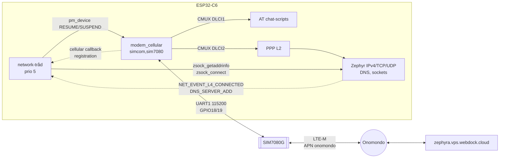
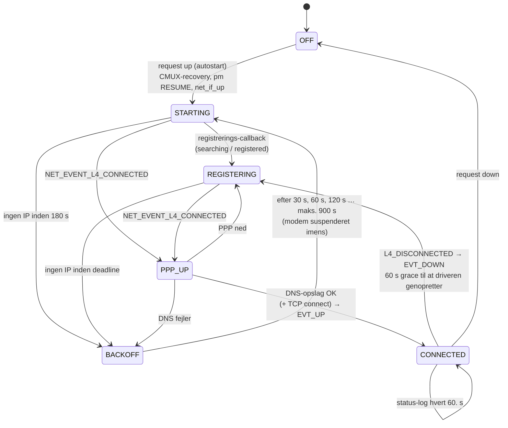

# Del 4 – Cellulært netværk

Enheden går på nettet via M5Stamp CAT-M (SIMCom SIM7080G, LTE-M/NB-IoT) med Onomondo-SIM'et.
Det sker med Zephyrs egen cellular-driver (`modem_cellular`), CMUX og PPP, så Zephyrs
almindelige TCP/IP-stak og sockets kan bruges over mobilnettet. `network`-modulet styrer
forbindelsen med en tilstandsmaskine og logger netværksstatus. Det tjekker også, at der er hul
igennem til egen server, og genstarter modemet med backoff ved fejl.

---

## 1. Opbygning



| Lag | Hvad | Hvor |
|---|---|---|
| Devicetree | `uart1` på GPIO18/19, modem-node `simcom,sim7080` med `autostarts` | `app/app.overlay` |
| Driver | `modem_cellular`: init-script (AT, ATE0, CFUN=4, CREG/CEREG, IMEI, model), CMUX, APN, `AT+CFUN=1`, `ATD*99***1#`, periodisk registreringstjek | Zephyr `drivers/modem/modem_cellular.c` |
| Net | PPP (IPCP giver IP + DNS), IPv4, TCP, UDP, DNS-resolver, connection manager (L4-events) | `prj.conf` |
| App | Tilstandsmaskine, logging, forbindelsestjek, backoff, CMUX-recovery | `app/src/network.c` |

---

## 2. Tilstandsmaskine (`network`-tråden)



- **Event-drevet:** Tråden venter på en intern `k_event`. Den bliver sat fra callbacks: net_mgmt
  (`L4_CONNECTED`, `L4_DISCONNECTED`, `DNS_SERVER_ADD`), cellular-driveren (registreringsstatus)
  og op/ned-requests. Callbacks gør ikke andet end at sætte en bit. Alt arbejde sker i tråden.
- **Offentlig status:** `network_events()` (`NETWORK_EVT_UP` / `NETWORK_EVT_DOWN`) er det, som
  MQTT-modulet venter på i Del 6.
- **Forbindelsestjek:** "PPP oppe" betyder ikke nødvendigvis, at der er hul igennem. Derfor slås
  `zephyra.vps.webdock.cloud` op med DNS, og der laves et TCP connect til port 80 (nginx på LEMP-imaget).
  Først så er tilstanden `CONNECTED`. Et fejlet TCP connect er kun en advarsel, fordi serveren eller
  firewallen måske ikke lytter. Et fejlet DNS-opslag er en fejl.
- **Backoff:** Ved timeout eller fejl suspenderes modemet, og der ventes 30 s, som fordobles for hver
  fejl op til 15 min. Det skåner både batteri og netværk. Efter en vellykket forbindelse nulstilles
  backoff.

---

## 3. Fund i driveren og designvalg

### 3.1 Modemet har ingen PWRKEY/RESET-stift

| Driverens opførsel (Zephyr 4.4.0) | Konsekvens for os |
|---|---|
| `simcom,sim7080`-bindingen **kræver** `mdm-power-gpios` | Pladsholder på **GPIO22**, som **ikke må forbindes** |
| Med `autostarts` springer resume power-pulsen over og venter op til 10 s på, at modemet er klar | Passer til modulet, der tænder af sig selv |
| Suspend: CMUX lukkes, og der kommer en power-off-puls på pladsholderen | Modemet forbliver tændt, men i AT-tilstand. Næste resume virker |
| Fejler init-scriptet: power-on-puls, vent og prøv igen, i det uendelige | Uden rigtig PWRKEY kan driveren ikke genstarte et modem, der hænger |
| SIM7080-driveren har intet shutdown-script | `AT+CPOWD`/`AT+CFUN=0` ved sleep tilføjes i Del 9 |

### 3.2 CMUX-recovery

Modemet får 5 V fra boardet og bliver ved med at køre, når ESP32-C6 resettes, fx når du flasher eller
trykker RESET. Var det i CMUX-tilstand, svarer det ikke på almindelige AT-kommandoer, og driverens
init-script ville fejle for evigt. Før hver start sender `network` derfor en **CMUX close-down-ramme**
(3GPP TS 27.010, CLD på DLCI 0) på UART1:

```
F9 03 EF 05 C3 01 F2 F9
│  │  │  │  └─┬─┘ │  └ flag
│  │  │  │    │   └ FCS = 0xFF − CRC8(03 EF 05)
│  │  │  │    └ CLD-kommando (type 0xC3, længde 0)
│  │  │  └ længde 2 (EA-bit)
│  │  └ UIH-ramme
│  └ adresse: DLCI 0, C/R=1, EA=1
└ flag
```

Det er samme kodning, som Zephyrs `modem_cmux` selv bruger ved disconnect, og FCS-algoritmen er
verificeret mod kendte referencerammer (SABM 0x1C, DISC 0xFD, UA 0xD7). I AT-tilstand ignorerer
modemet bytes'ene. Kan slås fra med `CONFIG_APP_NET_CMUX_RECOVERY=n`.

### 3.3 Heap til DNS

`zsock_getaddrinfo()` allokerer sit resultat med `k_calloc()`. Uden `CONFIG_HEAP_MEM_POOL_SIZE` (standard
0 i denne konfiguration) ville alle DNS-opslag fejle med "out of memory". Fejlen blev fanget ved
gennemgang af Zephyr-koden. Heap'en er sat til 4 kB, og DNS-timeouten er hævet fra 2 s til 10 s, fordi
svartiderne på mobilnettet er lange.

---

## 4. Konfiguration

| Kconfig | Værdi | Betydning |
|---|---|---|
| `CONFIG_MODEM_CELLULAR_APN` | `"onomondo"` | Onomondo kræver altid denne APN. Ingen bruger, password eller PIN |
| `CONFIG_MODEM_DEDICATED_WORKQUEUE` | y | CMUX/PPP/chat på egen workqueue |
| `CONFIG_NET_L2_PPP`, `NET_IPV4`, `NET_TCP`, `NET_UDP`, `NET_SOCKETS` | y | IPv4 over PPP. IPv6 er slået fra (sparer RAM) |
| `CONFIG_NET_CONNECTION_MANAGER` | y | L4 connected/disconnected-events |
| `CONFIG_HEAP_MEM_POOL_SIZE` | 4096 | Til `getaddrinfo` (afsnit 3.3) |
| `APP_NET_AUTOSTART` | y | Netværket startes ved boot |
| `APP_NET_CONNECT_TIMEOUT_S` | 180 | Maks. tid fra modemstart til verificeret link (første LTE-M-registrering kan tage minutter) |
| `APP_NET_RECONNECT_GRACE_S` | 60 | Tid, driveren får til selv at genoprette en tabt forbindelse |
| `APP_NET_BACKOFF_MIN_S` / `MAX_S` | 30 / 900 | Eksponentiel backoff ved genstart af modemet |
| `APP_NET_STATUS_INTERVAL_S` | 60 | Periodisk status-log (RSSI, registrering) |
| `APP_NET_CHECK_HOST` / `PORT` | broker-host / 80 | Forbindelsestjek (DNS + TCP) |
| `APP_NET_CMUX_RECOVERY` | y | CLD-ramme før start (afsnit 3.2) |

Build-variant til fejlsøgning:

```powershell
.\scripts\build.ps1 -ModemDebug    # shell + "modem at ..." + debug-log fra CMUX/PPP/chat
```

---

## 5. Test på hardware

### 5.1 Før du starter

- [ ] **Antennen** er monteret på modulet. Uden antenne kan modemet ikke registrere sig, og det kan
      tage skade, når det sender.
- [ ] **SIM-kortet** (micro-SIM) sidder i modulet og er aktivt i Onomondo-appen (spørg underviseren).
- [ ] Ledninger: modulets TX → GPIO19, modulets RX → GPIO18, 5V og GND. **GPIO22 er ikke forbundet.**

### 5.2 Kør

```powershell
cd C:\zp\zephyr_a
git fetch
git checkout del-04-netvaerk
.\scripts\setup.ps1 -SkipWinget     # ingen nye moduler, men sikrer at alt er opdateret
.\scripts\build.ps1
.\scripts\flash.ps1   -Port COM3
.\scripts\monitor.ps1 -Port COM3    # luk: Ctrl+T, X
```

### 5.3 Forventet log

Rækkefølge og tider varierer. Den første registrering på LTE-M kan tage 1–3 minutter.

```
<inf> network: Modem modem on uart@60001000, APN "onomondo"
<inf> network: Starting modem (APN "onomondo")
<inf> network: Network: off -> starting
<inf> network: Cellular registration: searching
<inf> network: Network: starting -> registering
<inf> network: Cellular registration: registered (roaming)
<inf> network: Network: registering -> ppp-up
<inf> network: PPP up, IPv4 address 10.x.x.x
<inf> network: Modem model: SIM7080 ...
<inf> network: Modem IMEI: 86xxxxxxxxxxxxx
<inf> network: SIM ICCID: 89xxxxxxxxxxxxxxxxx
<inf> network: DNS: zephyra.vps.webdock.cloud -> 193.180.213.155 (... ms)
<inf> network: TCP connect to 193.180.213.155:80 OK (... ms)
<inf> network: Network: ppp-up -> connected
<inf> network: Network status: connected, RSSI -85 dBm, registration registered (roaming)
...
<inf> network: Network status: connected, RSSI -83 dBm, ...        (hvert 60. s)
```

Målingerne fra Del 3 (`meas #n ...`) kører videre uafhængigt af netværket.

Onomondo er en roaming-operatør, så **"registered (roaming)"** er det normale svar. "home"
forekommer næsten ikke.

### 5.4 Definition of done

- [ ] Loggen når `Network: ppp-up -> connected` og viser en IPv4-adresse.
- [ ] `DNS: zephyra.vps.webdock.cloud -> 193.180.213.155`.
- [ ] `TCP connect ... :80 OK` (en advarsel her er OK, hvis nginx ikke kører).
- [ ] `Network status` med RSSI kommer hvert 60. sekund.
- [ ] Tryk på **RESET** på ESP32-boardet, mens modemet kører. Forbindelsen skal komme op igen uden at
      afbryde strømmen. Det tester CMUX-recovery.
- [ ] Skru antennen af, mens forbindelsen er oppe (eller dæk modulet med alufolie). Så skal der komme
      `Network link lost`, derefter `registering` og enten automatisk genopretning eller `backoff`.
      Skru antennen på igen, så skal den nå `connected`.
- [ ] Ingen `Reset cause: brownout` under opkobling.

### 5.5 Fejlsøgning

| Symptom | Mulig årsag | Hvad du gør |
|---|---|---|
| Hænger i `starting`, ingen `Cellular registration`-linje, derefter `No IP link before the deadline` | Modemet svarer ikke: TX/RX byttet, ingen 5 V, forkert baudrate | Tjek ledninger (modul-TX → GPIO19). Byg med `-ModemDebug`, og se om der kommer svar på `AT` |
| `Cellular registration: searching` i lang tid | Ingen dækning med LTE-M/NB-IoT, antennen mangler, SIM'et er ikke aktivt | Tjek antennen. Med `-ModemDebug`: `modem at AT+CPSI?`, `modem at AT+CSQ`. Tjek SIM-status i Onomondo-appen |
| `Registration denied by the network` | SIM'et er ikke aktiveret eller er spærret | Onomondo-appen / underviser |
| `ppp-up`, men `DNS lookup ... failed` | APN eller PPP-DNS | `modem at AT+CGDCONT?` skal vise `onomondo` |
| `TCP connect ... failed` (warning) | nginx/firewall på VPS'en | Ikke kritisk nu. Webdock-firewallen tages i Del 5 |
| `Reset cause: brownout` | Modemets strømspidser er for store for USB-forsyningen | Brug et kortere eller bedre USB-kabel eller en USB-port med mere strøm, eller giv modulet egen 5 V-forsyning (fælles GND) |
| Modemet svarer ikke efter flashing | CMUX-recovery virkede ikke | Træk USB ud i 5 s (power-cycle modemet). Meld tilbage, så vi kan justere recovery |

`-ModemDebug` giver en shell i monitoren. Tryk Enter for at få prompten `uart:~$`:

```
uart:~$ modem at AT+CPSI?       # fx "+CPSI: LTE CAT-M1,Online,238-01,...,EUTRAN-BAND20,..."
uart:~$ modem at AT+CSQ         # "+CSQ: 18,99" -> RSSI = -113 + 2*18 = -77 dBm
uart:~$ modem at AT+COPS?
uart:~$ net iface               # PPP-interface med IP-adresse
uart:~$ net dns query zephyra.vps.webdock.cloud A
```

---

## 6. Kendte begrænsninger og videre arbejde

- **Ingen RTS/CTS:** Ved store PPP-bursts kan der tabes bytes. PPP/TCP retransmitterer, men opdager vi
  mange fejl, øges UART-bufferne (`CONFIG_MODEM_CELLULAR_UART_BUFFER_SIZES`), eller baudraten sænkes.
- **Modemet kan ikke slukkes helt** (ingen PWRKEY). Strømsparing via `AT+CFUN`, PSM og eDRX kommer i Del 9.
  Den kan bruge Zephyrs `modem_at_user_pipe` (samme CMUX-kanal som AT-shell'en).
- Driverens periodiske registreringstjek kører hvert 2. sekund (`MODEM_CELLULAR_PERIODIC_SCRIPT_MS`).
  Det justeres i Del 9 af hensyn til strøm.
- Netværksmodulet er bygget, men kan ikke afvikles uden modem i testmiljøet. Første rigtige test sker
  på dit board.
