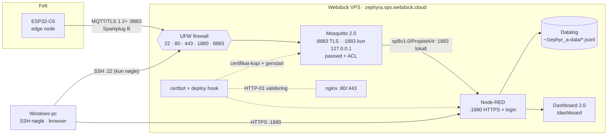

# Del 5 – Cloud-server (Webdock VPS)

Den egen server `zephyra.vps.webdock.cloud` (Webdock, Ubuntu 24.04 "Noble", LEMP-image) får:

- **Mosquitto** som MQTT-broker: TLS på port 8883 til enhederne, login for alle og ACL, så hver
  enhed kun kan bruge sine egne topics.
- **Let's Encrypt-certifikat**, som Webdock allerede har udstedt. Det fornyes automatisk og kopieres
  til Mosquitto og Node-RED.
- **Node-RED** som Sparkplug B-"host application": dekoder beskederne, gemmer dem i en datalog
  (JSON Lines) og viser dem på et dashboard over HTTPS med login.
- **Hærdning:** login kun med SSH-nøgle, nye passwords, FTP lukket, firewall og automatiske
  sikkerhedsopdateringer.

Alt ligger som scripts og konfiguration i `cloud/`, så opsætningen kan gentages og dokumenteres.

---

## 1. Opbygning



| Port | Tjeneste | Åben udefra | Beskyttelse |
|---|---|---|---|
| 22 | SSH | ja | Kun nøgle-login (password-login slået fra i Webdock) |
| 80 / 443 | nginx (Webdock) | ja | Bruges af certbot (HTTP-01) og Webdocks standardside |
| 8883 | Mosquitto, MQTT over TLS | ja | TLS ≥ 1.2, Let's Encrypt-certifikat, brugernavn + password, ACL |
| 1883 | Mosquitto, plain MQTT | **nej** | Bundet til 127.0.0.1 (kun Node-RED på samme server) |
| 1880 | Node-RED editor + dashboard | ja | HTTPS, login til editor (adminAuth) og dashboard (httpNodeAuth) |
| 21, 50000–50099 | FTP | **lukkes** | Ukrypteret protokol og lækket password. SFTP/scp bruges i stedet |

---

## 2. Sikkerhedsvalg (grundlag for Del 8)

| Tiltag | Hvorfor | Hvor |
|---|---|---|
| SSH kun med nøgle, nyt `admin`-password | Passwords var synlige i et skærmbillede. Nøgler kan ikke gættes | Webdock-dashboard + `passwd` |
| FTP lukket og stoppet | Klartekst-protokol, ikke nødvendig | `20-firewall.sh` |
| UFW: kun nødvendige porte | Mindre angrebsflade | `20-firewall.sh` |
| Automatiske sikkerhedsopdateringer | Kendte sårbarheder lukkes uden manuelt arbejde | `10-base.sh` |
| TLS ≥ 1.2 på MQTT, offentligt CA-certifikat | **Fortrolighed og integritet** af data på vej (CRA Annex I 1.c/1.d) | `zephyr_a.conf` |
| `allow_anonymous false` + password pr. enhed | **Autentifikation** af hver klient | `zephyr_a.conf`, `60-add-device.sh` |
| ACL: brugernavn = edge node-id, `pattern … %u` | **Least privilege:** en enhed kan ikke udgive sig for en anden eller sende kommandoer | `acl` |
| 1883 kun på localhost | Ukrypteret MQTT kan ikke nås udefra | `zephyr_a.conf` |
| Node-RED: HTTPS, login, krypterede credentials | Editoren kan ændre alt. Dashboardet viser data | `settings-zephyr_a.js` |
| Hemmeligheder aldrig i git | Passwords findes kun på serveren (hashet) og i `app/secrets.conf` | `.gitignore` |

---

## 3. Trin for trin

### 3.1 SSH-nøgle på Windows

```powershell
ssh-keygen -t ed25519 -C "anders@zephyr_a"                 # Enter = standardsti, vælg gerne en passphrase
Get-Content $env:USERPROFILE\.ssh\id_ed25519.pub | Set-Clipboard   # offentlig nøgle i udklipsholderen
```

I **Webdock-dashboardet**:

1. **Profil → Public Keys → Add Public Key**: indsæt nøglen (én linje, der starter med `ssh-ed25519`).
2. **Serveren → Shell Users → admin → Assign Public Keys**: vælg nøglen.

Første login fra PowerShell (svar `yes` til fingerprint):

```powershell
ssh admin@zephyra.vps.webdock.cloud
```

**Skift straks de passwords, der var synlige på skærmbilledet:**

```bash
passwd                  # admin-brugerens password (bruges også til sudo)
```

- MySQL-passwordene skiftes i Webdock-dashboardet under **MySQL/Databases**. Projektet bruger ikke MySQL.
- FTP lukkes af `20-firewall.sh`.

Når nøgle-login virker, så slå **Password Authentication** fra under **Shell Users** i
Webdock-dashboardet. Test i et *nyt* terminalvindue, at du stadig kan logge ind, før du lukker det gamle.

### 3.2 Hent scripts på serveren

```bash
sudo apt-get install -y git
git clone -b del-05-cloud https://github.com/asni75488/Zephyr_A.git ~/Zephyr_A
cd ~/Zephyr_A/cloud/scripts
```

Senere opdateringer henter du med `cd ~/Zephyr_A && git pull`.

### 3.3 Kør scripts i rækkefølge

Alle scripts kan køres igen. De springer over det, der allerede er gjort.

```bash
sudo bash 10-base.sh                        # pakker, auto-opdateringer, tjek af tid (NTP)
sudo bash 20-firewall.sh                    # UFW: 22, 80, 443, 1880, 8883 - FTP lukkes
sudo bash 30-certs.sh                       # finder Webdocks Let's Encrypt-cert, installerer deploy-hook
sudo bash 40-mosquitto.sh                   # broker, TLS, ACL, bruger "nodered" (du vælger password)
sudo bash 60-add-device.sh esp32c6-test0001 # bruger til testpublisheren
sudo bash 60-add-device.sh esp32c6-14c19fe0ab24   # dit board (til Del 6)
sudo bash 50-nodered.sh                     # Node-RED, Dashboard 2.0, logins, HTTPS
```

**Gem til senere** (i en password-manager, ikke i git):

| Hvad | Bruges hvor |
|---|---|
| MQTT-password for `nodered` | Node-RED's broker-node (3.4) |
| MQTT-password for `esp32c6-test0001` | Testpublisheren (3.5) |
| MQTT-password for `esp32c6-14c19fe0ab24` | `app\secrets.conf` på pc'en (Del 6) |
| Node-RED editor-login og dashboard-login | Browseren |

`30-certs.sh` udskriver certifikatkæden (udsteder og nøgletype). **Kopiér den ind i din
besked til mig.** Den bestemmer, hvilket rodcertifikat enheden skal have i Del 6.

Lykkes `certbot`-trinnet ikke (fx hvis Webdock ikke har udstedt et certifikat), så udsted det i
Webdock-dashboardet under **SSL Certificates**, eller kør `sudo LE_EMAIL=din@mail.dk bash 30-certs.sh`.

### 3.4 Node-RED: importér flowet

1. Åbn **https://zephyra.vps.webdock.cloud:1880** og log ind med editor-login.
2. **Menu (≡) → Import → select a file to import** → vælg `cloud\node-red\flows.json` fra
   `C:\zp\zephyr_a` (branch `del-05-cloud`) → **Import**.
3. Dobbeltklik på noden **spBv1.0/ProjektA/#** → blyanten ved **Server: Mosquitto (local)** →
   fanen **Security** → Username `nodered` og passwordet fra 40-mosquitto.sh → **Update** → **Done**.
4. **Deploy** (øverst til højre). Ved første deploy installerer Node-RED selv npm-modulet
   `sparkplug-payload`, som function-noden bruger. Det tager op til et minut.
5. MQTT-noden skal vise **connected** (grøn prik).

Flowet:

```
[mqtt in spBv1.0/ProjektA/#] → [Sparkplug B decode] ─┬→ [debug] + [fil: ~/zephyr_a-data/sparkplug-YYYY-MM-DD.jsonl]
                                                     ├→ [ui-chart: alle målinger, 24 t]
                                                     └→ [ui-text: seneste besked]
```

Dekoderen (`cloud/node-red/decode.js`) slår metric-navne op via aliaser fra NBIRTH/DBIRTH. Hver
måling i en batch får sit eget tidsstempel i grafen, ikke ankomsttiden.

### 3.5 Test hele kæden med testpublisheren

Testpublisheren opfører sig som enheden: TLS på 8883 med certifikatverifikation, edge node-id som
brugernavn, NDEATH som Last Will, NBIRTH/DBIRTH og en DDATA med 6 målinger pr. minut.

```bash
cd ~/Zephyr_A/cloud/tools
npm install
MQTT_USER=esp32c6-test0001 node spb-test-publisher.js        # spørger om passwordet
# hurtigere test: SAMPLE_S=2 BATCH=3 MQTT_USER=esp32c6-test0001 node spb-test-publisher.js
```

Forventet output:

```
Connecting to mqtts://zephyra.vps.webdock.cloud:8883 as esp32c6-test0001 ...
Connected (TLSv1.3, TLS_AES_256_GCM_SHA384), certificate verified
NBIRTH + DBIRTH sent (bdSeq 0)
DDATA: 6 samples, ~100 bytes protobuf, values 22.33, 22.65, ...
```

Tjek samtidig:

- Node-RED's **debug**-panel viser `NBIRTH`, `DBIRTH` og `DDATA` med `Temperature/Die`.
- **https://zephyra.vps.webdock.cloud:1880/dashboard** (dashboard-login) viser grafen.
- På serveren: `tail -n 2 ~/zephyr_a-data/sparkplug-$(date +%F).jsonl`.
- Stop med **Ctrl+C**. Så sendes NDEATH, og den ses i debug-panelet.

### 3.6 Samlet kontrol

```bash
sudo bash ~/Zephyr_A/cloud/scripts/90-verify.sh
```

Fra **Windows PowerShell**:

```powershell
Test-NetConnection zephyra.vps.webdock.cloud -Port 8883   # TcpTestSucceeded : True
Test-NetConnection zephyra.vps.webdock.cloud -Port 1880   # True
Test-NetConnection zephyra.vps.webdock.cloud -Port 1883   # False  (kun localhost)
Test-NetConnection zephyra.vps.webdock.cloud -Port 21     # False  (FTP lukket)
```

---

## 4. Definition of done

- [ ] SSH-login med nøgle virker, password-login er slået fra, og `admin`-passwordet er skiftet.
- [ ] `90-verify.sh` slutter med **All checks passed**.
- [ ] `Test-NetConnection` fra Windows: 8883 og 1880 er True, 1883 og 21 er False.
- [ ] Node-RED-editoren kræver login. Dashboardet kræver login.
- [ ] Testpublisheren skriver `certificate verified` og sender DDATA. Data ses i debug, dashboard og
      datafilen.
- [ ] Ctrl+C på testpublisheren giver en NDEATH i Node-RED.
- [ ] Certifikatkæden fra `30-certs.sh` er sendt til mig (til Del 6).

---

## 5. Verificeret i udviklingsmiljøet

Serveren kan ikke nås herfra. Følgende er afprøvet i stedet:

| Hvad | Hvordan | Resultat |
|---|---|---|
| `zephyr_a.conf` + `acl` | Mosquitto **2.0.18** (Ubuntu 24.04's version), bygget fra kildekoden, med testcertifikat og samme filrettigheder som scriptet sætter | Anonym og forkert password afvist. TLS 1.2 og 1.3 OK, TLS 1.1 og plain MQTT på 8883 afvist. 1883 kun på 127.0.0.1 |
| ACL | Enhed publicerer på egne, fremmede og kommando-topics, mens Node-RED-brugeren lytter | Kun egne NBIRTH/DDATA kom igennem. Forfalsket DDATA for anden enhed, egen NCMD, anden gruppe og tilfældigt topic blev kasseret. En enhed på `spBv1.0/#` modtog intet fra andre. En enhed modtog kun sin egen NCMD |
| Last Will | Enhed med NDEATH som will dræbt brat | Node-RED-brugeren modtog NDEATH |
| Filrettigheder | Mosquitto skifter til brugeren `mosquitto`, før nøglen læses | Fund: nøglen skal være `root:mosquitto 0640`, og passwd/acl skal være `mosquitto 0600`. Scripts og hook gør det |
| Deploy-hook | Kørt med testcertifikat, `mosquitto`- og `admin`-bruger | Ignorerer andre certifikater, kopierer med rigtige ejere, og begge brugere kan læse nøglen |
| `settings-zephyr_a.js` | Indlæst sammen med Node-RED 5.0.9's standard-`settings.js` og en bcrypt-hash fra bcryptjs 3.0.3 | HTTPS-nøgle og certifikat læses, `$2b$`-hash verificeres, øvrige standardindstillinger bevares |
| `decode.js` (function-noden) | Unit-test (`cloud/node-red/test/decode.test.js`) med det objektformat, Tahu's `sparkplug-payload` dokumenterer | Aliaser, batch-tidsstempler, Long→number, ukendt alias og ikke-Sparkplug-topic håndteres |
| `flows.json` | Alle referencer og nodetyper tjekket. Egenskaber slået op i kildekoden til Node-RED 5.0.9 og Dashboard 2.0 v1.36.1 | OK. **Selve importen i Node-RED er ikke afprøvet** (npm var ikke tilgængeligt herfra) |
| Shell-scripts | `bash -n` + ShellCheck 0.10 | Ingen fund |

---

## 6. Fejlsøgning

| Symptom | Årsag / løsning |
|---|---|
| `Permission denied (publickey)` | Nøglen er ikke tildelt `admin` i Webdock (Shell Users), eller der bruges en anden nøgle: `ssh -i $env:USERPROFILE\.ssh\id_ed25519 admin@...` |
| `mosquitto failed to start` | `journalctl -u mosquitto -n 50`. Typisk certifikatsti/rettigheder: kør `sudo bash 30-certs.sh` igen |
| `Connection Refused: not authorised` | Forkert brugernavn/password, eller brugeren findes ikke: `sudo bash 60-add-device.sh <id>` |
| Testpublisher: `unable to verify the first certificate` / host name-fejl | Certifikatet dækker ikke domænet: se output fra `30-certs.sh` |
| Node-RED: `MQTT disconnected` | Forkert `nodered`-password i broker-noden. Tjek `journalctl -u mosquitto -f` |
| Node-RED: `Error: Cannot find module 'sparkplug-payload'` | Modulet installeres ved deploy. Vent, eller genstart: `sudo systemctl restart nodered` |
| Dashboard viser intet | Data kommer først, når en DDATA er modtaget (testpublisher eller enhed). Tjek debug-panelet |
| Glemt Node-RED-login | `rm ~/.node-red/zephyr_a-secrets.json && sudo bash 50-nodered.sh`. Broker-passwordet skal derefter tastes igen |

## 7. Vedligehold

- **Certifikatfornyelse** sker automatisk (certbots systemd-timer). Deploy-hook'en kopierer og
  genstarter. Kontrol: `sudo certbot renew --dry-run` og `sudo bash 90-verify.sh`.
- **Ny enhed:** `sudo bash 60-add-device.sh <edge-node-id>`. ACL'en dækker den automatisk.
- **Spærre en enhed:** `sudo mosquitto_passwd -D /etc/mosquitto/passwd <id> && sudo systemctl reload mosquitto`.
- **Datalog:** én fil pr. dag i `~/zephyr_a-data/`. JSON Lines kan læses direkte i Python/Excel
  (Power Query) til rapporten.

## 8. Beslutning til Del 7

Dashboardet viser værdierne, som de modtages. Derfor sender enheden i Del 7 målinger som
Sparkplug-datatypen **Float i °C** (ikke heltal i m°C). Så skal hverken Node-RED eller andre
Sparkplug-værktøjer kende en skalering. Det koster 1–2 bytes pr. værdi i forhold til et varint-heltal.
