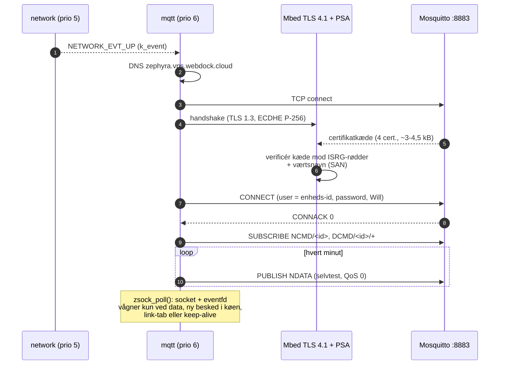
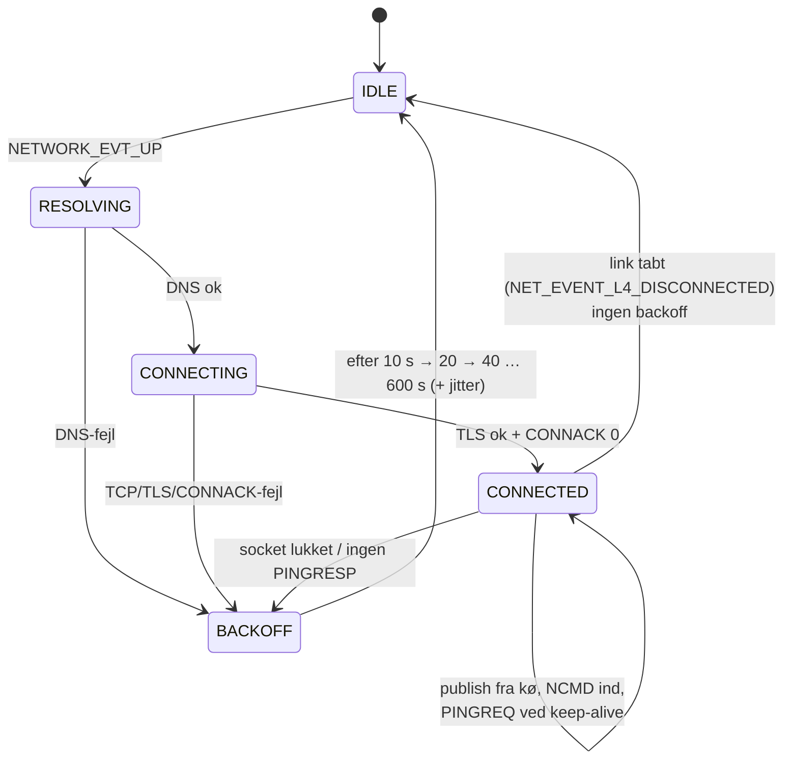

# Del 6 – MQTT over TLS (Mbed TLS 4.1 / PSA)

Enheden forbinder nu til egen broker `zephyra.vps.webdock.cloud:8883` (fra Del 5):

- **MQTT 3.1.1 over TLS 1.3** (TLS 1.2 som reserve) med Zephyrs MQTT-bibliotek og Mbed TLS 4.1.
- **Serverens certifikat verificeres** mod fire indbyggede rodcertifikater fra Let's Encrypt.
  **Værtsnavnet tjekkes også**: certifikatet skal være udstedt til `zephyra.vps.webdock.cloud`.
- **Login** med brugernavn = enhedens id og et password fra `app/secrets.conf`, som aldrig committes.
- **Abonnement** på egne kommandoer (NCMD/DCMD), **Last Will** klar til Sparkplug NDEATH,
  **genforbindelse** med backoff.
- En **selvtest-besked** (Sparkplug B NDATA) hvert minut, så hele kæden kan testes nu:
  enhed → TLS → Mosquitto → Node-RED → dashboard. Den rigtige Sparkplug-kodning følger i Del 7.

---

## 1. Opbygning



### Tilstandsmaskine (`mqtt`-tråden)



**Backoff:** ventetiden fordobles fra 10 s til højst 600 s. Der lægges op til 25 % tilfældig
jitter oveni, så mange enheder ikke forbinder samtidig efter et nedbrud.

**Permanente fejl springer direkte til 600 s.** Det gælder forkert certifikat eller værtsnavn,
forkert password og manglende rettighed (CONNACK 4/5). De forsvinder ikke ved at prøve igen, og
hvert forsøg koster et TLS-handshake på ca. 5 kB data.

**Reset af backoff:** først når en forbindelse har holdt i 60 s. Så undgås hurtige
genforbindelsesløkker, hvis brokeren accepterer og straks lukker igen.

---

## 2. Designvalg og hvorfor

| Valg | Hvorfor |
|---|---|
| **MQTT 3.1.1** (ikke 5.0) | Sparkplug B 3.0 bygger på 3.1.1. Mosquitto-ACL'en fra Del 5 er testet med 3.1.1. MQTT 5's ekstra felter giver flere bytes uden gevinst her |
| **TLS 1.3 først, TLS 1.2 som reserve** | TLS 1.3 har et handshake med én round trip mindre. Det betyder noget på LTE-M, hvor en round trip tager 100–500 ms. Mosquitto (`tls_version tlsv1.2` = minimum) vælger 1.3. Testen viser `TLS_AES_256_GCM_SHA384` |
| **Kun 4 egne rodcertifikater** (ISRG Root YE, YR, X2, X1) | Enheden stoler kun på de CA'er, der kan have udstedt serverens certifikat, ikke på hundredvis af CA'er i en "system trust store". Dermed kan et certifikat fra en anden CA ikke bruges til et man-in-the-middle-angreb (IEC 62443-4-2 CR 1.8/1.9, CRA Annex I 1.d). Se [app/ca/README.md](../app/ca/README.md) |
| **Root YE/YR direkte i trust store** | Let's Encrypt udsteder siden maj 2026 fra "Generation Y" (kæde: leaf ← YE2 ← Root YE ← X2 ← X1). Når Root YE er betroet, stopper verifikationen der, og den virker også, hvis serveren en dag sender en kortere kæde |
| **Værtsnavn-tjek** (`TLS_HOSTNAME`) | Uden det accepteres ethvert gyldigt Let's Encrypt-certifikat, også et for et andet domæne. Mbed TLS 4 afviser selv handshaket, hvis intet værtsnavn er sat |
| **ECDSA- og RSA-kæder understøttes** | Certbot på VPS'en kan have valgt ECDSA (standard siden certbot 2.0) eller RSA. Det er endnu ikke kendt, hvilken. `30-certs.sh` viser det. RSA koster kun 3,5 kB flash og 1,3 kB RAM (målt: bygget uden RSA og uden YR/X1), fordi ECC alligevel bruger bignum-koden. Derfor beholdes begge |
| **Rodcertifikater som DER i flash** (`TLS_CERT_NOCOPY`) | DER er mindre end PEM og kræver ingen base64-parser. Mbed TLS parser dem direkte fra flash uden at kopiere dem til RAM |
| **Input-buffer 8 kB, output-buffer 2 kB** | Serveren sender hele kæden i én TLS-record (ECDSA ca. 3,0 kB, RSA ca. 3,6 kB + leaf-certifikatets SCT'er). Enheden sender højst ClientHello og MQTT-pakker < 600 B. Den asymmetriske opdeling (`app/config/zephyr_a_mbedtls_user.h`) sparer 6 kB heap |
| **eventfd + `zsock_poll()`** | `mqtt`-tråden sover, indtil der kommer data på socket'en, en ny besked i køen, link-tab eller keep-alive. Der er ingen polling med kort timeout, og det er grundlaget for lavt strømforbrug i Del 9 |
| **Brugernavn = enheds-id** | Brokerens ACL (`pattern … %u`) lader kun en klient skrive under sit eget brugernavn. Så kan en enhed ikke udgive sig for en anden |
| **Password i `secrets.conf`, bygget ind i firmware** | Det enkleste, der holder hemmeligheden ude af git. Beskyttelse på enheden (flash encryption eller mTLS med nøgle i eFuse/NVS) er Del 8/10 |
| **Keep-alive 1200 s** | Der sendes data hvert minut alligevel, og det tæller som aktivitet. PINGREQ sendes kun, hvis linjen har været stille. Hvis PINGRESP ikke kommer inden for 30 s, er forbindelsen død, og der genforbindes |
| **Link-tab → IDLE uden backoff** | Når PPP falder (`NET_EVENT_L4_DISCONNECTED`), er det ikke brokerens skyld. `mqtt` lukker sessionen og venter på, at `network` genopretter linket |
| **Selvtest-NDATA i Del 6** | Kæden kan testes ende-til-ende, før nanopb/Sparkplug er klar. Den bruger samme vej som rigtige data (`app_mqtt_alloc` → kø → tråd). Den slås fra i Del 7 |

---

## 3. Konfiguration

TLS-blokken står i `app/prj.conf` mellem `# >>> mqtt-tls` og `# <<< mqtt-tls`. Testen på
`native_sim` (afsnit 5.2) læser præcis den samme blok, så testen og firmwaren altid har ens
TLS-konfiguration.

| Kconfig | Værdi | Forklaring |
|---|---|---|
| `APP_MQTT_BROKER_HOST` / `_PORT` | `zephyra.vps.webdock.cloud` / 8883 | Også det navn, certifikatet tjekkes mod |
| `APP_MQTT_USERNAME` | tom = enheds-id | Skal være lig edge node-id'et (ACL) |
| `APP_MQTT_PASSWORD` | **kun i `secrets.conf`** | Uden password starter klienten ikke (log forklarer hvorfor) |
| `APP_MQTT_KEEPALIVE_S` | 1200 | Tunes i Del 9 |
| `APP_MQTT_BACKOFF_MIN_S` / `_MAX_S` | 10 / 600 | |
| `APP_MQTT_SELFTEST` / `_INTERVAL_S` | y / 60 | Slås fra i Del 7 |
| `MBEDTLS_HEAP_SIZE` | 57344 | Se afsnit 6 |
| `MBEDTLS_SSL_MAX_CONTENT_LEN` | 8192 (output 2048 i user-config) | Hele certifikatkæden i én record |
| `MBEDTLS_HAVE_TIME_DATE` | **n** | Certifikaternes gyldighedsdatoer tjekkes ikke endnu, fordi enheden ikke kender UTC før SNTP (Del 7). Se afsnit 8 |
| `APP_MQTT_THREAD_STACK` | 8192 | Måles på hardware (loggen viser forbrug efter handshake) |

Nye build-flag i `scripts\build.ps1`:

- `app\secrets.conf` tilføjes **automatisk**, hvis filen findes. Mangler den, kommer en advarsel.
- `-TlsDebug` (`app/overlay-tls-debug.conf`): Mbed TLS-handshake-log, heap-statistik
  (`Mbed TLS heap peak`, shell `mbedtls heap`) og DEBUG-log for hver PUBLISH/PINGREQ.

---

## 4. Filer

| Fil | Indhold |
|---|---|
| `app/src/mqtt_client.c/.h` | MQTT-tråd, tilstandsmaskine, TLS-opsætning, kø (`k_msgq` + `k_mem_slab`), Will, subscribe, statistik |
| `app/src/tls_ca.c/.h` | Registrerer rodcertifikaterne som TLS-credentials (ét security tag pr. rod) |
| `app/src/mqtt_selftest.c/.h` | Selvtest-NDATA, protobuf kodet i hånden (Test/Uptime, Test/RSSI, Test/MQTT Connects) |
| `app/ca/*.der` + `README.md` | ISRG Root YE/YR/X2/X1 med fingeraftryk og kilde |
| `app/cmake/ca_certs.cmake` | Genererer C-arrays af DER-filerne ved build |
| `app/config/zephyr_a_mbedtls_user.h` | Mbed TLS-tilpasning: output-buffer 2 kB |
| `app/overlay-tls-debug.conf` | `-TlsDebug`-varianten |
| `app/tests/mqtt_tls/` | Test på `native_sim` mod rigtig Mosquitto (`run.sh`, `pki.sh`, `decode_ndata.py`) |
| `cloud/node-red/decode.js` (+ `flows.json`) | Bruger modtagetiden, når en besked ikke har tidsstempel (selvtesten) |

---

## 5. Test

### 5.1 På hardware (Windows 11)

**Forudsætning:** Del 5 er sat op på serveren, mindst `40-mosquitto.sh` og
`60-add-device.sh esp32c6-14c19fe0ab24`. Del 4 (netværk) skal virke.

```powershell
cd C:\zp\zephyr_a
git fetch origin
git checkout del-06-mqtt-tls
.\.venv\Scripts\Activate.ps1          # hvis venv ikke allerede er aktiv

# Password: det du valgte i 60-add-device.sh for esp32c6-14c19fe0ab24
Copy-Item app\secrets.conf.example app\secrets.conf
notepad app\secrets.conf              # ret CONFIG_APP_MQTT_PASSWORD="..."
git status                            # secrets.conf må IKKE stå på listen

.\scripts\build.ps1                   # skriver "Using app\secrets.conf"
.\scripts\flash.ps1 -Port COM3
.\scripts\monitor.ps1 -Port COM3      # afslut med Ctrl+T og derefter X
```

Samtidig på serveren (`ssh admin@zephyra.vps.webdock.cloud`):

```bash
sudo journalctl -u mosquitto -f       # "New client connected ... as esp32c6-14c19fe0ab24 (p2, c1, k1200, u'esp32c6-14c19fe0ab24')"
```

Sådan ser du data og sender en kommando til enheden (`read -s` gemmer passwordet uden at vise det):

```bash
read -rsp "nodered password: " P; echo
mosquitto_sub -h 127.0.0.1 -p 1883 -u nodered -P "$P" -t 'spBv1.0/#' -v -F '%t %l bytes'
# i et andet vindue:
mosquitto_pub -h 127.0.0.1 -p 1883 -u nodered -P "$P" -q 1 \
    -t spBv1.0/ProjektA/NCMD/esp32c6-14c19fe0ab24 -m test
```

Dashboardet på **https://zephyra.vps.webdock.cloud:1880/dashboard** viser kurverne
`Test/Uptime`, `Test/RSSI` og `Test/MQTT Connects`.

**Forventet log på enheden** (tider og RSSI varierer):

```
<inf> tls_ca: Trusted CA isrg-root-ye (477 B, tag 100)
<inf> tls_ca: Trusted CA isrg-root-yr (1325 B, tag 101)
<inf> tls_ca: Trusted CA isrg-root-x2 (543 B, tag 102)
<inf> tls_ca: Trusted CA isrg-root-x1 (1391 B, tag 103)
...
<inf> network: Network: ppp-up -> connected
<inf> app_mqtt: State IDLE -> RESOLVING
<inf> app_mqtt: Broker zephyra.vps.webdock.cloud -> 45.x.x.x:8883
<inf> app_mqtt: Connecting to zephyra.vps.webdock.cloud:8883 as esp32c6-14c19fe0ab24 (TLS, CA tags 4)
<inf> app_mqtt: TLS established in 2500 ms: TLS 1.3 TLS_AES_256_GCM_SHA384 (0x1302), server certificate verified for zephyra.vps.webdock.cloud
<inf> app_mqtt: MQTT connected (CONNACK after 300 ms), keep-alive 1200 s
<inf> app_mqtt: mqtt thread stack: NNNN of 8192 B used after TLS handshake
<inf> app_mqtt: State CONNECTING -> CONNECTED
<inf> mqtt_selftest: Self-test NDATA seq 0 queued (67 B)
<inf> app_mqtt: Subscribed spBv1.0/ProjektA/NCMD/esp32c6-14c19fe0ab24 (QoS 1)
<inf> app_mqtt: Subscribed spBv1.0/ProjektA/DCMD/esp32c6-14c19fe0ab24/+ (QoS 1)
<inf> app_mqtt: RX spBv1.0/ProjektA/NCMD/esp32c6-14c19fe0ab24 (4 B)
```

**Negative tests på hardware** (valgfrie, men gode til rapporten):

| Test | Sådan | Forventet |
|---|---|---|
| Forkert password | Ret `secrets.conf`, byg og flash | `CONNACK: not authorised (5)`, `Reconnect in 600..750 s` |
| Ingen secrets | Omdøb `secrets.conf`, byg | `mqtt: start failed (-22)` med forklaring. Ingen forsøg på at forbinde |
| Broker genstartes | `sudo systemctl restart mosquitto` | `Connection closed …`, `Reconnect in 10 s`, ny `MQTT connected` |
| Antenne af i 2 min | | `Network link lost - closing the MQTT session`, og efter netværket er oppe: ny forbindelse uden backoff |

### 5.2 Automatisk test på `native_sim` (lavet i udviklingsmiljøet)

`app/tests/mqtt_tls/run.sh` bygger **firmwarens egen `mqtt_client.c` med firmwarens
TLS-konfiguration** til Zephyrs Native Simulator. Testen bruger værtens sockets, kører mod en rigtig
**Mosquitto 2.0.18** (Ubuntu 24.04's version) med repoets ACL og navnet
`zephyra.vps.webdock.cloud` (sat til 127.0.0.1 i `/etc/hosts`). `pki.sh` laver testkæder med
samme form og størrelse som Let's Encrypt Generation Y. Til polstring indgår de rigtige
krydscertifikater (`root-ye-by-x2`, `root-x2-by-x1`, `root-yr-by-x1`). Trust store har fire rødder
som på enheden.

Resultat: **24 bestået, 0 fejlet** (1 kendt begrænsning):

| # | Scenarie | Resultat |
|---|---|---|
| 1 | ECDSA-kæde (4 cert., 2,9 kB) | TLS 1.3 `0x1302`, certifikat + værtsnavn verificeret, CONNACK, subscribe, NCMD modtaget (9 B), NDATA modtaget af `nodered` og afkodet uafhængigt (`decode_ndata.py`: `Test/RSSI=-71.0 (Float)`), link-tab → IDLE uden backoff → ny forbindelse, ingen tabte beskeder, ingen fejl i loggen |
| 2 | RSA-kæde (3 cert., 3,6 kB, rod RSA-4096) | TLS 1.3, verificeret |
| 3 | Server kun TLS 1.2 | ECDSA: `ECDHE-ECDSA-AES128-GCM-SHA256` ok. RSA: **kendt begrænsning**, se 7.3 |
| 4 | Certifikat fra en CA, enheden ikke stoler på | `-0x2700` (X509 verify failed), backoff = max, ingen session |
| 5 | Betroet CA, men certifikat til `other.example.org` | `-0x2700`, ingen session |
| 6 | Plain MQTT (uden TLS) på 8883 | Handshake fejler, ingen session |
| 7 | Forkert password | `CONNACK: not authorised (5)`, backoff = max |
| 8 | Broker dræbt og startet igen | Session-slut opdaget, ny forbindelse efter backoff |

Kør selv (Linux/WSL med Zephyr-workspace, Mosquitto og OpenSSL):

```bash
echo "127.0.0.1 zephyra.vps.webdock.cloud" | sudo tee -a /etc/hosts
bash app/tests/mqtt_tls/run.sh ~/zp [<sti til letsencrypt/website/static/certs>]
```

---

## 6. Målinger

| Hvad | Del 4 | Del 6 | Kommentar |
|---|---|---|---|
| Flash (app) | 214 kB (5,1 %) | **365 kB (8,7 %)** | +151 kB: Mbed TLS 4.1 + TF-PSA-Crypto (ECDSA P-256/384, RSA, AES-GCM, SHA-256/384, TLS 1.2+1.3), MQTT |
| RAM (`sram0_0_seg`, statisk) | 99 kB (20,3 %) | **183 kB (37,4 %)** | +56 kB Mbed TLS-heap, +8 kB mqtt-stack, buffere |
| `-TlsDebug` | | 465 kB / 198 kB | Debug-log og shell |
| Mbed TLS heap peak, ECDSA-kæde | | **32,1 kB** | `native_sim`, 64-bit pointere, 4 rødder, `MBEDTLS_MEMORY_DEBUG` |
| Mbed TLS heap peak, RSA-kæde | | **36,8 kB** | Største tilfælde |
| Data: TLS-handshake + CONNECT + SUBSCRIBE (op/ned) | | **0,7 / 3,9 kB** (ECDSA), 0,7 / 4,8 kB (RSA) | TCP-payload målt med proxy. Den rigtige leaf har SCT'er (+0,3–0,5 kB). Hertil kommer TCP/IP/PPP-headere |
| Data: én selvtest-NDATA (67 B payload) | | **170 B** TLS-record | 67 B payload + 39 B topic + MQTT-header + 22 B TLS 1.3-overhead |

**Heap:** 40 kB var *ikke* nok i RSA-tilfældet, selv om toppen kun var 36,8 kB. Mbed TLS'
allokator fragmenterer, og en mislykket allokering under kædeverifikationen viser sig som
`-0x2700` "not trusted", ikke som "out of memory" (se 7.2). 56 kB giver ca. 50 % margin. På
ESP32-C6 (32-bit) er forbruget lidt lavere. Det præcise tal fås med `-TlsDebug`.

**Data:** en ny forbindelse koster ca. 5 kB. Det svarer til ca. 20 minutters måledata. Derfor
undgås unødige genforbindelser (backoff, permanente fejl → 600 s). Del 9 ser på TLS session
resumption og en kortere kæde fra serveren.

**Stack:** loggen viser forbruget efter det første handshake (kun på hardware, fordi `native_sim`
kører tråde på værtens stack). Tallet bruges til at justere `APP_MQTT_THREAD_STACK` i Del 9.

---

## 7. Fund (Zephyr 4.4.0 / Mbed TLS 4.1)

### 7.1 RSA-PSS kræver to ekstra symboler
TLS 1.3 med et RSA-certifikat kræver signaturen `rsa_pss_rsae_sha256`. Mbed TLS tilbyder den kun
med `CONFIG_MBEDTLS_X509_RSASSA_PSS_SUPPORT=y`. Uden den afbryder OpenSSL/Mosquitto med
*"no suitable signature algorithm"*. Mbed TLS 4.1 kræver desuden `PSA_WANT_ALG_RSA_OAEP` for det
symbol (`mbedtls_check_config.h`), men Zephyrs Kconfig udtrykker ikke den afhængighed.
Resultatet er en compile-fejl, indtil `CONFIG_PSA_WANT_ALG_RSA_OAEP=y` sættes.

### 7.2 For lille heap ligner et certifikatproblem
Med 40 kB heap fejlede RSA-kæden med `-0x2700` og flag `0x08` (*not trusted*), selv om kæden var
korrekt. Det samme fejlede ikke med tre rødder i stedet for fire. Fejlsøgningen viste:

1. Verifikation direkte med `mbedtls_x509_crt_verify()` gik godt.
2. CA-listen i socket'en var korrekt (midlertidig debug-udskrift i `sockets_tls.c`, fjernet igen).
3. Med 64 kB heap virkede alt.

Årsagen er, at en mislykket allokering under RSA-verifikationen tolkes som "ingen gyldig
parent". Loggen nævner derfor nu også "Mbed TLS heap too small" som mulig årsag til `-0x2700`.

### 7.3 TLS 1.2 + RSA-certifikat mod OpenSSL virker ikke
Når RSA-PSS er slået til, signerer OpenSSL TLS 1.2-ServerKeyExchange med RSA-PSS. Mbed TLS 4.1's
TLS 1.2-klient afviser den nøgle (`-0x6600` illegal parameter). Uden RSA-PSS virker TLS 1.2 + RSA,
men så virker TLS 1.3 + RSA ikke (7.1).

**Valg:** TLS 1.3 prioriteres, fordi Mosquitto på Ubuntu 24.04 (OpenSSL 3) altid vælger 1.3. Det
blev verificeret mod Mosquitto i Del 5 og her. ECDSA-certifikater virker med begge versioner.

### 7.4 Andre noter
- **Ciphersuite:** Mosquitto vælger `TLS_AES_256_GCM_SHA384` (OpenSSL's foretrukne), selv om
  kun `AES_128_GCM` er valgt eksplicit. Mbed TLS slår automatisk de TLS 1.3-suites til, hvis
  primitiver er bygget med (AES-256 og SHA-384 er med på grund af kæden).
- **`west build -- -DCONFIG_...`** på kommandolinjen overstyrer ikke en værdi fra en
  `EXTRA_CONF_FILE`, som CMakeLists tilføjer. Testen ændrer derfor kun `prj.conf`.
- **Tilfældige tal:** PSA bruger ESP32-C6's hardware-RNG (`ENTROPY_ESP32_RNG`, external RNG).
  Ifølge driveren giver den kun fuld entropi, når Wi-Fi/BT-radioen er aktiv (her blandes en RTC-timer i).
  Det vurderes i Del 8 (IEC 62443-4-2 CR 4.3).

---

## 8. Kendte begrænsninger og videre arbejde

| Begrænsning | Konsekvens | Løses i |
|---|---|---|
| Certifikaternes **datoer tjekkes ikke** (`MBEDTLS_HAVE_TIME_DATE=n`) | Et udløbet certifikat accepteres. Kæde, signaturer og navn tjekkes fuldt ud | Del 7 (SNTP → slå til efter tidssynk.) |
| **Password i klartekst i flash** | Fysisk adgang + flash-dump afslører det | Del 8 (flash encryption) / Del 10 (mTLS) |
| Ingen **TLS session resumption** | Hver genforbindelse koster et fuldt handshake (~5 kB) | Del 9 |
| QoS 1 uden **gensending og persistens** | Kun relevant for kommandoer. Data sendes med QoS 0 (Sparkplug) | Del 7/10 |
| Køen (4 beskeder) **tabes ved reboot** | Data under længere udfald tabes | Del 7/9 (batching + evt. NVS) |
| Kun **værtsnavn + CA pinning**, ikke nøgle-pinning | En fejludstedelse fra Let's Encrypt til domænet ville blive accepteret | Accepteret risiko (dokumenteres i Del 8) |
| NBIRTH/NDEATH (Will) kommer først med Sparkplug | Will-mekanismen er klar (`sparkplug_encode_ndeath()` kaldes før hver CONNECT) | Del 7 |

---

## 9. Fejlsøgning

| Log | Årsag / løsning |
|---|---|
| `No MQTT password: create app/secrets.conf` | Kopiér `secrets.conf.example`, sæt password, byg igen |
| `DNS zephyra.vps.webdock.cloud failed` | Netværket er oppe, men DNS virker ikke. Se `04-netvaerk.md` §5.5 |
| `mqtt_connect failed (-111)` / `(-116)` | Port 8883 er lukket eller Mosquitto kører ikke: `sudo bash 90-verify.sh` på serveren |
| `TLS handshake error: -0x2700` | Certifikatet er ikke fra Let's Encrypt, har forkert navn, **eller Mbed TLS-heap er for lille**. Byg med `-TlsDebug`: `Certificate verification flags` viser årsagen (0x08 = not trusted, 0x04 = CN/SAN mismatch) |
| `TLS handshake error: -0x7780` | Serveren afbrød (fatal alert). Se `journalctl -u mosquitto` for OpenSSL-årsagen |
| `TLS handshake timeout` | Meget dårlig dækning. Øg `NET_SOCKETS_TLS_CONNECT_TIMEOUT` (30 s) |
| `CONNACK: not authorised (5)` | Forkert password, eller brugeren findes ikke: `sudo bash 60-add-device.sh esp32c6-14c19fe0ab24` |
| `Subscription … refused by broker` | ACL'en matcher ikke brugernavnet. Brugernavn skal være enheds-id'et |
| Data ses i `mosquitto_sub`, men ikke i Node-RED | Node-RED's broker-login (`nodered`) eller flowet er ikke deployet. Se `05-cloud.md` §3.4 |

---

## 10. Definition of done

- [ ] `.\scripts\build.ps1` bygger uden warnings og skriver `Using app\secrets.conf`.
      `git status` viser ikke `secrets.conf`.
- [ ] Loggen viser `TLS established … TLS 1.3 … server certificate verified for zephyra.vps.webdock.cloud`
      og `MQTT connected`.
- [ ] Mosquitto-loggen på serveren viser `New client connected … u'esp32c6-14c19fe0ab24'`.
- [ ] Selvtest-NDATA ses med `mosquitto_sub` hvert minut og som kurver på dashboardet.
- [ ] En NCMD fra serveren giver `RX spBv1.0/ProjektA/NCMD/…` i enhedens log.
- [ ] Forkert password giver `CONNACK: not authorised` og en lang backoff (negativ test).
- [ ] `sudo systemctl restart mosquitto` → enheden forbinder selv igen.
- [ ] Tallene fra loggen er sendt til mig: `mqtt thread stack: … used` og tiden for `TLS established in … ms`.
