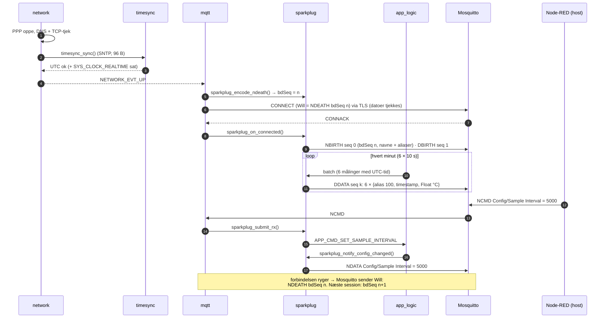

# Del 7 – Sparkplug B og tidssynkronisering

Enheden er nu en rigtig **Sparkplug B 3.0 edge node**:

- **Tid:** UTC hentes med **SNTP**, før netværket meldes oppe. Den samme tid bruges til tidsstempler
  og til Mbed TLS' **tjek af certifikaternes gyldighedsdatoer**, som nu er slået til.
- **Beskeder:** NBIRTH, DBIRTH, DDATA (én pr. batch, ét UTC-tidsstempel pr. måling), NDATA
  (konfiguration og status), NDEATH (MQTT Last Will og før reboot). Kodningen sker med
  **nanopb** ud fra Eclipse Tahus `sparkplug_b.proto`.
- **Kommandoer (NCMD):** Rebirth, Reboot, Sample Interval og Batch Size. Node-RED har fået knapper,
  der sender dem.
- Selvtest-beskeden fra Del 6 er fjernet.

---

## 1. Overblik



---

## 2. Tidssynkronisering (`timesync.c`)

| Hvad | Hvordan | Hvorfor |
|---|---|---|
| Kilde | SNTP: `pool.ntp.org`, ellers `time.cloudflare.com` (`APP_TIMESYNC_SERVER1/2`) | Boardet har intet batteribackup-ur. SNTP er én UDP-forespørgsel på 48 B + svar på 48 B |
| Hvornår | **Før `NETWORK_EVT_UP`**, og igen hver 24. time (`APP_TIMESYNC_RESYNC_H`) i `network`-tråden | Uden UTC kan certifikatdatoer ikke tjekkes, og målinger kan ikke tidsstemples. Den første synkronisering er derfor en betingelse for at melde netværket oppe. Mislykkes den, går `network` i backoff og prøver igen |
| Beregning | `utc = server-sendetid + estimeret envejsforsinkelse`. Gemmes som offset til `k_uptime_get()` under en spinlock | Læsning er billig og trådsikker. Uret driver højst nogle sekunder i døgnet |
| Mbed TLS | `sys_clock_settime(SYS_CLOCK_REALTIME)`. Mbed TLS læser `time()` | Så kan `CONFIG_MBEDTLS_HAVE_TIME_DATE=y` slås til (det var slået fra i Del 6) |
| Plausibilitet | Svar før 2026-01-01 afvises | Et forkert eller forfalsket SNTP-svar må ikke få udløbne certifikater til at se gyldige ud eller give 1970-tidsstempler |
| Tilbagedatering | Målinger fra før den første synkronisering omregnes (`timesync_uptime_to_utc_ms`), når de sendes | Ingen måling sendes uden UTC-tid |

---

## 3. Sparkplug B-beskederne (`sparkplug.c`)

Topics: `spBv1.0/ProjektA/<type>/esp32c6-14c19fe0ab24[/sensors]`.

### 3.1 Metrics og aliaser

| Metric | Alias | Datatype | Besked | Betydning |
|---|---|---|---|---|
| `bdSeq` | – | Int64 | NBIRTH, NDEATH | Fødsels-/dødsnummer 0–255, ét pr. MQTT-session |
| `Node Control/Rebirth` | 1 | Boolean | NBIRTH, **NCMD** | `true` → ny NBIRTH + DBIRTH |
| `Node Control/Reboot` | 2 | Boolean | NBIRTH, **NCMD** | `true` → NDEATH, derefter reboot efter 2 s |
| `Properties/FW Version` | 3 | String | NBIRTH | fx `0.7.0-del07` |
| `Properties/Reset Cause` | 4 | String | NBIRTH | fx `power-on`, `brownout`, `watchdog` |
| `Config/Sample Interval` | 5 | Int64 (ms) | NBIRTH, NDATA, **NCMD** | 5000–15000 |
| `Config/Batch Size` | 6 | Int64 | NBIRTH, NDATA, **NCMD** | 1–12 |
| `Status/RSSI` | 7 | Int32 (dBm) | NBIRTH, NDATA | Signalstyrke |
| `Status/Uptime` | 8 | Int64 (s) | NBIRTH, NDATA | |
| `Status/MQTT Connects` | 9 | Int64 | NBIRTH, NDATA | Antal forbindelser siden boot. Mange betyder ustabil forbindelse |
| `Properties/Security` | 10 | String | NBIRTH | Fra Del 8: eFuse-status, fx `sb=0 fe=0 jtag=1 dl=1 rng=sar` (se `08-sikkerhed.md`) |
| `Temperature/Die` | 100 | Float (°C) | DBIRTH, DDATA | Kanal 0. Modbus-kanaler får alias 100 + kanal |

### 3.2 Regler, som koden følger (Sparkplug B 3.0)

- **bdSeq:** `sparkplug_encode_ndeath()` kaldes af `mqtt` før hver CONNECT. Den tæller bdSeq op
  og laver Will-beskeden. NBIRTH i samme session har **samme** bdSeq. Rebirth uden ny forbindelse
  genbruger den.
- **seq:** NBIRTH = 0, og hver efterfølgende besked (DBIRTH, DDATA, NDATA) får +1 (efter 255 kommer 0).
  NDEATH har ingen seq.
- **Ingen DATA før BIRTH:** batches bliver liggende i `batch_q` (4 batches = 4 minutter), mens
  MQTT er nede, og sendes først efter næste NBIRTH/DBIRTH. Beskeder, der allerede lå i MQTT-køen,
  da forbindelsen røg, hører til den gamle session og kasseres ved næste forbindelse (loggen siger
  hvor mange).
- **Navne kun i BIRTH:** DATA-beskeder bruger kun alias. Det sparer ca. 17 B pr. værdi.
- **Datatype i alle metrics:** Eclipse Tahus dekoder (som Node-RED bruger) returnerer `null`, hvis
  datatypen mangler (`getValue()` i `sparkplugbpayload.ts`). Det koster 2 B pr. værdi.
- **Dårlig kvalitet → `is_null = true`:** en BAD- eller STALE-måling sendes som en eksplicit
  tom værdi, ikke som et falsk tal.
- **Afbrudt forbindelse:** Mosquitto sender den gamle sessions Will (NDEATH, bdSeq n), når den
  opdager tabet. Det sker senest efter 1,5 × keep-alive, men i praksis med det samme, når enheden
  forbinder igen med samme client id ("already connected, closing old connection"). Det er
  verificeret lokalt med Mosquitto 2.0.18. Derefter følger NBIRTH med bdSeq n+1.
- **Planlagt reboot:** enheden sender selv NDEATH, før den genstarter. Ellers sender brokeren først
  Will-beskeden efter 1,5 × keep-alive (30 min).

### 3.3 Kodning med nanopb

- `app/proto/sparkplug_b.proto` er Tahus fil uændret. `sparkplug_b.options` gør det felt, der
  gentages for metrics, til en **callback**. Så bygges én `Metric` (148 B) ad gangen på stakken
  i stedet for et array med 48 metrics (ca. 7 kB).
- DataSet, Template, PropertySet, MetaData og bytes ignoreres. Firmwaren bruger dem ikke.
- Den genererede kode (`app/src/proto/sparkplug_b.pb.c/.h`) er **committet**. Et normalt build
  kræver derfor hverken `protoc` eller Python-pakker på Windows. Kun hvis `.proto`/`.options`
  ændres, køres `python scripts\gen_sparkplug_pb.py` (se `app/proto/README.md`).
- Er en DDATA større end 512 B (fx 12 målinger × 4 kanaler), deles den automatisk i flere
  beskeder. Med standardindstillingen (6 × 1 kanal) er den på ca. 117 B.

---

## 4. Designvalg og hvorfor

| Valg | Hvorfor |
|---|---|
| **Float i °C** i stedet for Int32 i m°C | Node-RED, Ignition og andre Sparkplug-værktøjer viser værdien direkte. En skalering skulle ellers kendes alle steder. Koster det samme (Float = 4 B fast, Int32 m°C = 3–4 B varint) |
| **Int64 for konfigurationsværdier** (ikke UInt32) | Tahu-dekoderen læser UInt32 fra `long_value`, mens andre implementeringer bruger `int_value`. Int64 er entydigt |
| **SNTP er en betingelse for "netværk oppe"** | Både TLS-datotjekket og tidsstemplerne kræver det. Et link uden tid behandles som et link uden forbindelse |
| **Aliaser fra 100 for device-metrics** | Kolliderer aldrig med node-aliaserne 1–9, heller ikke når der kommer flere Modbus-kanaler |
| **Status-NDATA hvert 15. minut** (ca. 60 B) | Giver signalstyrke og forbindelsesstabilitet i dataloggen, så strøm/data kan vurderes i Del 9 |
| **Commands går via `app_logic`** (konfiguration) eller udføres i `sparkplug` (rebirth/reboot) | Konfigurationen ejes af `app_logic` (mutex). `sparkplug` ejer sessionen. Hver tråd ændrer kun sine egne data |
| **NCMD kun fra brugeren `nodered`** | Brokerens ACL tillader ikke, at en enhed publicerer NCMD (testet i Del 5). Det er den autorisation, IEC 62443-4-2 CR 2.1 kræver af kommandoer |

---

## 5. Node-RED

`cloud/node-red/flows.json` har fået en sektion **"Commands to the edge node"**:

```
[Rebirth] [Sample interval 5/10/15 s] [Batch size 1/6] [Reboot device]
      └──────────────► [Sparkplug B encode NCMD] ──► [mqtt out NCMD] + debug
```

- Kommandoen sendes til alle edge nodes, der er online. Dekoderen husker dem fra NBIRTH og NDEATH.
- Den nye værdi bekræftes af enheden med en NDATA, som ses i debug-panelet og datafilen.
- Dashboardet viser nu `Temperature/Die` og `Status/RSSI`. Konfigurations- og kontrolmetrics
  logges kun. Knapper på selve dashboardet kommer i Del 10.

**Importér flowet igen:** Menu → Import → `flows.json` → **Replace** de eksisterende noder →
Deploy. Broker-passwordet beholdes, fordi broker-noden har samme id.

---

## 6. Test

### 6.1 På hardware (Windows 11)

Forudsætninger: Del 5 (server) og Del 6 (`app\secrets.conf`).

```powershell
cd C:\zp\zephyr_a
git fetch origin
git checkout del-07-sparkplug
.\scripts\build.ps1
.\scripts\flash.ps1 -Port COM3
.\scripts\monitor.ps1 -Port COM3      # afslut med Ctrl+T og derefter X
```

**Forventet log** (tider og værdier varierer):

```
<inf> timesync: Time synced via pool.ntp.org: 2026-11-12T08:15:02.481Z (+/- 210 ms)
<inf> network: Network: ppp-up -> connected
<inf> app_mqtt: Last Will: spBv1.0/ProjektA/NDEATH/esp32c6-14c19fe0ab24 (20 B)
<inf> app_mqtt: TLS established in 2400 ms: TLS 1.3 ... server certificate verified for zephyra.vps.webdock.cloud
<inf> app_mqtt: MQTT connected (CONNACK after 280 ms), keep-alive 1200 s
<inf> sparkplug: NBIRTH seq 0: 10 metric(s), 374 B
<inf> sparkplug: DBIRTH seq 1: 1 metric(s), 44 B
<inf> app_logic: Batch #1 ready: 6 measurement(s), up 10010..60010 ms
<inf> sparkplug: DDATA seq 2: 6 metric(s), 117 B
```

På serveren:

```bash
read -rsp "nodered password: " P; echo
mosquitto_sub -h 127.0.0.1 -p 1883 -u nodered -P "$P" -t 'spBv1.0/#' -v -F '%t %l bytes'
tail -n 3 ~/zephyr_a-data/sparkplug-$(date +%F).jsonl     # dekodede beskeder med UTC-tid
```

**Kommandoer:** importér `flows.json` igen (§5), klik på **Sample interval 5 s**, og check:

- Enheden logger `NCMD: Config/Sample Interval = 5000 ms` og `Sample interval set to 5000 ms`.
- Debug-panelet viser en NDATA med `Config/Sample Interval = 5000`.
- Målingerne kommer nu hvert 5. sekund.

Klik derefter **Sample interval 10 s** for at gå tilbage.

### 6.2 Automatisk test på `native_sim` (lavet i udviklingsmiljøet)

`app/tests/mqtt_tls/run.sh` (fra Del 6) tester nu hele kæden:

- De rigtige moduler `app_logic` → `sparkplug` → `mqtt_client` + `timesync` kører mod Mosquitto
  2.0.18 med repoets ACL og en lokal SNTP-server (`sntp_server.py`).
- `check_e2e.py` kontrollerer sessionen med en **uafhængig protobuf-dekoder** (`spb.py`, ingen
  nanopb-kode) efter Sparkplug B 3.0-reglerne og Tahus dekodningsregler.
- Beskederne er desuden parset med Python-kode genereret af `protoc` ud fra Tahus officielle
  `sparkplug_b.proto` uden fejl.

Resultat: **68 bestået, 0 fejlet** (+ den kendte TLS 1.2/RSA-begrænsning fra Del 6):

| # | Scenarie | Kontrolleret |
|---|---|---|
| 1 | Hel session | SNTP før forbindelse. NBIRTH seq 0 med bdSeq og alle 10 metrics (navn, datatype, timestamp, unikke aliaser). `Status/RSSI = -71` dekodes korrekt som Int32. DBIRTH seq 1 med alias 100 Float. seq +1 inden for hver session. DDATA kun med alias, Float og UTC-tidsstempler, der stiger. BAD-måling som `is_null`. NCMD Sample Interval (navn) og Batch Size (alias 6) anvendes af `app_logic` og bekræftes med NDATA. Ukendt metric logges. DCMD ignoreres. Status-NDATA. Rebirth med samme bdSeq. Link-tab: Will-NDEATH med sessionens bdSeq og ny NBIRTH med bdSeq + 1. Ingen ACL-afvisninger. Ingen fejl i loggen |
| 1b | NCMD Reboot | NDEATH sendes, før processen genstarter |
| 2–8 | TLS fra Del 6 | ECDSA/RSA, TLS 1.2, forkert CA/navn, plain, forkert password, broker-genstart: alle som før |
| 9 | **Udløbet** og **ikke endnu gyldigt** servercertifikat | Begge afvises (`-0x2700`). Det viser, at datotjekket virker |
| 10 | SNTP svarer med en tid i 1994 | `implausible time … rejected`. Netværket meldes ikke oppe, og der oprettes ingen MQTT-session |

Node-RED-funktionerne har unit-tests: `node cloud/node-red/test/decode.test.js` og
`node cloud/node-red/test/ncmd.test.js`.

---

## 7. Målinger

| Hvad | Del 6 | Del 7 | Kommentar |
|---|---|---|---|
| Kode (`.text` + `.rodata`) | 288 kB | **307 kB** | +19 kB: nanopb, Sparkplug, SNTP, X.509-datoer |
| FLASH i build-output | 365 kB (8,7 %) | 433 kB (10,3 %) | Heraf +49 kB ren justering (`.flash.align_rom`): ESP32-C6 mapper flash i MMU-sider på 64 kB |
| RAM (`sram0_0_seg`) | 183 kB (37,4 %) | **193 kB (39,4 %)** | +4 kB sparkplug-stack, +2,7 kB batch-kø, +0,7 kB RX-kø |
| NBIRTH | | 370 B (test-id) / ca. 374 B | Navne, aliaser og timestamps. Plads til 512 B |
| DBIRTH | | 41–44 B | |
| DDATA | | **9 B + 18 B pr. måling** (6 målinger ≈ 117 B) | alias 2 + timestamp 7 + datatype 2 + Float 5 + rammer 2 |
| NDATA status | | 58 B hvert 15. min | |
| Data pr. minut (skøn) | | ca. 280 B | DDATA 117 + topic 51 + MQTT 4 + TLS 22 + TCP/IP/PPP ca. 90 inkl. ACK. **Ca. 0,4 MB/døgn**, som skønnet i Del 2. Måles med Onomondo i Del 9 |

---

## 8. Fund

- **`CONFIG_SNTP_UNCERTAINTY` i Zephyr 4.4.0** måler mod `SYS_CLOCK_REALTIME` (ikke uptime), selv
  om feltet hedder `uptime_us`. Den returnerer `fraction` i **mikrosekunder** i stedet for
  1/2³² s. Bruges derfor ikke. `timesync` regner selv med server-tid + envejsforsinkelse.
- **Tahu kræver datatype i hver metric.** Uden den bliver værdien `null` i Node-RED (se 3.2).
- **Tahu læser UInt32 fra `long_value`**, men Int32 fra `int_value` med fortegn. Derfor bruges
  Int32 for RSSI (negativ) og Int64 for konfiguration.
- `gmtime_r()` findes ikke i alle C-biblioteker (fejlede på native_sim). Datoformatet i loggen
  beregnes derfor uden libc.

## 9. Kendte begrænsninger

| Begrænsning | Konsekvens | Videre |
|---|---|---|
| **bdSeq starter ved 0 efter reboot** (ikke gemt i flash) | En host kan ikke skelne en ny session efter reboot fra den første. NBIRTH viser `Properties/Reset Cause` | Del 10 (NVS), hvis det ønskes |
| Primary host / STATE-topic bruges ikke | Enheden publicerer, uanset om Node-RED kører. Data går ikke tabt, fordi Node-RED læser dem fra brokeren og logger dem | Accepteret (én host) |
| Batches i MQTT-køen, da forbindelsen røg, kasseres | Højst én DDATA (1 minuts data) pr. afbrydelse | Del 9 kan måle, hvor ofte det sker (`Status/MQTT Connects`) |
| `batch_q` holder 4 minutter | Længere udfald → batches droppes (`Batch #n dropped`) | Del 9 (større buffer, evt. flash) |
| Kvalitet kun som `is_null` | BAD og STALE kan ikke skelnes i Node-RED (begge ses i enhedens log) | Del 10 (Sparkplug quality-property) |
| NCMD er kun beskyttet af brokerens login + ACL | Den, der kender `nodered`-passwordet, kan genstarte enheden | Dokumenteres i Del 8 (IEC 62443-4-2 CR 2.1) |

## 10. Fejlsøgning

| Log | Årsag / løsning |
|---|---|
| `SNTP pool.ntp.org failed (-110)` + `No UTC time …` | UDP 123 er blokeret, eller DNS virker ikke. Prøv `CONFIG_APP_TIMESYNC_SERVER1="time.cloudflare.com"`. Netværket prøver igen med backoff |
| `TLS handshake error: -0x2700` efter Del 7 | Ud over Del 6's årsager: forkert tid. Tjek `Time synced …` i loggen |
| `NBIRTH not sent (-12)` | Ingen ledig payload-buffer. MQTT-køen er fuld (forbindelsen hænger). Løses ved genforbindelse |
| `Batch #n dropped - sparkplug queue full` | MQTT har været nede i over 4 minutter |
| Node-RED viser `alias:100` i stedet for navn | Node-RED er startet efter enhedens NBIRTH. Klik **Rebirth** |
| `NCMD: unsupported metric …` | Forkert navn eller type i kommandoen. Se tabellen i 3.1 |

## 11. Definition of done

- [ ] Bygger uden warnings. Loggen viser `Time synced via …` **før** `MQTT connected`.
- [ ] `NBIRTH seq 0`, `DBIRTH seq 1` og derefter én `DDATA` pr. minut med 6 metrics.
- [ ] Datafilen på serveren har 6 målinger pr. DDATA med hvert sit UTC-tidsstempel (10 s imellem).
- [ ] Dashboardet viser `Temperature/Die` i °C og `Status/RSSI`.
- [ ] Knappen **Sample interval 5 s** ændrer intervallet, og NDATA bekræfter det. **10 s** sætter det tilbage.
- [ ] Knappen **Rebirth** giver en ny NBIRTH og DBIRTH med samme bdSeq.
- [ ] Hiv antennen ud i over 30 s, og sæt den i igen. Når enheden forbinder igen, viser Node-RED
      **NDEATH** (den gamle sessions bdSeq) efterfulgt af **NBIRTH med bdSeq + 1**.
- [ ] **Reboot device** giver NDEATH, ny boot og `Reset Cause = software` i NBIRTH.
