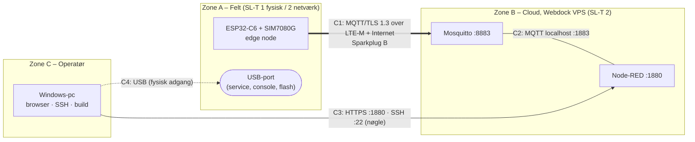

# Del 8 – Sikkerhed (IEC 62443-4-2 og Cyber Resilience Act)

Denne del gør to ting:

1. **Redegør** for sikkerheden i hele systemet: zoner og conduits, trusselsmodel,
   security level og en kortlægning til **IEC 62443-4-2** og **CRA (forordning (EU) 2024/2847)
   bilag I** med dokumentation for hvert punkt.
2. **Implementerer** de sikkerhedskrav, der manglede efter Del 1–7:

| # | Nyt i Del 8 | Krav |
|---|---|---|
| 1 | **Signeret firmware:** MCUboot verificerer en ECDSA P-256-signatur ved **hver boot**. Egen nøgle uden for git. Nedgradering spærres for opdateringer | CR 3.4, EDR 3.14 · CRA I(2)(f) |
| 2 | **Ægte tilfældige tal:** SAR ADC-støjkilden i RNG'en holdes tændt, så TLS-nøgler (ECDHE) ikke kun bygger på den sekundære entropikilde | CR 4.3 · CRA I(2)(e) |
| 3 | **Sikkerhedsstatus fra eFuses** (secure boot, flash encryption, JTAG, download mode) logges ved boot og sendes i NBIRTH (`Properties/Security`) | CR 7.8, EDR 2.13 · CRA I(2)(b), I(2)(l) |
| 4 | **Sikkerhedshændelser logges** med præfikset `SECURITY:`. Test sikrer, at password og nøgler aldrig logges | CR 2.8, CR 3.7 · CRA I(2)(l) |
| 5 | **Beskyttelse mod reboot-loop:** NCMD Reboot afvises de første 60 s efter boot | CR 7.1 · CRA I(2)(h) |
| 6 | **Stack canaries** (`-fstack-protector`) | CRA I(2)(k) |
| 7 | **SBOM** (SPDX 2.3) med `.\scripts\build.ps1 -Sbom` og **release-variant** uden debug-funktioner (`-Release`) | CRA bilag I del II(1), I(2)(j) |
| 8 | **SECURITY.md:** politik for rapportering af sårbarheder | CRA bilag I del II(5), (6) |

> **Bemærk om nummereringen:** kravmatrixen bruger betegnelsen "CRA bilag I 1.c (fortrolighed)
> og 1.d (integritet)". I den vedtagne forordning (EU) 2024/2847 står de som
> **bilag I, del I, punkt (2)(e) fortrolighed** og **(2)(f) integritet**. Dokumentet bruger den
> vedtagne nummerering.

---

## 1. System, zoner og conduits

Tankegangen følger IEC 62443-3-2 (zoner og conduits).



| Conduit | Beskyttelse | Del |
|---|---|---|
| **C1** enhed ↔ broker (utroværdigt net) | TLS 1.3 (AES-GCM, ECDHE P-256). Serveren autentificeres med certifikat mod 4 egne rodcertifikater, værtsnavn og datoer. Klienten autentificeres med password pr. enhed. ACL: kun egne topics. NCMD kun fra `nodered` | 5, 6, 7 |
| **C2** Node-RED ↔ Mosquitto | Kun 127.0.0.1, login `nodered` | 5 |
| **C3** operatør ↔ server | HTTPS med login (bcrypt), SSH kun med nøgle, UFW, FTP lukket | 5 |
| **C4** USB-service | Kun log-output (ingen shell i standard/release). Flash kræver fysisk adgang. Signeret firmware forhindrer fremmede images. eFuse-hærdning beskrevet i §7 | 8 |

---

## 2. Trusselsmodel (STRIDE, kort)

| Trussel | Eksempel | Modforanstaltning | Rest-risiko |
|---|---|---|---|
| **S**poofing af broker | Falsk server/DNS på mobilnettet (MITM) | TLS: kæde mod egne ISRG-rødder + værtsnavn + datoer (testet: forkert CA, forkert navn, udløbet → afvist) | Fejludstedt Let's Encrypt-certifikat til domænet (lav) |
| **S**poofing af enhed | Andre publicerer data i enhedens navn | Password pr. enhed (≥ 12 tegn, hashet på serveren), ACL `pattern … %u` | Password kan læses fra flash ved fysisk adgang (§7) |
| **T**ampering med data/kommandoer | Ændring under transport | TLS AEAD (integritet pr. record), MQTT over TLS | – |
| **T**ampering med firmware | Fremmed eller ændret image flashes via USB | **MCUboot ECDSA P-256** ved hver boot (Del 8) | MCUboot selv er ikke verificeret af ROM (kræver eFuse secure boot, §7) |
| **R**epudiation | Hvem sendte en NCMD? | Mosquitto logger forbindelser (bruger, IP). NCMD kun fra brugeren `nodered` | Node-RED logger ikke, hvilken operatør der klikkede (én konto) |
| **I**nformation disclosure | Aflytning af data | TLS 1.3. Ingen hemmeligheder i git eller logs (testet) | Data på serveren er ukrypterede på disken (VPS) |
| **D**enial of service | Reboot-loop via NCMD, gentagne forbindelser | Reboot-spærring 60 s, backoff med jitter, permanente fejl → 600 s, faste køer | Jamming af mobilnettet (uden for scope) |
| **E**levation of privilege | Enhed sender kommandoer til andre enheder | ACL: enheder må kun læse egne NCMD/DCMD og skrive egne topics (testet i Del 5) | – |
| **Tid** (SNTP er uautentificeret) | Falsk tid får et udløbet certifikat til at se gyldigt ud | Svar før 2026 afvises. TLS kræver stadig gyldig kæde + navn | En angriber med både MITM på NTP og en gammel kompromitteret nøgle (meget lav). NTS findes ikke i Zephyr 4.4 |

---

## 3. Security level (SL)

IEC 62443 definerer SL 1 (beskyttelse mod tilfældige fejl/utilsigtet misbrug) til SL 4 (angreb
med avancerede midler og store ressourcer).

| Zone/conduit | **SL-T** (mål) | Begrundelse | **SL-C** (opnået) |
|---|---|---|---|
| C1 netværk enhed ↔ broker | **2** | Data går over internettet og et offentligt mobilnet. SL 2 dækker bevidste angreb med enkle midler (fx MITM-værktøjer, credential stuffing) | **2** for FR1, FR3, FR4 (autentifikation, integritet, fortrolighed) |
| Zone A fysisk (enheden) | **1** | Monteres hos Micro Technic i et adgangskontrolleret område. Et udviklingsboard kan ikke modstå fysisk angreb | **1**. Signeret firmware hæver integriteten, men flash encryption/JTAG kræver eFuse (§7) |
| Zone B cloud | **2** | Offentligt tilgængelig server | **2** (UFW, nøgle-SSH, TLS, ACL, opdateringer). CR 1.11 (lås efter fejlede logins) mangler (fail2ban) |

**Konklusion:** SL 2 for kommunikationen, som er projektets fokus (fortrolighed og integritet),
og SL 1 for den fysiske enhed. SL 2 fysisk ville kræve flash encryption, ROM secure boot og
lukket JTAG, og det er irreversible eFuse-ændringer (§7).

---

## 4. IEC 62443-4-2: krav og dokumentation

Nummerering efter IEC 62443-4-2:2019 (CR = component requirement, EDR = embedded device
requirement). ✅ implementeret og testet · 🟡 delvist · ⬜ mangler · ➖ ikke relevant.

| Krav | Hvordan | Dokumentation / test | Status |
|---|---|---|---|
| **CR 1.1** Identifikation og autentifikation af personer | Ingen brugerinterface på enheden. Server: SSH kun med nøgle, Node-RED-login (bcrypt) | `05-cloud.md` §3, `90-verify.sh` | ✅ |
| **CR 1.2** Identifikation og autentifikation af software/enheder | Enhed → broker: unikt brugernavn (= enheds-id) + password. Broker → enhed: X.509-certifikat | native_sim: forkert password → `CONNACK 5`. Forkert CA/navn → afvist | ✅ |
| **CR 1.5** Håndtering af authenticators | Ingen standardpassword: firmwaren starter ikke MQTT uden `secrets.conf`. Hashet på serveren. Aldrig i git | `secrets.conf.example`, `.gitignore`, Del 6 negativ test | ✅ |
| **CR 1.7** Styrke af password-autentifikation | Min. 12 tegn ved oprettelse (`60-add-device.sh`) | `common.sh` `read_password` | ✅ |
| **CR 1.8/1.9** PKI og offentlig-nøgle-autentifikation | Let's Encrypt (auto-fornyelse). Kæde, signaturer, værtsnavn og **datoer** tjekkes. Kun 4 rødder | native_sim scenarie 4, 5, 9 | ✅ |
| **CR 1.11** Fejlede loginforsøg | Mosquitto har ingen lås. Enheden selv: permanente fejl → 600 s backoff | – | 🟡 (fail2ban, Del 10) |
| **CR 2.1** Autorisation | Mosquitto-ACL: enheder kun egne topics. NCMD kun fra `nodered` | Del 5 ACL-test | ✅ |
| **CR 2.8** Sporbare hændelser | Enhed: `SECURITY:`-logs (TLS-fejl, CONNACK-afvisning, afviste/ukendte kommandoer, reboot, urimelig tid, sikkerhedsstatus). Broker: connect/disconnect | native_sim scenarie 11 | ✅ |
| **CR 2.9/3.9** Lagring og beskyttelse af auditlog | Enhedens log går kun ud over USB (ingen lagring). Brokerens log i journald | – | 🟡 |
| **CR 2.11** Tidsstempler | UTC fra SNTP i alle beskeder og logs på serveren | Del 7 | ✅ |
| **CR 3.1** Kommunikationsintegritet | TLS 1.3 AEAD (AES-GCM) | Del 6 | ✅ |
| **CR 3.4** Software- og informationsintegritet | **MCUboot ECDSA P-256**, `BOOT_VALIDATE_SLOT0=y` (hver boot), egen nøgle. Build-scriptet verificerer signaturen | `imgtool verify`. Ændret byte → "invalid hash". Hardwaretest §6 | ✅ (hardware mangler) |
| **CR 3.5** Inputvalidering | NCMD: kun kendte metrics, typer og intervaller (5–15 s, 1–12). Protobuf med længdegrænser (256 B RX). DCMD afvist | native_sim scenarie 1 | ✅ |
| **CR 3.6** Deterministisk output | Ingen aktuatorer. Ved fejl fortsætter målingerne. Dårlige værdier sendes som `null` | Del 3 | ➖ / ✅ |
| **CR 3.7** Fejlhåndtering | Fejl logges uden hemmeligheder | native_sim scenarie 11 | ✅ |
| **CR 3.8** Sessionsintegritet | TLS. Sparkplug bdSeq/seq. Gamle sessioners beskeder kasseres | Del 7 | ✅ |
| **EDR 2.13** Fysiske debug-/testinterfaces | Ingen shell i standard/release. **JTAG og download mode er åbne** (dev-board). Status rapporteres | Boot-log `SECURITY: development device …`, NBIRTH | 🟡 (§7) |
| **EDR 3.10** Opdateringer | MCUboot med downgrade-spærring. OTA over netværket er nice to have | Del 10 | 🟡 |
| **EDR 3.11** Fysisk tamper-beskyttelse | Ikke på et udviklingsboard | – | ⬜ |
| **EDR 3.12** Leverandørens roots of trust | MCUboot-signeringsnøgle (offentlig del i bootloaderen). CA-rødder i firmware (`app/ca/`) | `certs/README.md`, `app/ca/README.md` | ✅ |
| **EDR 3.14** Boot-integritet | MCUboot verificerer appen ved hver boot. ROM → MCUboot (secure boot v2) kræver eFuse | §7 | 🟡 |
| **CR 4.1** Fortrolighed | I transit: TLS 1.3 ✅. I hvile: password ukrypteret i flash | §7 (flash encryption) | 🟡 |
| **CR 4.3** Kryptografi | TLS 1.3 / AES-128/256-GCM, ECDHE P-256, ECDSA P-256/384, RSA-PSS, SHA-256/384 (Mbed TLS 4.1 PSA). **Hardware-RNG med SAR-entropi** | Del 6. Boot-log `RNG entropy source: SAR ADC …` | ✅ |
| **CR 5.1** Netværkssegmentering | UFW. 1883 kun localhost. FTP lukket | `90-verify.sh` | ✅ |
| **CR 6.2** Kontinuerlig overvågning | NDEATH (Will) ved tab, `Status/*` hvert 15. min, `Status/MQTT Connects` | Del 7 | 🟡 |
| **CR 7.1** DoS-beskyttelse | Reboot-spærring, backoff med jitter, faste køer, permanente fejl → maks. backoff | native_sim scenarie 1b | ✅ |
| **CR 7.2** Ressourcestyring | Statisk allokering, afgrænsede køer, målt heap og stack | Del 6/7 | ✅ |
| **CR 7.4** Gendannelse | Genforbindelse automatisk. Watchdog mangler | Del 9/10 | 🟡 |
| **CR 7.7** Mindst mulig funktionalitet | Ingen shell. Release-variant. Kun nødvendige porte. Ingen Wi-Fi/BT | `overlay-release.conf`, `20-firewall.sh` | ✅ |
| **CR 7.8** Komponentinventar | `Properties/FW Version` + `Properties/Security` i NBIRTH. SBOM (SPDX) | `-Sbom` | ✅ |

**A-09 "mindst 2 krav implementeret":** CR 3.1/4.1 (TLS), CR 1.2/1.9 (gensidig
autentifikation), CR 3.4 (signeret firmware), CR 2.1 (ACL), CR 3.5 (inputvalidering) og CR 7.1
(DoS) er implementeret og testet.

---

## 5. CRA, forordning (EU) 2024/2847, bilag I

### 5.1 Del I – egenskaber ved produktet

| Punkt | Krav (kort) | Projekt A | Status |
|---|---|---|---|
| (2)(a) | Ingen kendte udnyttelige sårbarheder | Nyeste versioner: Zephyr 4.4.0, Mbed TLS 4.1.0, TF-PSA-Crypto 1.1.0, nanopb 1.0.0. SBOM med CPE, så de kan matches mod CVE-databaser | 🟡 (processen er §5.2) |
| (2)(b) | Secure by default | Ingen standardpassword (MQTT starter ikke uden). TLS altid til. Ingen shell. Development-status advares i log og NBIRTH | ✅ |
| (2)(c) | Sikkerhedsopdateringer | MCUboot: signerede opdateringer, downgrade-spærring. Server: unattended-upgrades | 🟡 (OTA: Del 10) |
| (2)(d) | Beskyttelse mod uautoriseret adgang + rapportering | Autentifikation begge veje, ACL, `SECURITY:`-logs, Mosquitto-log | ✅ |
| **(2)(e)** | **Fortrolighed** | **TLS 1.3 for alle data. Ingen hemmeligheder i git eller logs. Ægte RNG til nøgleudveksling.** Flash encryption beskrevet (§7) | ✅ i transit · 🟡 i hvile |
| **(2)(f)** | **Integritet** af data, kommandoer, programmer og konfiguration | **TLS AEAD. Signeret firmware verificeret ved hver boot. Kommandoer kun fra autoriseret bruger og valideret. Sparkplug seq afslører tabte beskeder** | ✅ |
| (2)(g) | Dataminimering | Kun måleværdier, signal og status. Ingen persondata | ✅ |
| (2)(h) | Tilgængelighed, DoS | Reboot-spærring, backoff, bufferet data (4 min), automatisk genforbindelse | ✅ (watchdog i Del 9/10) |
| (2)(i) | Begræns påvirkning af andre | Backoff med jitter (ingen "thundering herd"), ca. 0,4 MB/døgn | ✅ |
| (2)(j) | Begrænset angrebsflade | Ingen indgående porte på enheden (kun udgående MQTT/SNTP/DNS), ingen shell, ingen radio | ✅ |
| (2)(k) | Exploit-mitigering | Stack canaries, stack sentinel, statisk allokering, TLS-bibliotek med PSA | ✅ |
| (2)(l) | Logning og overvågning | `SECURITY:`-hændelser, sikkerhedsstatus i NBIRTH, NDEATH/Status i Node-RED | ✅ |
| (2)(m) | Sikker sletning | Ingen lagrede data på enheden ud over firmware og password. Sletning sker med `esptool erase-flash` | 🟡 (dokumenteret) |

### 5.2 Del II – håndtering af sårbarheder (producentens processer)

| Punkt | Projekt A |
|---|---|
| (1) SBOM | `.\scripts\build.ps1 -Sbom` → `build\spdx\*.spdx` (SPDX 2.3, med CPE/purl for Zephyr, Mbed TLS, TF-PSA-Crypto, nanopb) |
| (2) Rettelser uden forsinkelse | Afhængighederne er låst i `west.yml`, så en opdatering er en ændring i én fil + nyt signeret build |
| (3) Test og review | `app/tests/mqtt_tls/run.sh` (negative sikkerhedstests), unit-tests, ShellCheck, review pr. del (PR) |
| (5)/(6) Coordinated vulnerability disclosure | [`SECURITY.md`](../SECURITY.md): rapportér via GitHubs private "Report a vulnerability" |
| (7)/(8) Sikker distribution af opdateringer | Signerede images. OTA er Del 10 |

---

## 6. Test

### 6.1 På hardware (Windows 11)

```powershell
cd C:\zp\zephyr_a
git fetch origin; git checkout del-08-sikkerhed

# 1. Opret signeringsnøglen (én gang) og byg + flash bootloader og app
.\scripts\new-signing-key.ps1        # certs\mcuboot-signing-key.pem (hemmelig, tag backup)
.\scripts\build.ps1 -Pristine        # skal skrive "Signature verified with certs\mcuboot-signing-key.pem"
.\scripts\flash.ps1 -Port COM3
.\scripts\monitor.ps1 -Port COM3
```

**Forventet i loggen:**

```
<wrn> security: SECURITY: development device - secure boot OFF, flash encryption OFF, JTAG OPEN, download mode OPEN (docs/08-sikkerhed.md section 7)
<inf> security: RNG entropy source: SAR ADC noise + RC_FAST clock (true random)
...
<inf> sparkplug: NBIRTH seq 0: 11 metric(s), ~425 B     (Properties/Security = "sb=0 fe=0 jtag=1 dl=1 rng=sar")
```

**2. Negativ test: et image med forkert signatur må ikke starte.**

```powershell
Rename-Item certs\mcuboot-signing-key.pem mcuboot-signing-key.pem.bak
.\scripts\build.ps1 -Pristine        # advarer: MCUboots offentlige udviklingsnøgle
.\scripts\flash.ps1 -Port COM3 -AppOnly   # kun appen. MCUboot har stadig DIN nøgle
.\scripts\monitor.ps1 -Port COM3     # forventet: INGEN app-log (ingen "boot"-linje). Tryk RESET for at se igen
Rename-Item certs\mcuboot-signing-key.pem.bak mcuboot-signing-key.pem
.\scripts\build.ps1 -Pristine; .\scripts\flash.ps1 -Port COM3   # alt virker igen
```

**3. eFuse-status læses uden at ændre noget** (sammenlign med loggen):

```powershell
python -m espefuse --port COM3 --chip esp32c6 summary | Select-String "SECURE_BOOT_EN|SPI_BOOT_CRYPT_CNT|DIS_PAD_JTAG|DIS_USB_JTAG|SOFT_DIS_JTAG|DIS_DOWNLOAD_MODE"
```

**4. Reboot-spærring:** klik **Reboot device** i Node-RED inden for 60 s efter boot →
`SECURITY: NCMD Reboot rejected`. Klik efter 60 s → reboot.

**5. SBOM:** `.\scripts\build.ps1 -Sbom` → `build\spdx\modules-deps.spdx` indeholder
`mbed_tls 4.1.0` med CPE.

### 6.2 I udviklingsmiljøet

| Test | Resultat |
|---|---|
| Signeret build (egen nøgle) → `imgtool verify` | `Image was correctly validated` |
| Samme image mod MCUboots udviklingsnøgle | `No signature found for the given key` |
| Én byte ændret i det signerede image | `Image has an invalid hash` |
| MCUboot-konfiguration | `CONFIG_BOOT_VALIDATE_SLOT0=y`, `CONFIG_MCUBOOT_DOWNGRADE_PREVENTION=y`, `BOOT_ECDSA_TINYCRYPT`. Den offentlige nøgle er bygget ind (`autogen-pubkey.c`) |
| Build uden egen nøgle | Virker og advarer ("default MCUboot signing key … for debug use") |
| SBOM | `west spdx` gav `zephyr.spdx`, `app.spdx`, `build.spdx`, `modules-deps.spdx` med Mbed TLS 4.1.0, TF-PSA-Crypto 1.1.0 og nanopb 1.0.0 (CPE + purl) |
| native_sim, hele suiten | **75/75**: alle tidligere scenarier + reboot-spærring (afvist ved 2 s, accepteret ved 7 s), `SECURITY:`-hændelser ved forkert password og forkert CA, intet password eller privat nøgle i 18 enhedslogs, `Properties/Security` i NBIRTH |
| Builds | Standard, `-Release`, `-TlsDebug`, `-ModbusRtu -Simulation`: ingen warnings. Standard: FLASH 10,3 %, RAM 39,6 % |

---

## 7. Irreversibel hærdning (eFuses): beskrevet, ikke udført

Følgende brænder eFuses i ESP32-C6 og **kan ikke fortrydes**. En fejl kan gøre boardet
ubrugeligt. Det er derfor ikke en del af firmwaren eller scripts, men den dokumenterede vej til
SL 2 fysisk på et produktionsboard (gerne et ekstra board).

| Skridt | Hvad det giver | Hvordan (ESP32-C6) |
|---|---|---|
| **Secure boot v2** | ROM'en verificerer bootloaderen (RSA-3072), så hele kæden ROM → MCUboot → app er signeret | Kræver **MCUboot Espressif-porten** bygget standalone (`bootloader/mcuboot/boot/espressif`, `CONFIG_SECURE_BOOT_V2_ENABLED=1`, `CONFIG_SECURE_SIGNED_APPS_RSA_SCHEME=1`) i stedet for sysbuild-MCUboot. Se `bootloader/mcuboot/docs/readme-espressif.md` |
| **Flash encryption** (release mode) | Firmware og MQTT-password kan ikke læses ud af flash (CR 4.1 i hvile) | MCUboot Espressif-port med `CONFIG_SECURE_FLASH_ENC_ENABLED=1` + Zephyr `CONFIG_ESP_FLASH_ENCRYPTION` (kræver write-block-size 32 i devicetree) |
| **Luk JTAG** | Ingen debugger-adgang til hukommelse og nøgler | `espefuse burn-efuse DIS_PAD_JTAG 1` og `DIS_USB_JTAG 1` (eller `SOFT_DIS_JTAG`, kan genåbnes med HMAC) |
| **Secure download mode** | UART-download kan kun skrive krypteret/signeret, ikke læse | `espefuse burn-efuse ENABLE_SECURITY_DOWNLOAD 1` |

Før man brænder eFuses, kan man prøve med `CONFIG_ESP32_EFUSE_VIRTUAL=y`, som simulerer eFuses i
RAM. Efter hærdning viser loggen `SECURITY: hardened device (sb=1 fe=1 jtag=0 …)`.

---

## 8. Kendte begrænsninger og videre arbejde

| Begrænsning | Konsekvens | Videre |
|---|---|---|
| eFuse-hærdning ikke udført | Fysisk adgang → firmware/password kan læses, JTAG åben | §7 på et produktionsboard |
| MCUboot verificeres ikke af ROM | En angriber med fysisk adgang kan udskifte bootloaderen | Secure boot v2 (§7) |
| `BOOT_VALIDATE_SLOT0` er ikke Espressifs standard | Ikke testet på hardware endnu. Boot bliver ca. 0,1–0,3 s længere | Hardwaretest §6.1. Måles i Del 9. Kan slås fra i `app/sysbuild/mcuboot.conf` |
| SAR ADC-entropi kører hele tiden | Lidt ekstra strømforbrug | Måles i Del 9 (evt. kun tændt omkring TLS-handshakes) |
| SNTP uautentificeret | Se §2 | Accepteret (NTS findes ikke i Zephyr 4.4) |
| Mosquitto uden låsning efter fejlede logins | Password-gætning mod 8883 er mulig (12+ tegn gør det upraktisk) | fail2ban på serveren (Del 10) |
| Én fælles Node-RED-konto | Kan ikke se, hvem der sendte en kommando | Flere brugere i `adminAuth` (Del 10) |
| Ingen watchdog | Hænger en tråd, genstarter enheden ikke selv | Del 9/10 |
| `Properties/Security` er en selvrapportering | En kompromitteret firmware kan lyve | Med secure boot er firmwaren selv verificeret |

## 9. Definition of done

- [ ] `new-signing-key.ps1` har lavet nøglen. `git status` viser **ikke** `certs\mcuboot-signing-key.pem`. Der er taget backup.
- [ ] `build.ps1` skriver `Signature verified with certs\mcuboot-signing-key.pem`.
- [ ] Enheden booter med den signerede firmware. Loggen viser sikkerhedsstatus og `RNG entropy source: SAR ADC …`.
- [ ] **Negativ test:** app signeret med en anden nøgle (`-AppOnly`) starter **ikke**. Med rigtig nøgle virker alt igen.
- [ ] `espefuse summary` svarer til `Properties/Security` i NBIRTH.
- [ ] NCMD Reboot inden for 60 s afvises med `SECURITY:`. Efter 60 s udføres den.
- [ ] `build.ps1 -Sbom` laver `build\spdx\modules-deps.spdx`.
- [ ] `build.ps1 -Release` bygger.
- [ ] Dokumentet her er gennemlæst: SL-vurdering (A-10) og mapping (A-08/A-09).
