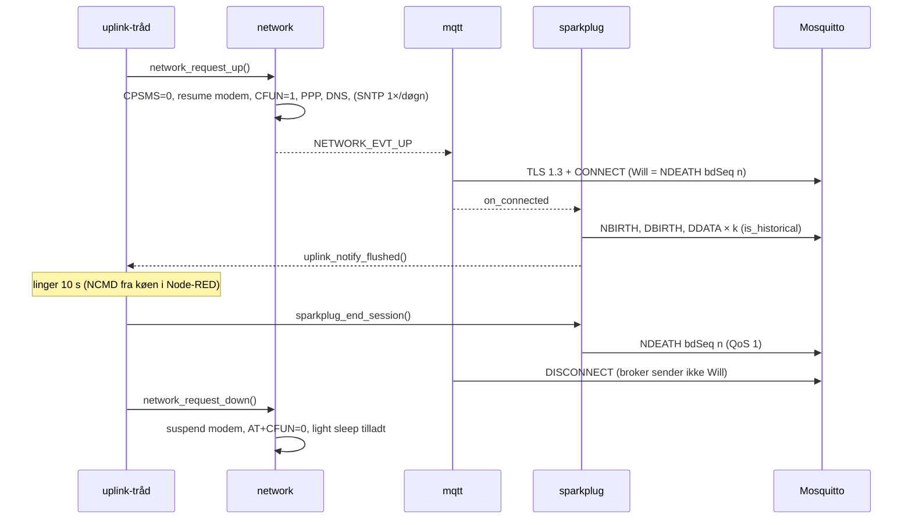

# Del 9 – Lavt strøm- og dataforbrug, LP-kernen (`remote/`)

Denne del opfylder kravene A-03 (lavt strømforbrug via sleep modes/interrupts), A-04 (lavt
dataforbrug) og G-13 (LP-kerne-kode i `remote/`).

| # | Nyt i Del 9 | Hvor |
|---|---|---|
| 1 | **To uplink-tilstande:** *continuous* (som Del 7) og *interval* (modem kun tændt under en uplink hvert 30. min). Vælges med `.\scripts\build.ps1 -LowPower` | `uplink.c`, `overlay-lowpower.conf` |
| 2 | **Light sleep** af HP-kernen (`CONFIG_PM`), låst mens modem-UART eller en måling er aktiv | `power.c`, `network.c`, `sensor.c`, `app.overlay` |
| 3 | **Modemets radio slukkes** (`AT+CFUN=0`), når linket stoppes. PSM slås fra og eDRX kan vælges | `network.c` |
| 4 | **LP-kernen** (`app/remote/`) kører hvert sekund: vækker HP-kernen fra deep sleep og overvåger, at målingerne kører (supervisor) | `remote/src/main_ULP.c`, `common/lp_shared.h`, `power.c` |
| 5 | **Deep sleep** via NCMD `Node Control/Sleep` (60 s–24 t). LP-kernen vækker HP-kernen | `sparkplug.c`, `power.c` |
| 6 | **Ren afslutning af sessionen:** NDEATH + MQTT DISCONNECT (ingen Will). Data målt mellem uplinks sendes med `is_historical` | `sparkplug.c`, `mqtt_client.c` |
| 7 | **LP-billedets integritet:** HP-billedet (signeret, Del 8) indeholder SHA-256 af LP-billedet og tjekker det ved boot | `cmake/lp_image.cmake`, `power.c` |
| 8 | Node-RED: kommandoer til en offline node sættes i kø og sendes ved næste NBIRTH. Ny knap "Deep sleep 10 min" | `cloud/node-red/ncmd.js`, `flows.json` |

---

## 1. Hvor går strømmen? (udgangspunkt for alle valg)

| Forbruger | Størrelsesorden | Kilde |
|---|---|---|
| SIM7080G-modul (M5Stack), registreret, ingen trafik | **ca. 46 mA** ved 5 V | M5Stack (`02-arkitektur.md` §7.1) |
| SIM7080G, med netværkstrafik | **ca. 71 mA** ved 5 V | M5Stack |
| ESP32-C6, aktiv (CPU kører / venter i WFI) | nogle mA til ca. 20–30 mA | Espressif datablad, måles i §6 |
| ESP32-C6, light sleep | sub-mA | måles i §6 |
| ESP32-C6, deep sleep + LP-kerne | µA-området | måles i §6 |

**Konklusion:** modemet dominerer. ESP32-C6's egen sleep giver kun noget, når modemet også er
slukket. Derfor er den vigtigste beslutning ikke *om CPU'en sover*, men **hvor længe radioen er
tændt**. Det styrer uplink-tilstanden.

### 1.1 Hvorfor PSM ikke bruges

LTE-M PSM ville lade modemet sove i µA-området og stadig være registreret. Men M5Stack-modulet
har **ingen PWRKEY-ledning** til ESP32-C6. SIM7080G forlader kun PSM ved PWRKEY eller ved sin egen
periodiske opdatering (T3412). Driveren ville derfor ikke kunne vække modemet, når der skal
sendes. `network.c` sender `AT+CPSMS=0` før hver start, så PSM aldrig er aktiv ved et uheld.
I stedet bruges `AT+CFUN=0` (minimumsfunktionalitet: RF og SIM slukket). Det kan altid
fortrydes over UART.

### 1.2 Hvorfor light sleep kun bruges, når modemet er slukket

UART'erne har ingen flow control (RTS/CTS, fund F5 i Del 2). I light sleep er HP-kernens UART
uden ur. En byte, der kommer i det øjeblik, går tabt, og PPP/CMUX går i stykker. Zephyr 4.4
vækker kun ESP32-C6 fra light sleep med RTC-timeren, ikke med UART. Derfor:

- `network.c`: `app_power_sleep_lock()` når modemet startes, `unlock` når det er stoppet og radioen er slukket.
- `sensor.c`: lås under hver måling (Modbus RTU-svar må ikke gå tabt).
- Ellers går idle-tråden automatisk i light sleep (`CONFIG_PM`, power state `standby`, vækkes af `&rtc_timer` i `app.overlay`).

I *continuous* kører modemet altid, så HP-kernen kommer i praksis aldrig i light sleep. Det er
præcis derfor, interval-tilstanden findes.

---

## 2. De to uplink-tilstande

| | **Continuous** (standard) | **Interval** (`-LowPower`) |
|---|---|---|
| Målinger | hvert 10. s (5–15 s) | hvert 10. s (uændret, A-06) |
| Modem | altid registreret, PPP + MQTT/TLS altid oppe | slukket (`AT+CFUN=0`), tændes hvert 30. min eller når køen er ¾ fuld |
| HP-kerne mellem målinger | venter (WFI), ingen light sleep (modem-UART aktiv) | **light sleep** |
| Data i Node-RED | hvert minut (batch 6) | samlet hvert 30. min, med de oprindelige tidsstempler |
| NCMD | med det samme | i køen i Node-RED, sendes ved næste NBIRTH (højst 30 min) |
| Batch | 6 målinger (1 min) | 12 målinger (2 min) |
| Dataforbrug (§5) | ca. 0,43 MB/døgn | ca. 0,62 MB/døgn |
| Modem tændt | 100 % | ca. 2 % (ca. 35 s pr. 30 min, §6) |

**Valget:** Interval-tilstanden er den, der opfylder "lavt strømforbrug". Continuous er
standard indtil hardwaretesten af Del 4–8 er gennemført, fordi den giver levende data og
øjeblikkelige kommandoer under fejlfinding. Efter strømmålingen (§6) skiftes standarden i Del 11.

### 2.1 Forløb af en uplink (interval)



Detaljer, der er valgt bevidst:

| Valg | Begrundelse |
|---|---|
| **Første uplink lige efter boot** | Giver UTC-tid (SNTP) og NBIRTH, så man i Node-RED kan se, at enheden lever |
| **Tidlig uplink ved ¾ fuld kø** | Ingen data går tabt, hvis intervallet er længere end køen (24 batches à 2 min = 48 min) |
| **Linger 10 s** | Node-RED sender kommandoer fra køen, når den ser NBIRTH (§2.2) |
| **Egen NDEATH + DISCONNECT** | Uden DISCONNECT ser brokeren først forbindelsen død efter 1,5 × keep-alive (30 min) og sender så Will'en. Det giver en forsinket "død" midt i næste session. Testet: brokeren logger `disconnected.`, aldrig `closed its connection` |
| **`is_historical` på DDATA målt før sessionens NBIRTH** | Sparkplug B 3.0: en host gemmer værdien med sit tidsstempel, men bruger den ikke som "nuværende" værdi. Node-RED tegner efter tidsstempel, så grafen er korrekt |
| **Timeout 240 s** | Uden dækning slukkes modemet igen, og data bliver i køen til næste forsøg |
| **mqtt venter på `NETWORK_EVT_DOWN` efter planlagt DISCONNECT** | Ellers ville klienten forbinde igen, mens modemet er ved at blive slukket |

### 2.2 Kommandoer til en node, der er offline

Sparkplug forbyder retained NCMD, og en edge node skal bruge Clean Session. En kommando sendt,
mens noden er offline, ville derfor gå tabt. `ncmd.js` gemmer den i stedet i flow-konteksten
`pendingNcmd` (seneste værdi pr. metric) og sender den, når MQTT-in-noden leverer nodens næste
NBIRTH. Testet i `test/ncmd.test.js`.

---

## 3. LP-kernen (`app/remote/`)

ESP32-C6 har en 20 MHz RISC-V **LP-kerne** i det altid tændte strømdomæne. Den bygges som et
separat Zephyr-image via sysbuild (`app/sysbuild.cmake`, board `esp32c6_devkitc/esp32c6/lpcore`),
præcis som Zephyrs `samples/boards/espressif/ulp/lp_core/*`. Zephyr kopierer billedet fra
partitionen `slot0_lpcore_partition` (0x3A0000) til LP-SRAM ved boot og starter det med LP-timeren
som vækkekilde (`CONFIG_ESP32_ULP_LP_CORE_WAKEUP_SOURCE_LP_TIMER`, 1 s).

```
app/remote/
├── boards/esp32c6_devkitc_lpcore.overlay   samme LP-SRAM-layout som HP (app_lp_shm)
├── CMakeLists.txt
├── prj.conf                                ingen drivere, ingen konsol
└── src/main_ULP.c                          ét skridt pr. sekund, derefter halt
app/common/lp_shared.h                      delt hukommelse + beslutningslogik
```

### 3.1 Hvad LP-kernen gør, og hvorfor

LP-kernen kan på ESP32-C6 **ikke** læse temperatursensoren. Den sidder i HP-domænet, som er
slukket i deep sleep, og C6 har ingen LP-ADC. Med 5–15 s måleinterval er det desuden dyrere at
vække HP-kernen fra deep sleep (ROM → MCUboot med signaturtjek → Zephyr-init, flere hundrede ms
aktiv) end at lade den sove i light sleep i 10 s. LP-kernen får derfor de to opgaver, som kun en
uafhængig kerne kan løse:

| Opgave | Hvordan | Krav |
|---|---|---|
| **Vække fra deep sleep** | HP sætter `hp_state=SLEEP` og `wake_after_s` og kalder `sys_poweroff()`. LP tæller sekunder og kalder `ulp_lp_core_wakeup_main_processor()`. Det gentages hvert sekund, til HP melder `RUN`, så en vækning ikke kan gå tabt | G-13, A-03 |
| **Supervisor** | `app_logic` giver et heartbeat for hver behandlet måling. Står det stille i `APP_LPCORE_WATCHDOG_S` (120 s), nulstiller LP-kernen HP-systemet (`LP_AON_HPSYS_SW_RESET`). Efter boot logger HP `SECURITY: HP core was reset by the LP-core supervisor`, og NBIRTH viser `Reset Cause = "lp-core supervisor"` | CRA I(2)(h) tilgængelighed, IEC 62443-4-2 CR 7.4 (Del 8-gap "ingen watchdog") |

LP-kernen kører på sit eget ur og strømdomæne. Supervisoren virker derfor også, hvis HP-kernen
hænger med interrupts slået fra.

### 3.2 Delt hukommelse (`app/common/lp_shared.h`)

- 64 B i slutningen af LP-SRAM-området til LP-billedet (`ulp_ram` 0x3C00 → 0x3BC0, ny node
  `app_lp_shm` @ 0x50003BC0). Begge images får samme overlay, så adressen er den samme.
- Området ligger uden for begge images. Det overlever derfor HP-reset, deep sleep og genindlæsning
  af LP-billedet. `magic` + `version` fortæller, om HP har skrevet det (efter power-on er det
  tilfældigt).
- **Én skriver pr. felt** (`HP:`/`LP:` i kommentaren), alle felter 32 bit og alignede. Så skal
  der ingen låse til mellem kernerne.
- Hele beslutningslogikken (`lp_supervisor_step()`) er en ren funktion af strukturen. Den samme
  kode kører på LP-kernen og i host-unittesten `app/tests/lp_supervisor` (7 tests).
- **Første skridt efter indlæsning** (flag i `.data`, som ikke nulstilles mellem LP-kørsler)
  glemmer gammel "stale"-tid. Ellers kunne et manuelt reset lige før supervisor-grænsen give
  et ekstra reset under den nye boot.

### 3.3 Deep sleep (NCMD `Node Control/Sleep`)

`Node Control/Sleep` (Int64, alias 11, 60–86400 s) bruges, når der ikke skal måles i en periode
(produktionsstop, weekend, transport). Forløb: NDEATH → DISCONNECT → modem stop + `AT+CFUN=0` →
`app_power_deep_sleep()` → LP vækker → normal boot med Reset Cause `low-power wake` → NBIRTH.
Uden LP-kerne (fx native_sim) afvises kommandoen med `SECURITY: NCMD Sleep rejected`.
Målinger stopper under sleep, og den halve batch i RAM går tabt (højst 2 min). Det er accepteret,
fordi kommandoen netop betyder "stop".

### 3.4 Integritet af LP-billedet (sammenhæng med Del 8)

MCUboot verificerer kun HP-billedet. LP-billedet ligger i sin egen partition og kopieres uden
tjek. `app/cmake/lp_image.cmake` lægger SHA-256 og størrelse af LP-billedets `zephyr.bin` ind i
det **signerede** HP-billede. `power.c` hasher partitionen (PSA SHA-256) ved hver boot. Ved
afvigelse stoppes LP-kernen (`ulp_lp_core_stop()`), og der logges
`SECURITY: LP-core image check failed`.

**Begrænsning:** Zephyr starter LP-kernen i `soc_late_init_hook`, før applikationen kører. Et
ændret LP-billede har derfor kørt i under ét sekund, før det stoppes. Tjekket *opdager*
ændringen, men forhindrer den ikke helt. Den fulde løsning er ROM secure boot + flash
encryption (Del 8 §7). Den samme angriber (fysisk adgang til flash) kan i dag også udskifte
MCUboot.

---

## 4. Ændringer i de eksisterende moduler

| Modul | Ændring |
|---|---|
| `network.c` | Light-sleep-lås mens modemet kører. `modem_raw_at()` (AT på den rå UART, mens driveren har frigivet den): `AT+CPSMS=0` og `AT+CEDRXS` før resume, `AT+CFUN=0` efter suspend |
| `mqtt_client.c` | `app_mqtt_disconnect()`: DISCONNECT efter de køede beskeder. Ny returkode `ERR_PLANNED` venter på `NETWORK_EVT_DOWN` |
| `sparkplug.c` | `sparkplug_end_session()`, `sparkplug_batches_queued()`, `is_historical`, NCMD Sleep (alias 11), Reset Cause "lp-core supervisor", `uplink_notify_flushed()` efter tømt kø |
| `app_logic.c` | Heartbeat til LP-kernen pr. måling, `uplink_notify_batch()` pr. batch |
| `sensor.c` | Light-sleep-lås under hver måling |
| `uplink.c` (ny) | Interval-scheduler (tråd `uplink`, prioritet 9, kun i interval-tilstand) |
| `power.c` | Sleep-låse, LP-kernens delte hukommelse, LP-billedtjek, deep sleep |
| `soc_log.c` (ny) | Workaround F3 fra Del 2: `CONFIG_PM=y` kræver log-modulet `soc` |

Tråd-tabellen får én tråd mere (kun interval): `uplink`, prioritet 9, 1536 B. Den er lavest,
fordi den kun planlægger og venter.

---

## 5. Dataforbrug

### 5.1 Målt (native_sim + Mosquitto, byte-tællende TCP-proxy, `run.sh` scenarie 13)

Proxyen tæller TCP-payload (TLS-records) i begge retninger. Certifikatkæden har samme form og
størrelse som Let's Encrypts (`pki.sh` med padding).

| Måling | Op (enhed → broker) | Ned | Kommentar |
|---|---|---|---|
| Uplink med NBIRTH + DBIRTH + 1 DDATA + NDEATH | 1669 B | 3960 B | 581 B MQTT-payload. **Fast pris pr. uplink ≈ 0,8 kB op + 3,9 kB ned** (TLS 1.3-handshake, CONNECT, SUBSCRIBE, DISCONNECT) |
| Uplink med 6 DDATA (historiske) | 2615 B | 3961 B | 932 B MQTT-payload |
| Continuous, 33 s med 10 DDATA + 5 NDATA | 3773 B | 3959 B | Inkl. ét handshake |
| NBIRTH (12 metrics) | 457 B payload | | Under bufferen på 512 B |
| DDATA, 3 værdier | 60–63 B payload | | 9 B + 18 B pr. værdi (+2 B med `is_historical`) |

TLS-sessionsgenoptagelse ville gøre en uplink meget billigere (ingen certifikatkæde). Det er
undersøgt og **ikke muligt i Zephyr 4.4.0** uden at ændre Zephyr. MQTT-biblioteket kan ikke slå
`TLS_SESSION_CACHE` til på sin socket. Og socket-laget gemmer sessionen lige efter handshaket,
mens TLS 1.3 sender billetten (NewSessionTicket) først bagefter. Det er noteret som videre
arbejde (Del 10: egen MQTT-transport).

### 5.2 Beregnet pr. døgn (produktionsværdier)

Pr. DDATA kommer der ud over payload: topic 51 B + MQTT 4 B + TLS-record 22 B + TCP/IP 40 B +
PPP ca. 8 B, plus en TCP-ACK ned (ca. 48 B). Pr. uplink: målt 4,7 kB TLS + NBIRTH/DBIRTH/NDEATH
ca. 0,8 kB + TCP/IP/PPP for ca. 30 pakker ca. 1,4 kB + DNS ca. 0,1 kB ≈ **7 kB**.

| Tilstand | Beregning | **Pr. døgn** |
|---|---|---|
| Continuous, batch 6 (Del 7) | 1440 DDATA × ca. 290 B + 96 status-NDATA × ca. 150 B | **ca. 0,43 MB** |
| Interval 15 min, batch 12 | 96 × 7 kB + 720 DDATA × ca. 400 B | ca. 0,96 MB |
| **Interval 30 min, batch 12** (`-LowPower`) | 48 × 7 kB + 720 × ca. 400 B | **ca. 0,62 MB** |
| Interval 60 min, batch 12 | 24 × 7 kB + 720 × ca. 400 B | ca. 0,46 MB |
| Uden batching (Del 2, til sammenligning) | 8640 beskeder à ca. 210 B | ca. 1,8 MB |

**Afvejning:** Interval-tilstanden koster lidt mere data end continuous, fordi hver uplink
betaler et fuldt TLS-handshake. 30 min giver ca. +45 % data for ca. −95 % modem-tid. 60 min ville
give samme data som continuous, men data og kommandoer bliver op til en time gamle. 30 min er
valgt som kompromis. Batch 12 halverer overhead pr. DDATA. Kontrollen med TCP-connect til port
80 er slået fra i `-LowPower` (kun DNS). MQTT/TLS-forbindelsen lige efter beviser det samme.

Onomondo-portalen viser det faktiske forbrug pr. SIM. Det sammenlignes med tabellen i §6.

---

## 6. Hardwaretest og strømmåling

### 6.1 Byg og flash

```powershell
cd C:\zp\zephyr_a
git fetch origin; git checkout del-09-strom

# Standard (continuous) - bygger nu tre images: MCUboot, app og LP-kernen
.\scripts\build.ps1 -Pristine
.\scripts\flash.ps1 -Port COM3          # flasher også LP-billedet til 0x3A0000
.\scripts\monitor.ps1 -Port COM3
```

Forventet ved boot:

```
<inf> app_power: Light sleep allowed when idle, uplink mode continuous
<inf> app_power: LP core: image verified (1577 B), step 1000 ms, supervisor 120 s, wakes 0, resets 0
<inf> network: Modem radio off (AT+CFUN=0)            (kun når linket stoppes)
```

### 6.2 Funktionstest

| # | Test | Forventet |
|---|---|---|
| 1 | Continuous kører 10 min | Som Del 7. Ingen `LP core`-reset. `Status/MQTT Connects` uændret |
| 2 | **Supervisor, normal drift:** lad standard-buildet køre 30 min | Ingen reset. `lp_resets` i boot-loggen er stadig 0 efter et manuelt reset |
| 2b | **Supervisor, hæng-test:** tilføj midlertidigt `if (batches_done == 1U) { k_sched_lock(); for (;;) { } }` sidst i `handle_measurement()` i `app_logic.c` (ikke committet), byg og flash | Efter ca. 120 s uden målinger: reboot, `SECURITY: HP core was reset by the LP-core supervisor`, NBIRTH `Reset Cause = lp-core supervisor`. Fjern linjen igen |
| 3 | **Deep sleep:** klik "Deep sleep 10 min" i Node-RED | NDEATH, `Modem radio off`, `Deep sleep for 600 s`. Efter 10 min: boot, `Woken from deep sleep by the LP core after 600 s`, NBIRTH `Reset Cause = low-power wake` |
| 4 | **Interval:** `.\scripts\build.ps1 -LowPower -Pristine`, flash | Uplink #1 lige efter boot, `Uplink #1 ok: modem on N s`, `Modem radio off`. Næste uplink efter 30 min. I Node-RED: data i klumper hvert 30. min, korrekte tidsstempler |
| 5 | Kommando under interval: klik "Sample interval 5 s", mens noden er offline | Node-RED-status "queued". Udføres ved næste NBIRTH (`Sample interval set to 5000 ms`) |
| 6 | LP-billedtjek: flash kun appen (`-AppOnly`) efter at have ændret `remote/src/main_ULP.c` og bygget | `SECURITY: LP-core image check failed (-77)` (-EBADMSG), ingen supervisor |

### 6.3 Strømmåling (A-03)

Mål strømmen i 5 V-forsyningen til **hele** opstillingen (ESP32-C6-board + M5Stack-modul) med
multimeteret i serie. Mål også, hvis muligt, kun ESP32-boardets 5 V. Notér værdierne i tabellen
(til Del 11-rapporten):

| Tilstand | Hvordan | I (mA) |
|---|---|---|
| A. Continuous, mellem sendinger | standard-build, efter 2 min | |
| B. Continuous, under sending | toppen hvert minut | |
| C. Interval, mellem uplinks (modem `CFUN=0`, HP light sleep) | `-LowPower`, 2 min efter `Uplink #1 ok` | |
| D. Interval, under uplink | gennemsnit over uplinket | |
| E. Deep sleep (modem `CFUN=0`, HP deep sleep, LP kører) | "Deep sleep 10 min" | |
| F. Som C, men `CONFIG_APP_POWER_LIGHT_SLEEP=n` | viser light sleeps andel | |

Gennemsnit for interval: `I_avg = (t_uplink × I_D + (1800 − t_uplink) × I_C) / 1800`, hvor
`t_uplink` er "modem on N s" fra loggen. Sammenlign med A.

**Forventning (ikke målt):** C og E ligger langt under A, fordi modemet er i `CFUN=0`.
Forskellen mellem C og F viser, hvad light sleep sparer på ESP32-siden. Forskellen mellem C og
E viser deep sleeps ekstra besparelse. Hvor meget M5Stack-modulet selv trækker i `CFUN=0`
(regulator, LED), ved vi først efter målingen. Bliver værdien høj, er den næste forbedring en
load-switch i modulets 5 V (`02-arkitektur.md` §7.1).

---

## 7. Test i udviklingsmiljøet (gennemført)

| Test | Resultat |
|---|---|
| ESP32-C6-build, standard (continuous) | 3 images, ingen nye warnings. FLASH 10,45 %, RAM 41,4 %. LP-billede 1577 B (5,7 kB af 15 kB LP-RAM inkl. stack) |
| ESP32-C6-build, `-LowPower` | FLASH 10,46 %, RAM 44,6 % (kø 24 batches à 680 B) |
| `app/tests/lp_supervisor` (ztest, native_sim) | **7/7**: tilfældig hukommelse udløser intet, heartbeat holder HP i live, reset efter 120 s og igen efter 120 s, supervisor slået fra, genindlæsning glemmer stale-tid, vækning efter 300 s gentages til RUN men tælles én gang, 24 timers sleep uden overløb |
| `app/tests/mqtt_tls/run.sh` (native_sim + Mosquitto 2.0.18) | **91/91** (75 fra Del 8 + 16 nye). Scenarie 12: første uplink ved boot, NDEATH + ren DISCONNECT, modem slukket, tidlig uplink ved ¾ fuld kø, kun 2 sessioner på 34 s, brokeren ser kun rene disconnects, én NDEATH pr. session med NBIRTH'ens bdSeq, historiske data med `is_historical`, alle værdier i tidsorden. Scenarie 1: NCMD Sleep afvist uden LP-kerne. Scenarie 13: bytes på linjen (§5.1) |
| `cloud/node-red/test/*.test.js` | `ncmd.js` (kø til offline noder, frigives ved NBIRTH, én gang) og `decode.js` bestået |
| `build.ps1` | Parser fejlfrit (pwsh), ny `-LowPower` |

---

## 8. Kendte begrænsninger og videre arbejde

| Begrænsning | Konsekvens | Videre |
|---|---|---|
| Intet er målt på hardware | Strømtal i §1 er datablad/M5Stack, §6 skal udfyldes | Hardwaretest §6 |
| Modem-suspend i Zephyrs driver venter ca. 11,6 s (power-pulse + `shutdown_time_ms` for SIM7080), før `AT+CFUN=0` kan sendes | Radioen er tændt ca. 12 s længere pr. uplink end nødvendigt | `AT+CFUN=0` over en CMUX-brugerkanal (DLCI 3, `MODEM_AT_USER_PIPE`) før suspend (Del 10) |
| Ingen TLS-sessionsgenoptagelse (§5.1) | Ca. 4,7 kB pr. uplink | Egen MQTT-transport med `TLS_SESSION_CACHE` + TLS 1.2-billetter, eller rettelse i Zephyr |
| NCMD kun under en uplink | Op til 30 min forsinkelse | Kø i Node-RED (§2.2) |
| LP-billedet kører < 1 s før integritetstjekket | Kun opdagelse, ikke forebyggelse | Secure boot (Del 8 §7) |
| Supervisoren dækker kun målekæden (`sensor` → `app_logic`) | En hængende `mqtt`-tråd opdages ikke | Zephyr task watchdog (Del 10) |
| eDRX er ikke testet mod Onomondo | Ukendt, om nettet giver eDRX | Sæt `CONFIG_APP_MODEM_EDRX="0101"` i continuous og se `eDRX request 0101: OK` + strøm (A) |
| Light sleep med shell-input | Tegn tastet, mens HP sover, går tabt | Kun relevant i udvikling. Release-build har ingen shell |
| `-ModbusRtu -LowPower`: konsollen ligger på USB Serial/JTAG | USB-forbindelsen til pc'en kan falde ud i light sleep (`02-arkitektur.md` §6.5) | Log via UART-broen, eller `CONFIG_APP_POWER_LIGHT_SLEEP=n` under fejlfinding |

## 9. Definition of done

- [ ] `build.ps1 -Pristine` bygger tre images (MCUboot, app, `zephyr_a_lpcore`). Flash + boot viser `LP core: image verified`.
- [ ] Continuous kører som i Del 7 (ingen regression), uden supervisor-reset.
- [ ] Hæng-test (§6.2 nr. 2b) giver reset efter ca. 120 s og Reset Cause `lp-core supervisor`.
- [ ] "Deep sleep 10 min" fra Node-RED: enheden vågner selv efter 10 min (`low-power wake`).
- [ ] `-LowPower`: uplink hvert 30. min, `Modem radio off`, korrekte tidsstempler i Node-RED, kommando i kø udføres ved næste uplink.
- [ ] Strømtabellen §6.3 er udfyldt (A, C, D, E, F). Interval-gennemsnittet er beregnet og sammenlignet med continuous.
- [ ] Onomondo-forbrug efter et døgn i hver tilstand sammenlignet med §5.2.
