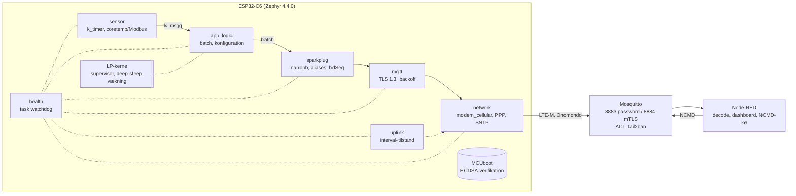

# Del 11 – Afslutning: test, memory layout og rapportmateriale

Del 11 samler projektet og tilføjer ingen nye funktioner. Den leverer fire ting:

| # | Leverance | Hvor |
|---|---|---|
| 1 | **Memory layout** (N-06): flash, HP-SRAM og LP-SRAM, genereret fra build-outputtet | §2, `scripts/memory_layout.py` |
| 2 | **Samlet test**: ét script til alle host-tests og **CI på GitHub** ved hvert push | §3, `scripts/run-host-tests.sh`, `.github/workflows/host-tests.yml` |
| 3 | **Hardware-acceptprotokol**: én samlet testgang for Del 3–10 i den rækkefølge, der giver mening på bordet | §4 |
| 4 | **Rapportmateriale**: arkitektur, designvalg med begrundelse, nøgletal, fund, begrænsninger | §5–§7 |

---

## 1. Status ved afslutningen

Alt er implementeret og testet i udviklingsmiljøet: native_sim mod en rigtig Mosquitto-broker,
unittests og byggede ESP32-C6-images. **Intet fra Del 3–10 er endnu kørt på boardet eller på
VPS'en.** De fleste 🟡 i kravmatrixen betyder netop "implementeret og testet på host, mangler
hardware". Hardware-acceptprotokollen i §4 er vejen fra 🟡 til ✅.

| Kategori | ✅ | 🟡 | ⬜ |
|---|---|---|---|
| Generelle krav (G-01…G-25) | 10 | 15 | 0 |
| Dataopsamling (D-01…D-07) | 6 | 1 | 0 |
| Projekt A (A-01…A-10) | 0 | 10 | 0 |
| Nice to have (N-01…N-06) | 1 (N-06) | 4 | 1 (N-02 OTA, udskudt) |

**Uplink-tilstand:** Del 9 lovede at skifte standard til `-LowPower` i Del 11 *efter*
strømmålingen. Målingen er ikke lavet, så **continuous forbliver standard**. Skiftet er én
linje (`default APP_UPLINK_INTERVAL` i `app/Kconfig`) og bør laves, når tabellen i
`09-strom-data.md` §6.3 bekræfter besparelsen.

---

## 2. Memory layout (N-06)

Genereres fra et sysbuild-build (devicetree, linker-map, ELF og images) med:

```powershell
.\scripts\build.ps1 -Pristine
python scripts\memory_layout.py build            # Markdown som nedenfor
python scripts\memory_layout.py build --check    # fejler, hvis en grænse overskrides
```

Tallene herunder er fra standard-buildet (continuous, password, Del 10-kode). `-LowPower`
bruger ca. 13 KiB mere RAM (batch-kø 24 i stedet for 4), mTLS 1,2 KiB mere flash.

<!-- memory_layout:begin (scripts/memory_layout.py build) -->
### Flash (4 MB, `partitions_0x0_default_4M.dtsi`)

| Adresse | Størrelse | Partition | Indhold | Brugt |
|---|---|---|---|---|
| `0x000000` | 64.0 KiB | `mcuboot` | MCUboot (verificerer slot0 ved hver boot, Del 8) | 41.1 KiB (64.2 %) |
| `0x010000` | 64.0 KiB | `sys` | ESP-IDF systemdata (PHY-kalibrering) | – |
| `0x020000` | 1792.0 KiB | `image-0` | Applikation, signeret (MCUboot-header + ECDSA-TLV) | 428.9 KiB (23.9 %) |
| `0x1E0000` | 1792.0 KiB | `image-1` | Opdateringsslot (OTA, N-02 - ikke brugt endnu) | – |
| `0x3A0000` | 32.0 KiB | `image-0-lpcore` | LP-kerne-image (Del 9, SHA-256 tjekket af app) | 1.5 KiB (4.8 %) |
| `0x3A8000` | 32.0 KiB | `image-1-lpcore` | LP-image til OTA (ikke brugt) | – |
| `0x3B0000` | 192.0 KiB | `storage` | Lager (NVS/settings - ikke brugt endnu) | – |
| `0x3E0000` | 124.0 KiB | `image-scratch` | MCUboot scratch (swap ved OTA) | – |
| `0x3FF000` | 4.0 KiB | `coredump` | Coredump (ikke slået til) | – |

```
0x000000 |#| mcuboot
0x010000 |.| sys
0x020000 |######....................| image-0
0x1E0000 |..........................| image-1
0x3A0000 |.| image-0-lpcore
0x3A8000 |.| image-1-lpcore
0x3B0000 |...| storage
0x3E0000 |..| image-scratch
0x3FF000 |.| coredump
0x400000  (# = brugt, . = fri; bredde ~ størrelse)
```

### HP-SRAM (`sram0_0_seg`, 477.5 KiB til applikationen)

Brugt: **198.3 KiB (41.5 %)**. Fri: 279.3 KiB.

| Sektion | Størrelse | Hvad |
|---|---|---|
| `.dram0.bss` | 81.8 KiB | nulstillede variabler (stacks, heaps, køer) |
| `.dram0.noinit` | 54.5 KiB | ikke-initialiseret (bl.a. stacks) |
| `.iram0.text` | 49.3 KiB | kode der skal køre fra RAM (ISR, flash-driver) |
| `.dram0.data` | 10.3 KiB | initialiserede variabler |
| `log_const_area` | 0.6 KiB |  |
| (øvrige små) | 1.8 KiB | |

**Største RAM-objekter** (symboler ≥ 2 KiB):

| Symbol | Størrelse | Type |
|---|---|---|
| `_mbedtls_heap` | 56.0 KiB | heap |
| `_k_thread_stack_mqtt_tid` | 8.0 KiB | tråd-stack |
| `kheap__system_heap` | 4.3 KiB | heap |
| `_k_thread_stack_sparkplug_tid` | 4.0 KiB | tråd-stack |
| `_k_mem_slab_buf_tcp_conns_slab` | 3.9 KiB | kø/buffer |
| `data_simcom_sim70800` | 3.8 KiB | modem |
| `_k_fifo_buf_batch_q` | 2.7 KiB | kø/buffer |
| `tls_contexts` | 2.6 KiB | netværk/TLS |
| `_k_mem_slab_buf_payload_slab` | 2.5 KiB | kø/buffer |
| `net_buf_data_tx_bufs` | 2.0 KiB | netværk/TLS |
| `net_buf_data_rx_bufs` | 2.0 KiB | netværk/TLS |
| `z_interrupt_stacks` | 2.0 KiB | tråd-stack |
| `_k_thread_stack_network_tid` | 2.0 KiB | tråd-stack |
| `z_main_stack` | 2.0 KiB | tråd-stack |

| Type (alle symboler) | Sum |
|---|---|
| heap | 60.4 KiB |
| tråd-stack | 30.5 KiB |
| øvrigt | 26.1 KiB |
| kø/buffer | 12.3 KiB |
| netværk/TLS | 11.1 KiB |
| modem | 5.9 KiB |

### Kode og konstanter (kører/læses fra flash via cache)

| Område | Størrelse |
|---|---|
| `irom` – kode | 285.8 KiB |
| `drom` – konstanter, strenge, CA-certifikater (DER, ikke kopieret til RAM: `TLS_CERT_NOCOPY`) | 44.7 KiB |
| Signeret image i alt | 428.9 KiB |

### LP-SRAM (16 KiB @ `0x50000000`, altid tændt)

| Adresse | Størrelse | Område | Indhold |
|---|---|---|---|
| `0x50000000` | 15296 B | `ulp_ram` | LP-kerne-image (kode, data, stack) |
| `0x50003BC0` | 64 B | `app_lp_shm` | Zephyr_A: delt HP/LP (`lp_shared.h`, Del 9/10) |
| `0x50003C00` | 16 B | `ulp_shm` | ESP-IDF LP-kernens konfiguration (timer) |
| `0x50003C10` | 232 B | `lp_rtc` | HP `RTC_DATA_ATTR`-data |
| `0x50003CF8` | 512 B | `retainedmem` | Zephyr retained memory (bevares over reset) |
| `0x50003EF8` | 256 B | `ipc_shm` | IPC-mailbox (bruges ikke) |
| `0x50003FF8` | 8 B | `mbox0` | IPC-mailbox (bruges ikke) |

LP-image: 1577 B binær, 5821 B i `ulp_ram` inkl. stack (38.1 % af 15296 B).
<!-- memory_layout:end -->

### 2.1 Tolkning

| Iagttagelse | Betydning |
|---|---|
| Appen fylder 24 % af `image-0`, `image-1` + `image-scratch` er reserveret | **OTA (N-02) kan tilføjes uden ny partitionstabel**: MCUboot swap med scratch er allerede sat op, og et image på op til 1,75 MiB passer. `--check` kræver højst 50 %, så der er plads til vækst |
| Største enkeltpost i RAM er Mbed TLS-heapen (56 KiB) | Målt i Del 6: mindre heap gav `-0x2700` under handshaket med Let's Encrypt-kæden. Den er dimensioneret til den værste kæde (RSA-rod), ikke gennemsnittet |
| Tråd-stacks i alt ca. 30 KiB, `mqtt` alene 8 KiB | TLS-handshaket kører i `mqtt`-tråden (Mbed TLS bruger meget stack til ECDSA/RSA-verifikation). Tallene er valgt med margin og **skal måles** på hardware (§2.2) |
| 42 % HP-SRAM brugt, ca. 279 KiB fri | Rigelig plads. `--check`-grænsen er 75 %. En evt. OTA-download kan buffere i RAM |
| CA-certifikaterne ligger i `drom` (flash) | `TLS_CERT_NOCOPY` (Del 6): de 4 rødder koster ingen RAM |
| `storage` (192 KiB) og `coredump` bruges ikke | Kandidater: NVS til konfiguration, som overlever reboot, og bdSeq (Sparkplug anbefaler persistent bdSeq). Coredump til fejlfinding i felten |
| LP-image 1,5 KiB binært, 38 % af `ulp_ram` med stack | LP-kernens Zephyr-kerne genstartes hvert sekund. Det meste af forbruget er stack + kernestrukturer, ikke vores kode |
| `app_lp_shm` (64 B) ligger i den ende af `ulp_ram`, som LP-imaget ikke bruger | Begge images har samme overlay. Begge sider tjekker størrelsen med `BUILD_ASSERT` |

### 2.2 Stack-forbrug (skal måles på hardware)

native_sim er 64-bit x86 og giver andre stack-tal end ESP32-C6 (32-bit RISC-V). Derfor er der
en overlay til måling på boardet:

```powershell
.\scripts\build.ps1 -ExtraConf app\overlay-stack-usage.conf -Pristine
.\scripts\flash.ps1 -Port COM3; .\scripts\monitor.ps1 -Port COM3
# kør boot, modemstart, TLS, NBIRTH, NCMD, link-tab igennem; analyzer logger hvert 5. min
```

| Tråd | Stack (Kconfig) | Målt maks. brugt | Margin |
|---|---|---|---|
| `mqtt` (TLS-handshake) | 8192 B | | |
| `sparkplug` (protobuf) | 4096 B | | |
| `network` | 2048 B | | |
| `main` | 2048 B | | |
| `sensor` | 1536 B | | |
| `app_logic` | 1536 B | | |
| `uplink` (kun `-LowPower`) | 1536 B | | |
| ISR-stack | 2048 B | | |
| Zephyr: net RX/TX, PPP TX, sockets service, net_mgmt, sysworkq, modem workqueue, logging | 1792/1200/1024/1200/800/1024/1024/768 B | | |

**Regel:** mindst 25 % margin over det målte maksimum. Ellers øges Kconfig-værdien. Ligger
forbruget under 50 %, kan værdien sænkes. `CONFIG_STACK_SENTINEL`/canaries (Del 8) fanger
overløb i drift.

---

## 3. Test

### 3.1 Testpyramiden

| Niveau | Hvad | Antal | Hvor |
|---|---|---|---|
| Statisk | ShellCheck (alle bash-scripts), PowerShell-parser (alle `.ps1`), compiler-warnings får testen til at fejle (`run.sh`) | 15 bash, 7 ps1 | CI `tools`, `run-host-tests.sh` |
| Unit | LP-kernens beslutningslogik (ztest) | 7 | `app/tests/lp_supervisor` |
| Unit | Task watchdog (ztest, simuleret tid) | 5 | `app/tests/health` |
| Unit | Node-RED-funktioner: decode, NCMD + kø, overview, dashboard-kommandoer, sammenhæng i `flows.json` | 5 filer | `cloud/node-red/test` |
| Værktøj | Device-PKI mod `openssl verify` (kæde, CRL). fail2ban-filter mod sample-log | 2 | CI `tools` |
| **Integration** | Den rigtige firmware (alle moduler undtagen modem/sensor-drivere) på native_sim mod **Mosquitto 2.0.18** med TLS, ACL, Sparkplug, SNTP, mTLS, interval-uplink, bytes på linjen | **105** checks i 14 scenarier | `app/tests/mqtt_tls/run.sh` |
| Hardware | Acceptprotokol | §4 | manuelt |

Integrationstesten er den vigtigste: den kører samme C-kode som på boardet (`mqtt_client`,
`sparkplug`, `tls_ca`, `timesync`, `app_logic`, `uplink`, `health`, `power`, `security`).
Kun netværk og sensor er erstattet af stubs. Den har fundet rigtige fejl undervejs: for lille
TLS-heap, RSA-PSS-konfiguration, Will ved client-id-overtagelse og forkert SNTP-semantik.

### 3.2 Én kommando til alle host-tests

```bash
# Linux, WSL eller devcontainer (native_sim kører ikke på Windows)
scripts/run-host-tests.sh <west-workspace> [<firmware build dir>]
```

Trin, hvis værktøj mangler, springes over (SKIP) i stedet for at fejle, og der vises en
oversigt til sidst. Kørt her:

```
PASS lp_supervisor   pass = 7, fail = 0
PASS health          pass = 5, fail = 0
PASS mqtt_tls        Result: 105 passed, 0 failed
PASS node-red        5 test files
PASS device_pki      chain OK, revoked certificate refused
PASS fail2ban        7 failures from 5 addresses
PASS shellcheck      15 scripts
PASS memory          All memory limits OK
```

### 3.3 CI (GitHub Actions)

`.github/workflows/host-tests.yml` kører ved hvert push og hver pull request:

- **tools** (ca. 1 min): Node-RED-tests, ShellCheck, PowerShell-syntaks, device-PKI, fail2ban-filter.
- **firmware**: west-workspace fra `west.yml`, de to ztest-suiter og hele native_sim-suiten mod
  Mosquitto fra Ubuntu. Kører i samme image som `.devcontainer/`, så CI og devcontainer bygger
  ens.

Ingen hemmeligheder: testene laver deres egen engangs-PKI.

**Resultat:** begge jobs er grønne. `firmware` kører 7/7 + 5/5 + 105/105 i en ren container
med Ubuntus Mosquitto 2.0.18. Det bekræfter, at testene ikke afhænger af udviklingsmaskinen. De
to første kørsler fandt E11 og E12 (§5.4). I CI-jobbet `firmware` er fail2ban og ShellCheck
SKIP; de kører i `tools`.

### 3.4 Sporbarhed krav → test

| Krav | Testet på host af | Mangler på hardware |
|---|---|---|
| A-02 TLS, G-14 | `mqtt_tls` scenarie 2–9: TLS 1.3/1.2, ECDSA/RSA-kæder, forkert CA/navn/udløbet/ikke-gyldig-endnu afvist | Handshake mod VPS over LTE-M |
| G-15 MQTT, G-20 | scenarie 1, 3, 10: connect, keep-alive, reconnect, broker-genstart, link-tab | Over LTE-M |
| A-07 / G-17 / G-25 Sparkplug | scenarie 1 + `check_e2e.py`: NBIRTH/DBIRTH/DDATA/NDEATH, bdSeq/seq, aliases, tidsstempler | Node-RED på VPS |
| N-01 NCMD | scenarie 1, 1b: Rebirth, Reboot (+ spærring), interval, batch, ugyldige værdier, Sleep afvist | Dashboard → board |
| A-04 data | scenarie 13 (bytes på linjen) | Onomondo-forbrug pr. døgn |
| A-03 strøm | scenarie 12 (interval-forløb) | **Multimeter**, `09` §6.3 |
| A-08–A-10, N-05 sikkerhed | scenarie 11 (ingen hemmeligheder i logs, `SECURITY:`-hændelser), `imgtool verify` | Signaturtest + eFuse-læsning på board |
| N-04 mTLS | scenarie 14 | VPS + board |
| G-13 LP-kerne | `lp_supervisor` 7/7, build | Hæng-test, deep sleep 10 min |
| CR 7.4 watchdog | `health` 5/5, ingen falske alarmer i 105 checks | Hæng-test |
| A-01, A-06, D-04, G-16, G-19 | – (kræver modem/Modbus) | Del 3/4-tests |

---

## 4. Hardware-acceptprotokol (første samlede testgang)

Rækkefølgen bygger nedefra og op: hvert trin forudsætter de foregående. Noter resultatet i
kolonnen. Hver række henviser til delens egen DoD for detaljer. Forventet tidsforbrug er ca.
én dag plus et døgn til data-/strømmåling.

**Forberedelse:** branch med alle dele merget (`main` efter PR #5–#11). `C:\zp` opdateret
(`git pull`, `west update`). Board + M5Stack-modul + SIM. Multimeter i 5 V-forsyningen. VPS
opdateret (`git pull` i `~/Zephyr_A`).

| # | Trin | Krav | Kommando / handling | Forventet | Resultat |
|---|---|---|---|---|---|
| 1 | Byg og flash, signeret | G-01–05, N-05 | `new-signing-key.ps1` (én gang), `build.ps1 -Pristine`, `flash.ps1` | `Signature verified`, boot-log med version 0.11.0-del11, `LP core: image verified`, `Task watchdog ... wdt0` | |
| 2 | Signatur-negativtest | N-05, CR 3.4 | `08` §6.1 trin 2 (`-AppOnly` med dev-nøgle) | App starter ikke. Med rigtig nøgle virker alt igen | |
| 3 | eFuse-status | A-10, EDR 2.13 | `python -m espefuse --port COM3 --chip esp32c6 summary` | Svarer til `Properties/Security` (sb=0 fe=0 jtag=1 dl=1) | |
| 4 | Dataopsamling (simulering) | D-01–06, A-06 | `build.ps1 -Simulation`, monitor | Måling hvert 10. s, batch hver 6. | |
| 5 | Modbus RTU mod ModbusTools | G-16, D-04, D-07 | `03` (Del 3) testvejledning | Værdier, CRC/timeout-fejl logges, `is_null` ved dårlig kvalitet | |
| 6 | Modem + SIM | A-01, G-19 | `04` DoD: registrering, PPP, DNS, RSSI | `Network up`, RSSI i log | |
| 7 | VPS-opsætning verificeret | A-05 | `sudo bash 90-verify.sh` | All checks passed | |
| 8 | TLS + MQTT mod VPS | A-02, G-14, G-15, G-20 | `06` DoD | TLS 1.3, CONNACK, ingen `SECURITY:`-fejl | |
| 9 | Sparkplug i Node-RED | A-07, G-17, G-25 | `07` DoD, dashboard | NBIRTH/DDATA med tid, graf, tabel med noden | |
| 10 | NCMD fra dashboard | N-01, N-03 | Måleinterval 5 s, Rebirth, Reboot (efter 60 s) | NDATA bekræfter, Reboot før 60 s afvist | |
| 11 | Stack-måling | N-06 | §2.2 | Tabellen udfyldt, margin ≥ 25 % | |
| 12 | Task watchdog, hæng-test | CR 7.4 | `10` §5.1 nr. 2–3 | `task watchdog (mqtt)`, HW-reset ved `irq_lock` | |
| 13 | LP-supervisor, hæng-test | G-13 | `09` §6.2 nr. 2b | `lp-core supervisor` efter ca. 120 s | |
| 14 | Deep sleep 10 min | G-13, A-03 | Dashboard-knap | Vågner selv, `low-power wake` | |
| 15 | fail2ban | CR 1.11 | `10` §5.1 nr. 6 | IP spærret efter 11 forsøg, `unbanip` virker | |
| 16 | mTLS | N-04 | `10` §3.5, derefter revoke + nyt certifikat | Forbinder på 8884, spærret afvises | |
| 17 | Strømmåling continuous vs. interval | A-03 | `09` §6.3 (A–F) | Tabel udfyldt, interval ≪ continuous | |
| 18 | Data pr. døgn | A-04 | Onomondo-portal efter 24 t pr. tilstand | ca. 0,43 / 0,62 MB (`09` §5.2) | |
| 19 | Release + SBOM | CRA del II | `build.ps1 -Release -Sbom` | Bygger, `build\spdx\*.spdx` | |
| 20 | Valg af standard | – | Efter 17–18: sæt `-LowPower` som standard? | Beslutning noteret i STATUS | |

Efter protokollen opdateres kravmatrixens 🟡 → ✅ for de bestående rækker, og
`memory_layout.py`-afsnittet genereres igen fra det endelige build.

---

## 5. Rapportmateriale: system og designvalg

### 5.1 Systemet på én side



### 5.2 De vigtigste designvalg og hvorfor

| Valg | Alternativ | Hvorfor (kort) | Del |
|---|---|---|---|
| T2-manifest med allowlist | hele Zephyr-workspacet | Reproducerbart, lille workspace, hurtig `west update` | 1 |
| Én tråd pr. modul, kommunikation via `k_msgq`/`k_event` | delte globale variabler med mutex | Ingen delte data mellem tråde ud over køer, så der er ingen låserækkefølge-fejl (G-10) | 2 |
| `k_timer` + semafor til måling | `k_sleep` i løkke | Fast interval uafhængigt af målingens varighed (A-06) | 3 |
| Batching af målinger (6, i lavstrøm 12) | én besked pr. måling | ca. 4× mindre data (1,8 → 0,43 MB/døgn) | 3/7/9 |
| Zephyrs `modem_cellular` + PPP + sockets | AT-kommando-sockets (SIM7080 TCP/TLS) | TLS i Mbed TLS på enheden (vi styrer CA og version), standard socket-API | 4 |
| Egen VPS med Mosquitto + Node-RED | cloud-tjeneste | Krav A-05. Fuld kontrol over ACL, logs og TLS | 5 |
| 4 indlejrede rod-CA'er (ISRG X1/X2 + YE/YR) | kun den nuværende rod | Overlever Let's Encrypts rod-skifte uden firmwareopdatering | 6 |
| TLS 1.3 foretrukket, 1.2 som fallback | kun 1.3 | Robust mod brokerkonfiguration. Handshake-data målt | 6 |
| Sparkplug B med aliases og batch-DDATA | JSON | Standard (A-07), ca. 18 B pr. værdi | 7 |
| SNTP med plausibilitetstjek | tid fra modem (CCLK) | Modemets tid er ikke altid sat. Tjekket værdi giver gyldig TLS-datokontrol | 7 |
| MCUboot ECDSA + slot0-validering ved hver boot | kun ved opdatering (Espressif-default) | Detekterer ændret firmware ved hver boot (CR 3.4) | 8 |
| eFuse-hærdning kun beskrevet | udført | Irreversibel. Kræver eget produktionsboard | 8 |
| Interval-uplink + light sleep | PSM | Modulet har ingen PWRKEY, så PSM ville gøre modemet uopnåeligt | 9 |
| LP-kerne som supervisor/vækker | LP-kerne som sampler | C6's LP-kerne kan ikke læse temperatursensoren. Deep sleep pr. måling er dyrere end light sleep | 9 |
| Task watchdog med pause | klassisk fodring hvert N s | Ingen ekstra opvågninger, og kun "optaget" tid overvåges | 10 |
| Device-CA på pc'en | CA på serveren | En kompromitteret server kan ikke udstede enhedsidentiteter | 10 |

### 5.3 Nøgletal gennem projektet

| Efter del | FLASH (af 4 MiB) | RAM (HP-SRAM) | Host-tests |
|---|---|---|---|
| 6 – MQTT/TLS | 8,7 % | 37,4 % | 24 |
| 7 – Sparkplug + tid | 10,3 % | 39,4 % | 68 |
| 8 – Sikkerhed | 10,34 % | 39,57 % | 75 |
| 9 – Strøm/LP-kerne | 10,45 % | 41,4 % | 91 + 7 |
| 10 – Nice to have | 10,46 % | 41,52 % | 105 + 7 + 5 |

| Data og strøm | Værdi | Kilde |
|---|---|---|
| NBIRTH | ca. 425–457 B (12 metrics) | målt, Del 7/9 |
| DDATA | 9 B + 18 B pr. værdi (+2 B historisk) | målt, Del 7/9 |
| TLS-handshake (LE-lignende kæde) | 0,7–0,8 kB op / 3,9 kB ned. mTLS +0,57 / +0,93 kB | målt, Del 6/9/10 |
| Data pr. døgn | continuous ca. 0,43 MB, `-LowPower` ca. 0,62 MB | beregnet af målte størrelser, Del 9 |
| Modem tændt | continuous 100 %, `-LowPower` ca. 2 % | beregnet, Del 9 |

### 5.4 Fund undervejs (til rapportens "erfaringer")

F1–F8 er fundene fra analysen i Del 2. E1–E12 er de erfaringer, der kom under implementeringen.

| # | Fund | Konsekvens / løsning | Del |
|---|---|---|---|
| F1–F8 | Fund fra analysen i Del 2: Mbed TLS 4.1/PSA, `log_const_soc` ved PM, ingen PWRKEY, UART uden flow control m.fl. | `02-arkitektur.md` §9 | 2 |
| E1 | Mbed TLS-heap på 40 KiB rækker ikke til LE-kæden (`-0x2700`) | 56 KiB, målt | 6 |
| E2 | RSA-PSS kræver både `X509_RSASSA_PSS_SUPPORT` og `PSA_WANT_ALG_RSA_OAEP` | Konfiguration + test med RSA-kæde | 6 |
| E3 | Mosquitto sender den *gamle* Will, når samme client-id forbinder igen | bdSeq-håndtering + kassering af gammel TX | 7 |
| E4 | `SNTP_UNCERTAINTY` i Zephyr 4.4 har brøkdel i µs og bruger REALTIME | Egen offset-beregning | 7 |
| E5 | Espressifs default er `BOOT_VALIDATE_SLOT0=n` | Slået til eksplicit | 8 |
| E6 | PowerShell 5.1 fjerner anførselstegn i `-D`-argumenter | Kconfig-fragmenter i `certs\` | 8 |
| E7 | Zephyrs socket-lag gemmer TLS-sessionen før TLS 1.3-billetten kommer | Ingen genoptagelse. Dokumenteret | 9 |
| E8 | Modem-suspend venter ca. 11,6 s (power-pulse uden PWRKEY) | Radioen er tændt længere end nødvendigt. Fremtid: CMUX-brugerkanal | 9 |
| E9 | TLS 1.3: et afvist klientcertifikat ses først efter handshaket | Egen `SECURITY:`-besked før CONNACK | 10 |
| E10 | Mosquitto logger IP og årsag på to linjer | fail2ban-filter over to linjer | 10 |
| E11 | I Zephyrs build-image er SDK'en kun registreret for brugeren `user`. CI-containere kører som root og finder den ikke | `ZEPHYR_SDK_INSTALL_DIR` sættes som i Zephyrs egen CI. Devcontaineren (bruger `user`) er ikke ramt | 11 |
| E12 | `getent hosts` foretrækker IPv6 og fik serverens rigtige adresse via DNS i CI. Firmwaren slår kun IPv4 op | Testen tjekker IPv4-opslaget (`ahostsv4`). Navnet sættes med `--add-host` | 11 |

---

## 6. Begrænsninger og videre arbejde (samlet)

| Område | Begrænsning | Næste skridt |
|---|---|---|
| Verifikation | Intet testet på board/VPS | Acceptprotokol §4 |
| OTA (N-02) | Ikke lavet | Partitioner og signering er klar (§2.1). Download via MQTT/HTTPS + `mcumgr`/egen |
| Fysisk sikkerhed | eFuses ikke brændt, nøgler i klartekst i flash | `08` §7, DS-periferi (`10` §3.6) |
| Data | Fuldt TLS-handshake pr. uplink | Egen MQTT-transport med session-cache (E7) |
| Strøm | Modemets suspend-tid (E8), PSM umulig uden PWRKEY | CMUX-brugerkanal, hardware med PWRKEY eller load-switch |
| Persistens | Konfiguration og bdSeq overlever ikke reboot | NVS i `storage`-partitionen |
| Drift | Én fælles Node-RED-login, ingen bekræftelse ved Reboot/Sleep | Brugere/roller, bekræftelsesdialog |
| Watchdog | Rapport om tråden kun med LP-kerne | – |

## 7. Definition of done (Del 11)

- [ ] `python scripts\memory_layout.py build --check` på dit build: OK, og tallene ligner §2.
- [ ] Stack-tabellen §2.2 er udfyldt fra hardware.
- [ ] CI er grøn på `main` efter merge (begge jobs).
- [ ] Acceptprotokollen §4 er gennemført, og kravmatrixen er opdateret.
- [ ] Rapporten bruger §5 (arkitektur, valg, tal, fund) og §6 (begrænsninger).
